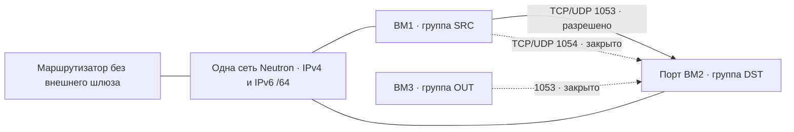

# Сеть и виртуальные машины через OpenStack CLI

Для ДКБ-С-03, 13–16 и 19 сеть создаёт оператор с deployment-машины А. Нужны отдельный тестовый проект, OpenStack CLI, четыре небольшие ВМ для полного группового теста и образ Linux с локальным входом через консоль, iproute2, ping, dig, nc, dnsmasq и Python 3. Для короткого показа С-03/19 достаточно ВМ 1 и 2. Тестовая сеть изолирована от внешней сети. Сети управления, хранения, VIP и ACL физических узлов берутся из паспорта действующего стенда.

**Схема тестового сегмента для N3.** Стрелки показывают новые соединения IPv4 в шаге выбора порта. С правилами шага 5 служба на 1053 отвечает, соседний работающий порт 1054 закрыт. Маршрутизатор обслуживает подсети внутри проекта.



<a id="cli-network"></a>

## N1. Создать сеть и две подсети

**1. На А** открыть Bash с профилем тестового проекта. Ввести имя профиля и два свободных префикса, выделенных администратором. IPv6 требует /64. Сверить показанный UUID проекта с паспортом.

```bash
read -rp 'Профиль тестового проекта из clouds.yaml: ' OS_CLOUD
export OS_CLOUD
openstack token issue -f value -c project_id
openstack subnet list
read -rp 'Тестовая подсеть IPv4, CIDR: ' CIDR4
read -rp 'Тестовая подсеть IPv6, /64: ' CIDR6
RUN=pmi-$(date -u +%Y%m%dT%H%M%SZ)
```

**2. На А** создать сеть и подсети. Каждый шаг выполнять после успеха предыдущего. Переменные хранят UUID в этом терминале. Если связь прервётся, найти свои объекты по имени прогона через `openstack network list`, `openstack subnet list` и `openstack port list`; сверить владельца и восстановить переменные по UUID. При частично выполненном прогоне продолжить с первого отсутствующего объекта.

```bash
NET=$(openstack network create --enable-port-security "$RUN-net" -f value -c id)
S4=$(openstack subnet create --network "$NET" --ip-version 4 --subnet-range "$CIDR4" "$RUN-v4" -f value -c id)
S6=$(openstack subnet create --network "$NET" --ip-version 6 --subnet-range "$CIDR6" --ipv6-ra-mode slaac --ipv6-address-mode slaac "$RUN-v6" -f value -c id)
openstack subnet list --network "$NET"
```

**3. На А** создать маршрутизатор для объявлений SLAAC и подключить подсети. Внешний шлюз для этих проверок не нужен.

```bash
RTR=$(openstack router create "$RUN-router" -f value -c id)
openstack router add subnet "$RTR" "$S4"
openstack router add subnet "$RTR" "$S6"
openstack router show "$RTR" -c interfaces_info -c external_gateway_info
openstack subnet show "$S6" -c cidr -c ipv6_ra_mode -c ipv6_address_mode
```

Ожидаем обе подсети на маршрутизаторе, пустой внешний шлюз и `slaac` в обоих полях IPv6.

<a id="cli-vms"></a>

## N2. Создать порты и ВМ

**1. На А** создать отдельные группы безопасности для источника, получателей и посторонней ВМ. Проверить исходные правила всех трёх групп. Для сценария нужен разрешённый исходящий трафик обеих семей и отсутствие входящих разрешений испытательных IPv4-потоков. Если в облаке другие шаблоны SG, сначала согласовать исходную политику тестового проекта.

```bash
SRC=$(openstack security group create "$RUN-src" -f value -c id)
DST=$(openstack security group create "$RUN-dst" -f value -c id)
OUT=$(openstack security group create "$RUN-out" -f value -c id)
openstack security group rule list "$SRC"
openstack security group rule list "$DST"
openstack security group rule list "$OUT"
```

**2. На А** создать порт каждой ВМ. Первый и второй нужны всегда. Для С-14 и контроля постороннего источника создать также третий и четвёртый. UUID и адреса из вывода перенести в паспорт. В коротком прогоне пропустить также SG OUT либо удалить её на этапе N5, если она создана. ВМ3 находится в той же сети, но изначально вне разрешённой группы.

```bash
P1=$(openstack port create --network "$NET" --security-group "$SRC" "$RUN-p1" -f value -c id)
P2=$(openstack port create --network "$NET" --security-group "$DST" "$RUN-p2" -f value -c id)
P3=$(openstack port create --network "$NET" --security-group "$OUT" "$RUN-p3" -f value -c id)
P4=$(openstack port create --network "$NET" --security-group "$DST" "$RUN-p4" -f value -c id)
openstack port list --network "$NET"
openstack port show "$P2" -c id -c fixed_ips -c mac_address -c security_group_ids -c port_security_enabled
```

**3. На А** выбрать образ и flavor. Создать ВМ на уже подготовленных портах, дождаться `ACTIVE`. Для короткого показа пропустить строки с ВМ3/4. На образе заранее подготовлен разрешённый консольный вход в гостевую ОС. Консоль работает независимо от тестовых ingress-правил.

```bash
openstack image list
openstack flavor list
read -rp 'UUID образа: ' IMG
read -rp 'UUID или имя flavor: ' FLAVOR
V1=$(openstack server create --wait --image "$IMG" --flavor "$FLAVOR" --port "$P1" "$RUN-vm1" -f value -c id)
V2=$(openstack server create --wait --image "$IMG" --flavor "$FLAVOR" --port "$P2" "$RUN-vm2" -f value -c id)
V3=$(openstack server create --wait --image "$IMG" --flavor "$FLAVOR" --port "$P3" "$RUN-vm3" -f value -c id)
V4=$(openstack server create --wait --image "$IMG" --flavor "$FLAVOR" --port "$P4" "$RUN-vm4" -f value -c id)
openstack server list --name "$RUN"
openstack port show "$P2" -c id -c device_id -c status -c fixed_ips
```

Для возобновления после разрыва связи на А сохранить UUID в личный файл. Команда записывает только перечисленные переменные. В сокращённом прогоне убрать из команды имена отсутствующих объектов. В новом Bash загрузить файл командой `source "$HOME/ИМЯ_ПРОГОНА.ids"` и заново выбрать тот же профиль проекта.

```bash
umask 077
declare -p RUN NET S4 S6 RTR SRC DST OUT P1 P2 P3 P4 V1 V2 V3 V4 > "$HOME/$RUN.ids"
```

**4. На А** получить адрес консоли каждой участвующей ВМ. Открыть выданную временную ссылку, войти в Linux и подписать терминалы. Ссылку с токеном в протокол не копировать. На каждой ВМ выполнить две последние команды. Сверить MAC и IPv4/IPv6 с Neutron.

```bash
openstack console url show "$V1"
openstack console url show "$V2"
openstack console url show "$V3"
openstack console url show "$V4"
```

```bash
hostname
ip -br addr
```

**5. На А и в консолях ВМ** ввести адреса ВМ1 и ВМ2 из вывода Neutron, в полном прогоне также адрес ВМ4. Переменные вводятся в каждом терминале, где используются. Для повторения между разными compute администратор проверяет размещение. Если ВМ на одном узле, результат относится только к этому размещению. Для отдельной пары с гарантированным разнесением использовать шаг N6.

```bash
read -rp 'IPv4 ВМ1: ' A1
read -rp 'IPv4 ВМ2: ' A2
read -rp 'IPv4 ВМ4 для полного прогона: ' A4
```

```bash
openstack server show "$V1" -c OS-EXT-SRV-ATTR:host
openstack server show "$V2" -c OS-EXT-SRV-ATTR:host
```

<a id="cli-sg"></a>

## N3. Проверить изоляцию, группу, порты и протоколы

**1. ВМ2**, затем **ВМ4** для групповой проверки. В отдельной консоли запустить тестовую DNS-службу. Ввести собственный IPv4 этой ВМ. Она отвечает одним известным адресом по TCP и UDP на 1053. Оставить службу работающей. Во второй консоли той же ВМ повторить ввод `MYIP` и две локальные пробы. Обе должны вернуть `192.0.2.123`.

```bash
read -rp 'IPv4 этой ВМ: ' MYIP
dnsmasq --no-daemon --user="$(id -un)" --conf-file=/dev/null --no-resolv --no-hosts --bind-interfaces --listen-address="$MYIP" --port=1053 --address=/probe.test/192.0.2.123
```

```bash
read -rp 'IPv4 этой ВМ: ' MYIP
dig +short +time=2 +tries=1 @"$MYIP" -p 1053 probe.test A
dig +short +tcp +time=2 +tries=1 @"$MYIP" -p 1053 probe.test A
```

Для полного прогона **на ВМ2 и ВМ4** заранее запустить во второй консоли ещё один работающий порт. В отдельном окне на той же ВМ проверить оба протокола к 1054. Оставить оба слушателя до конца N3. Для короткого показа С-03 достаточно 1053.

```bash
read -rp 'IPv4 этой ВМ: ' MYIP
dnsmasq --no-daemon --user="$(id -un)" --conf-file=/dev/null --no-resolv --no-hosts --bind-interfaces --listen-address="$MYIP" --port=1054 --address=/probe.test/192.0.2.123
```

```bash
read -rp 'IPv4 этой ВМ: ' MYIP
dig +short +time=2 +tries=1 @"$MYIP" -p 1054 probe.test A
dig +short +tcp +time=2 +tries=1 @"$MYIP" -p 1054 probe.test A
```

**2. С-03, одна пара. На ВМ1** выполнить обе пробы ниже. Исходно нет ответа. **На А** создать одно правило на адрес источника. **На ВМ1** повторить обе пробы. Только TCP должен вернуть тестовый адрес. **На А** удалить правило по сохранённому UUID. **На ВМ1** повторить обе пробы. Ожидаем снова отсутствие ответа при успешном локальном контроле на ВМ2.

```bash
dig +short +tcp +time=2 +tries=1 @"$A2" -p 1053 probe.test A
dig +short +time=2 +tries=1 @"$A2" -p 1053 probe.test A
```

```bash
T=$(openstack security group rule create --ingress --ethertype IPv4 --protocol tcp --dst-port 1053 --remote-ip "$A1/32" "$DST" -f value -c id)
openstack security group rule show "$T"
```

```bash
openstack security group rule delete "$T"
```

**3. С-13, связь узел → узел без ограничения портов. На А** создать правило для ВМ1 с любым протоколом. В этом шаге для буквального ограничения назначения выделить отдельную SG только порту ВМ2.

```bash
PAIR=$(openstack security group create "$RUN-pair" -f value -c id)
openstack port set --security-group "$DST" --security-group "$PAIR" "$P2"
R=$(openstack security group rule create --ingress --ethertype IPv4 --remote-ip "$A1/32" "$PAIR" -f value -c id)
openstack security group rule show "$R"
```

**На ВМ1** выполнить команды. На ВМ2 ожидаем ответ по ICMP, TCP и UDP. На ВМ4 та же TCP-проба остаётся без ответа. **На ВМ3** выполнить ту же команду dig к `"$A2"` на 1053, она также должна остаться без ответа. **На А** снять временное разрешение и членство, проверить, что на порту ВМ2 снова только DST.

```bash
ping -c 2 -W 2 "$A2"
dig +short +tcp +time=2 +tries=1 @"$A2" -p 1053 probe.test A
dig +short +time=2 +tries=1 @"$A2" -p 1053 probe.test A
dig +short +tcp +time=2 +tries=1 @"$A2" -p 1054 probe.test A
dig +short +tcp +time=2 +tries=1 @"$A4" -p 1053 probe.test A
```

```bash
openstack security group rule delete "$R"
openstack port unset --security-group "$PAIR" "$P2"
openstack port show "$P2" -c security_group_ids
openstack security group delete "$PAIR"
```

**4. С-14, группа → группа. На А** дать любой IPv4-протокол группе SRC на порты группы DST. **На ВМ1, затем на ВМ3** выполнить DNS-пробы ниже. ВМ1 получает ответ от обоих получателей, ВМ3 пока не получает. **На А** добавить порт ВМ3 в SRC. Повторить пробы с ВМ3, теперь ответы должны приходить от обеих ВМ. Снять членство, повторить отрицательные пробы с ВМ3, затем удалить правило на А.

```bash
G=$(openstack security group rule create --ingress --ethertype IPv4 --remote-group "$SRC" "$DST" -f value -c id)
openstack security group rule show "$G"
```

```bash
dig +short +time=2 +tries=1 @"$A2" -p 1053 probe.test A
dig +short +tcp +time=2 +tries=1 @"$A2" -p 1054 probe.test A
dig +short +tcp +time=2 +tries=1 @"$A2" -p 1053 probe.test A
dig +short +time=2 +tries=1 @"$A4" -p 1053 probe.test A
dig +short +tcp +time=2 +tries=1 @"$A4" -p 1054 probe.test A
dig +short +tcp +time=2 +tries=1 @"$A4" -p 1053 probe.test A
```

```bash
openstack port set --security-group "$OUT" --security-group "$SRC" "$P3"
openstack port show "$P3" -c security_group_ids
```

```bash
openstack port unset --security-group "$SRC" "$P3"
```

```bash
openstack security group rule delete "$G"
```

**5. С-15, выбор порта.** Использовать два порта, запущенных на ВМ2 в шаге 1. Ещё раз выполнить локальные пробы к 1054, если между испытаниями менялась конфигурация. **На А** разрешить два протокола только на 1053. **На ВМ1** сравнить соседние порты. На 1053 нужны два ответа, на работающем 1054 оба соединения закрыты.

```bash
T=$(openstack security group rule create --ingress --ethertype IPv4 --protocol tcp --dst-port 1053 --remote-ip "$A1/32" "$DST" -f value -c id)
U=$(openstack security group rule create --ingress --ethertype IPv4 --protocol udp --dst-port 1053 --remote-ip "$A1/32" "$DST" -f value -c id)
```

```bash
dig +short +tcp +time=2 +tries=1 @"$A2" -p 1053 probe.test A
dig +short +time=2 +tries=1 @"$A2" -p 1053 probe.test A
dig +short +tcp +time=2 +tries=1 @"$A2" -p 1054 probe.test A
dig +short +time=2 +tries=1 @"$A2" -p 1054 probe.test A
```

**6. С-16, выбор протокола. На А** удалить TCP-правило. **На ВМ1** повторить первые две пробы шага 5. Должен работать только UDP. Выполнить ping, исходно ответа нет. **На А** добавить только ICMP от ВМ1. Повторить ping, ожидаем ответ. Удалить оба правила и повторить ping и UDP, ожидаем прекращение доступа. Завершить тестовые DNS на ВМ клавишами Ctrl+C после последнего положительного локального контроля.

```bash
openstack security group rule delete "$T"
```

```bash
ping -c 2 -W 2 "$A2"
```

```bash
I=$(openstack security group rule create --ingress --ethertype IPv4 --protocol icmp --remote-ip "$A1/32" "$DST" -f value -c id)
```

```bash
openstack security group rule delete "$I" "$U"
```

<a id="cli-v6"></a>

## N4. Подтвердить IPv6 по одному порту

**1. На А** разрешить ICMPv6 внутри испытательного сегмента для двух участвующих групп. Источник `::/0` здесь нужен также для link-local адресов ND/RA. Использовать только SG данной изолированной сети. Если эквивалентное правило уже существует, записать его UUID и пропустить соответствующее создание.

```bash
openstack security group rule create --ingress --ethertype IPv6 --protocol ipv6-icmp --remote-ip ::/0 "$SRC"
openstack security group rule create --ingress --ethertype IPv6 --protocol ipv6-icmp --remote-ip ::/0 "$DST"
openstack port show "$P1" -c id -c fixed_ips -c mac_address
openstack port show "$P2" -c id -c fixed_ips -c mac_address
```

**2. На ВМ1 и ВМ2** сверить MAC и адрес выделенного /64 с портом. В госте может быть дополнительный временный адрес. Для следующего шага взять именно два адреса из Neutron.

```bash
ip -br link
ip -6 addr show scope global
ip -6 route
```

**3. На ВМ1** проверить соседа с явным адресом источника. Внести в протокол UUID порта ВМ2, MAC, IPv6 в Neutron и госте, ответ ping. Для замечания Н1 можно дополнительно сверить отображение существующего порта в Visage. Функция создания подсети кнопкой Visage при таком CLI-прогоне сохраняет статус «Не проверено».

```bash
read -rp 'IPv6 ВМ1 из Neutron: ' IP61
read -rp 'IPv6 ВМ2 из Neutron: ' IP62
ping -6 -I "$IP61" -c 3 -W 2 "$IP62"
```

<a id="cli-clean"></a>

## N5. Убрать объекты прогона

**1. На А** сверить имя прогона, UUID проекта и объектов с протоколом. Удалить только созданные для данного прогона ВМ и дождаться освобождения портов. При коротком прогоне выполнять только команды для созданных ресурсов.

```bash
openstack token issue -f value -c project_id
openstack server list --name "$RUN"
openstack server delete --wait "$V1" "$V2"
openstack server delete --wait "$V3" "$V4"
openstack port list --network "$NET"
```

**2. На А** удалить свои порты, затем интерфейсы маршрутизатора, сам маршрутизатор, подсети, сеть и SG. Если шаг С-13 прервался и осталась группа PAIR, удалить её после удаления портов. При ошибке посмотреть, какой объект остался зависимым, и повторить только незавершённый шаг.

```bash
openstack port delete "$P1" "$P2"
openstack port delete "$P3" "$P4"
openstack router remove subnet "$RTR" "$S6"
openstack router remove subnet "$RTR" "$S4"
openstack router delete "$RTR"
openstack subnet delete "$S6" "$S4"
openstack network delete "$NET"
openstack security group delete "$DST" "$SRC"
openstack security group delete "$OUT"
openstack network list --name "$RUN-net"
```

Последняя команда должна вернуть пустой список. ВМ, порты и сети действующего стенда в этот список удаления не входят.

## N6. Повторить С-03 между двумя compute

При наличии двух доступных compute выполнить как **отдельный прогон**. Пройти N1 и N2.1–2 с новым RUN. На А выбрать образ и flavor как в N2.3, создать группу размещения и запустить ВМ1 и ВМ2 в ней взамен двух обычных команд создания.

```bash
SP=$(openstack server group create --policy anti-affinity "$RUN-spread" -f value -c id)
V1=$(openstack server create --wait --image "$IMG" --flavor "$FLAVOR" --port "$P1" --hint group="$SP" "$RUN-vm1" -f value -c id)
V2=$(openstack server create --wait --image "$IMG" --flavor "$FLAVOR" --port "$P2" --hint group="$SP" "$RUN-vm2" -f value -c id)
openstack server show "$V1" -c OS-EXT-SRV-ATTR:host
openstack server show "$V2" -c OS-EXT-SRV-ATTR:host
```

Администратор подтверждает два разных имени compute. Повторить N2.4–5 и N3.1–2 для ВМ1/ВМ2. После удаления ВМ и сети по N5 удалить свою группу размещения.

```bash
openstack server group delete "$SP"
```

Синтаксис соответствует OpenStackClient 2025.1. [Сеть](https://docs.openstack.org/python-openstackclient/2025.1/cli/command-objects/network.html) · [Подсеть](https://docs.openstack.org/python-openstackclient/2025.1/cli/command-objects/subnet.html) · [Порт](https://docs.openstack.org/python-openstackclient/2025.1/cli/command-objects/port.html) · [Маршрутизатор](https://docs.openstack.org/python-openstackclient/2025.1/cli/command-objects/router.html) · [ВМ](https://docs.openstack.org/python-openstackclient/2025.1/cli/command-objects/server.html) · [Правило SG](https://docs.openstack.org/python-openstackclient/2025.1/cli/command-objects/security-group-rule.html)
