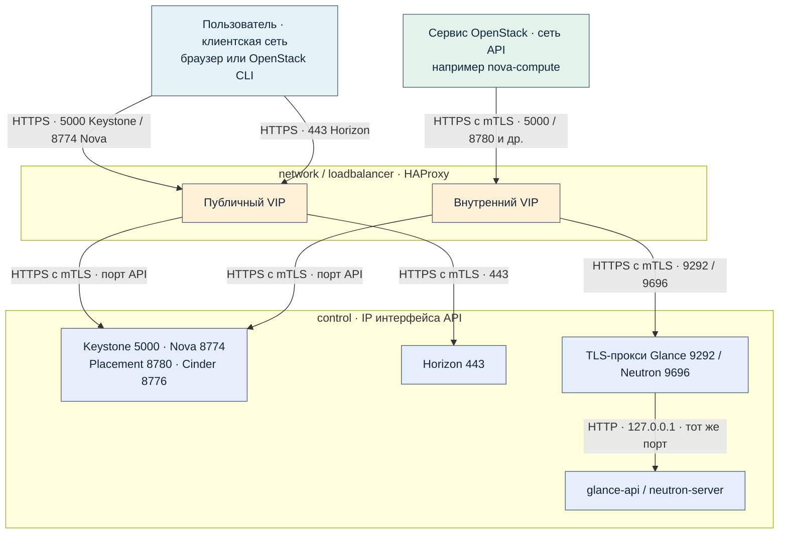
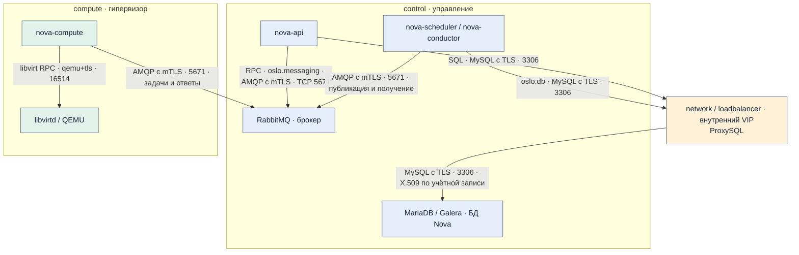
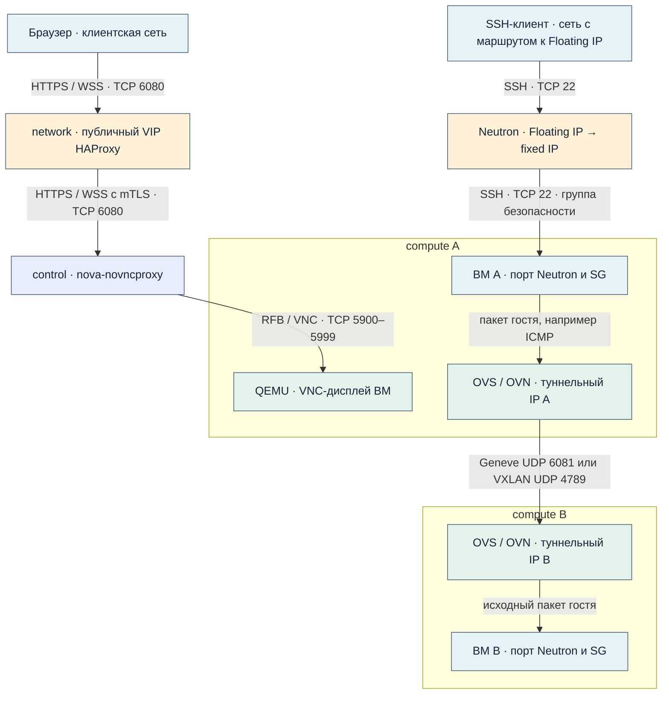
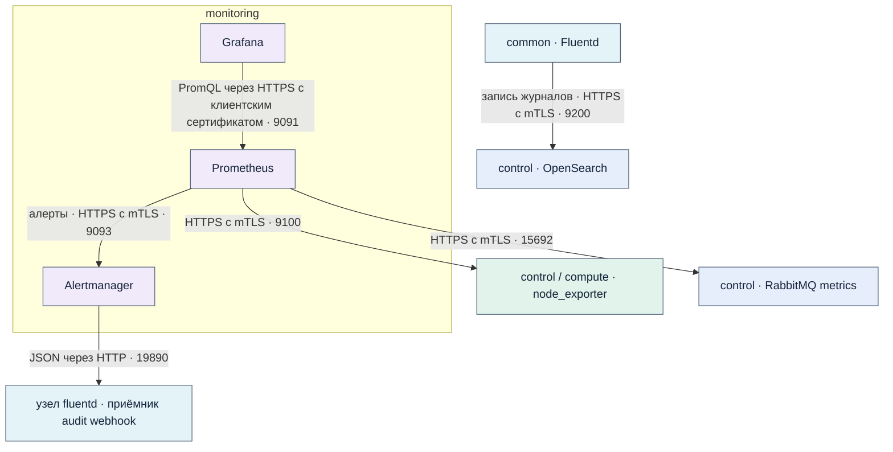

# OpenStack PVS · компоненты, порты и mTLS

**Для показа начните с четырёх схем ниже.** Стрелка указывает, кто открывает соединение. Число на стрелке — порт получателя. В конце файла есть команды для проверки и раскрываемый реестр всех 84 потоков из каталога host-firewall.

**Профиль схемы** — два разных VIP, `enable_secman: yes`, стандартные производные настройки форка, отдельные входы HAProxy для сервисов и включённый ProxySQL. Это пример для испытаний. Публичный VIP означает доступ из разрешённой клиентской сети, включая корпоративную. Доступ из интернета зависит от маршрута и внешних ACL. На своём стенде возьмите URL из каталога Keystone, роли узлов из inventory, адреса и порты из работающих слушателей.

| Как читать стрелку | Что получает сервер |
|---|---|
| HTTPS / WSS, TLS | Зашифрованный HTTP или WebSocket. Клиент проверяет сертификат сервера по имени и доверенному CA |
| **mTLS** | Дополнительно сервер запрашивает и проверяет клиентский сертификат. У каждого участка через прокси свой TLS-сеанс |
| AMQP, MySQL, VNC, iSCSI, Geneve | Прикладной или сетевой протокол. Тип защиты указан для конкретного соединения |
| oslo.messaging / oslo.db | Библиотеки в процессах OpenStack. Первая в этом профиле передаёт RPC и уведомления через RabbitMQ, вторая работает с SQL через драйвер БД |

В этом профиле `enable_config_vault` включает `kolla_enable_tls_external`, `kolla_enable_tls_internal`, `kolla_enable_tls_backend`, `kolla_enable_mtls_internal` и `kolla_enable_mtls_backend`. Внешний клиентский сертификат управляется отдельным флагом `kolla_enable_mtls_external`, по умолчанию `no`. У отдельных сервисов есть собственные переключатели. Для исходной конфигурации форка без переопределений `enable_secman` по умолчанию выключен.

## Карта слушающих компонентов по ролям

На общей карте найдите нужную роль. В узлах указаны типовые порты назначения. На четырёх схемах маршрутов ниже подписано, кто инициирует соединение и где проверяется сертификат.

```mermaid
flowchart LR
  ROOT["OpenStack PVS"]
  ROOT --- CT["control"]
  ROOT --- CP["compute"]
  ROOT --- LB["network / loadbalancer"]
  ROOT --- MON["monitoring"]
  ROOT --- AUX["Общие службы и другие роли"]
  CT --- CAPI["HTTPS API · Keystone 5000, Nova 8774, metadata 8775<br/>Glance 9292, Neutron 9696, Cinder 8776, Placement 8780<br/>Horizon 443 · локальная статистика TLS-прокси 9293 / 9697"]
  CT --- COPT["Дополнительные API · Watcher 9322, Masakari 15868<br/>Mistral 8989, Barbican 9311, Ironic 6385<br/>Ironic HTTP boot 8089 при отдельном включении"]
  CT --- CRPC["RabbitMQ · AMQP 5671 с mTLS / 5672 без TLS<br/>EPMD 4369, Erlang distribution 25672, Streams 6000–6500<br/>Management HTTPS 15672, метрики 15692"]
  CT --- CDB["MariaDB · MySQL/TLS 3306, Galera 4567 / 4568 / 4444<br/>Memcached TCP 11211, etcd 2379 / 2380<br/>OpenSearch REST 9200, узлы 9300, Dashboards 5601"]
  CT --- COTHER["Nova noVNC / serialproxy · WSS 6080 / 6083<br/>Keystone Fernet SSH 8023 · Corosync UDP 5405<br/>OVN NB / SB 6641 / 6642 при выборе OVN"]
  CT --- CMET["Экспорт метрик · MySQL 9104, Memcached 9150<br/>Ironic 9608, OpenSearch 9108"]
  CP --- CLIB["libvirt RPC/TLS 16514 · TCP-вариант 16509<br/>QEMU миграция TCP 49152–49261 · SSH 8022<br/>VNC 5900–5999 · serial 10000–20000"]
  CP --- CNET["OVS на compute и network · VXLAN UDP 4789 / Geneve UDP 6081<br/>Pacemaker Remote 3121 · экспорт метрик libvirt 9177<br/>Порты приложений в ВМ определяет гость"]
  LB --- LNET["HAProxy · публичные и внутренние VIP на портах API<br/>статистика 1984, состояние 61313, метрики 9101<br/>Keepalived · VRRP IP 112"]
  LB --- LSQL["ProxySQL · MySQL 3306, admin 6032, метрики 6070<br/>Группа правил каталога для этих портов — control"]
  MON --- MOBS["Prometheus HTTPS 9091 · Alertmanager 9093, кластер 9094<br/>Grafana HTTPS 3000 · OpenStack exporter 9198<br/>Blackbox exporter 9115"]
  AUX --- COMMON["На узлах common · SSH обычно 22 и ICMP<br/>Fluentd syslog UDP 5140, метрики 24231, audit webhook 19890¹<br/>node_exporter 9100, cAdvisor 18080"]
  AUX --- CONS["Consul · API HTTP 8500, RPC 8300<br/>LAN / WAN gossip TCP и UDP 8301 / 8302<br/>DNS TCP и UDP 8600 при включении слушателя"]
  AUX --- STOR["storage · iSCSI target TCP 3260"]
  classDef ctrl fill:#e6eefc,stroke:#52627a,color:#152339
  classDef cmp fill:#e1f3eb,stroke:#52627a,color:#152339
  classDef edge fill:#fff1d8,stroke:#52627a,color:#152339
  classDef obs fill:#f1eafb,stroke:#52627a,color:#152339
  classDef guest fill:#e4f3f8,stroke:#52627a,color:#152339
  class CT,CAPI,COPT,CRPC,CDB,COTHER,CMET ctrl
  class CP,CLIB,CNET cmp
  class LB,LNET,LSQL edge
  class MON,MOBS obs
  class AUX,COMMON,CONS,STOR guest
```

<details open>
<summary><b>Полная карта control, compute и смежных ролей</b></summary>



¹ Приёмник аудита размещается согласно конфигурации на узле роли fluentd. Alertmanager адресует запрос выбранному узлу. В таблицах ниже перечислены группы для каждого входа.

</details>

## 1. Пользователь → API OpenStack



Браузер открывает Horizon на 443. CLI обращается к публичному Keystone на 5000 за токеном, затем к URL нужного API, например Nova на 8774. Между сервисами используется внутренний endpoint. На входе HAProxy в этом профиле внешний пользователь проверяет сертификат VIP, а внутренний сервис ещё и предъявляет собственный сертификат. На следующем участке HAProxy предъявляет **свой backend-клиентский сертификат**. Токен Keystone и права проекта проверяются отдельно на уровне приложения.

**Если выставлен `kolla_enable_mtls_external: yes`**, внешний клиент также должен предъявить сертификат на индивидуальном HTTPS-входе сервиса. Если включён **единый внешний frontend** (`haproxy_single_external_frontend: true`), публичные HTTP-сервисы делят порт, обычно 443, и HAProxy выбирает backend по имени хоста. В шаблоне общего входа строка `bind` включает серверный TLS, но в ней отсутствует `verify required ca-file`. Для этой топологии обязательно проверьте результат вызова без сертификата на самом публичном URL.

## 2. Между сервисами · одна операция создания ВМ



1. **Команда на создание ВМ.** Nova API принимает HTTPS-запрос. Scheduler выбирает compute с учётом ресурсов Placement. Conductor координирует операцию. Процессы подключаются к брокеру из сети API и получают задания по уже открытым соединениям. Уведомления oslo.messaging при использовании RabbitMQ также идут по AMQP 0-9-1. В профиле брокер слушает 5671, требует клиентский сертификат и отключает незашифрованный AMQP на 5672.
2. **Запись состояния.** Nova API и conductor используют oslo.db, SQLAlchemy и драйвер PyMySQL. Сервис подключается к внутреннему VIP ProxySQL на 3306. Для управляемого SQL-пользователя `use_ssl: 1` требует TLS. Сервис может отправить сертификат, однако это свойство ProxySQL само по себе **не требует X.509 на входе**. ProxySQL открывает отдельное соединение на адрес MariaDB, где для него настроены CA, сертификат и ключ. Требование `REQUIRE X509` определяется учётной записью MariaDB.
3. **Запуск гостя.** nova-compute получает задание по RPC, вызывает libvirt и обращается к внутренним API, например к Placement для учёта ресурсов. Форк исключает секцию `[database]` из конфигурации nova-compute. На схеме поэтому отсутствует стрелка nova-compute → MariaDB.
4. **Вариант без ProxySQL.** При `enable_proxysql: no` и штатном HAProxy в режиме TCP сервис на 3306 согласует MySQL TLS непосредственно с MariaDB через балансировщик. Сертификат приложения проверяет MariaDB согласно требованиям SQL-пользователя.

## 3. Как попасть в ВМ и что идёт между compute



| Путь | Сеть и защита |
|---|---|
| Экран и serial-консоль | Браузер получает URL у Nova. Для serial путь аналогичен через serialproxy TCP 6083, затем на порт compute из 10000–20000. Защита последнего участка VNC (например VeNCrypt) и serial настраивается отдельно от WSS до прокси |
| Вход в гостя | Для Floating IP нужны маршрутизация внешней сети, правило SG для источника и порт, который слушает гость. При SSH шифрование между клиентом и гостевым sshd обеспечивает SSH. TCP 22 на собственном IP compute ведёт к sshd **узла** |
| ВМ ↔ ВМ | Для ВМ одной проектной сети на одном compute пакет может остаться в локальном коммутаторе. Между compute с overlay внешний заголовок адресован туннельному IP соседа. SG применяется к портам ВМ. Шифрование полезной нагрузки зависит от гостевого приложения или отдельно настроенной защиты сети |
| Логика SDN при OVN | Neutron → OVN NB TCP 6641, ovn-northd → NB и SB TCP 6641/6642. ovn-controller на compute → SB TCP 6642 напрямую либо на порт relay (по шаблону 1664 + номер, например 16641). Это OVSDB. Типовые строки форка начинаются с `tcp:`. Эти соединения отсутствуют среди 84 потоков каталога |
| Живая миграция | Управление libvirt идёт к адресу сети миграции по TLS/X.509 на 16514. Поток данных QEMU между compute имеет диапазон TCP 49152–49261 в каталоге. Для вывода о шифровании памяти и диска проверьте `live_migration_with_native_tls` и настройки QEMU. TCP 8022 — отдельный SSH-сервис миграции. [Настройки QEMU-native TLS в Nova](https://docs.openstack.org/nova/2025.1/admin/secure-live-migration-with-qemu-native-tls.html) |
| Том ВМ | Cinder API на 8776 принимает HTTPS-запрос управления. При iSCSI гипервизор обращается к target в сети хранения на TCP 3260. Аутентификация CHAP, если настроена, сама по себе не шифрует ввод-вывод. Для FC используется Fibre Channel, у этого пути нет TCP-порта |

## 4. Метрики, журналы и алерты



Пример относится к включённым интеграциям Prometheus, Fluentd и OpenSearch с HTTPS и флагом `enable_security_audit: yes`. Этот флаг включает в шаблонах OpenSearch security plugin и TLS-слушатель Dashboards. Сетевой приёмник audit webhook на 19890 пишет алерты в файл. Роль задаёт ему URL вида `http://…/alerts`. Это отдельное соединение от HTTPS между Prometheus и Alertmanager.

## Что пропускает firewall

При активной политике `kolla-host-input` новый входящий пакет к адресу узла должен совпасть с разрешением по источнику, назначению и порту/протоколу. Совпавший пакет доходит до слушателя, который и проверяет TLS. Для остальных новых входов политика формирует завершающий DROP. Режим роли по умолчанию — `report`. В этом режиме на узле может ещё не быть применённой политики.

- **Пользовательская сеть.** Разрешения для настроенных клиентских источников могут охватывать как VIP, так и прямые backend API. Клиентский адрес сам по себе не даёт доступа к SQL и AMQP. Для операторских источников форк формирует более широкие разрешения на активные TCP/UDP-потоки.
- **Между узлами.** В каталоге брокер принимает от группы `common`, куда входит compute, а VNC-дисплей — от узлов `nova-novncproxy`. SSH узла (порт inventory, обычно 22) и ICMP/ICMPv6 имеют отдельные разрешения. Новые исходящие соединения и правила SG гостей управляются отдельно от этой входной политики.
- **При выделенных сетях.** У всех 84 записей в каталоге форка указана сеть `api`. Служба может слушать другой адрес, особенно при отдельных tunnel, migration или storage VLAN. Сверьте IP назначения в rich rule и фактический адрес трафика. Отдельно проверьте ProxySQL: каталог целится в группу `control`, контейнер запускается в `loadbalancer` и слушает SQL на внутреннем VIP. При разнесённых ролях это разные узлы.

## Как проверить на стенде

Команды ниже выполняются вручную в Bash. Для примеров с контейнерами указан Docker. На узлах с Podman используйте `sudo podman` вместо `sudo docker`. Берите DNS-имена, указанные в сертификатах. Команды не меняют конфигурацию.

### 1. Найти адреса и слушателей

**На рабочей машине оператора** с настроенным OpenStack CLI:

```bash
openstack catalog show identity
openstack catalog show compute
```

Запишите URL из строк `public` и `internal`. При едином frontend у разных публичных API может совпадать порт 443.

**На control с RabbitMQ и Nova API**, затем **на compute**:

```bash
hostname -f
ip -br address
sudo ss -lntp | grep -E ':(5000|5671|5672|8774|16509|16514)[[:space:]]'
sudo firewall-cmd --info-policy=kolla-host-input
```

На control с этими службами ожидаются 5000, 8774 и 5671. На compute с сетевым libvirt в TLS-профиле ожидается 16514. В строке `ss` покажите адрес привязки. В выводе firewalld покажите источник, адрес назначения и порт того же соединения. Если политика отсутствует, проверьте режим роли. По выводу `ss` нельзя определить требования к сертификату.

**На активном владельце внутреннего VIP** проверьте, где действительно работает ProxySQL:

```bash
hostname -f
ip -br address
sudo docker ps --format '{{.Names}}' | grep -E '^(haproxy|proxysql)$'
sudo ss -lntp | grep -E ':(3306|6032)[[:space:]]'
sudo firewall-cmd --info-policy=kolla-host-input
```

Покажите внутренний VIP с портом 3306 в `ss` и найдите разрешение именно для этого назначения. На узле MariaDB тот же номер 3306 относится к другому IP и процессу.

### 2. Доказать требование сертификата на HTTPS

**На клиенте, которому разрешено соединение с проверяемым VIP**, подготовьте доверенный CA и уже выданную клиентскую пару для этого входа. Сначала выберите **внутренний** URL Keystone до `/v3/`. Используйте один компьютер, один URL и два новых соединения:

```bash
read -rp 'Полный URL Keystone, включая https:// и /v3/: ' URL
read -rp 'Файл доверенного CA: ' CA
read -rp 'Файл сертификата клиента: ' CERT
read -rp 'Файл ключа клиента: ' KEY
curl -q --noproxy '*' --max-time 8 --cacert "$CA" --cert "$CERT" --key "$KEY" -i "$URL"
curl -q --noproxy '*' --max-time 8 --cacert "$CA" -i "$URL"
```

С сертификатом ожидается ответ Keystone с описанием версии. Без него на входе с обязательным mTLS ожидается отказ с указанием отсутствующего клиентского сертификата при TLS-обмене либо явная диагностика TLS-прокси. Тайм-аут, ошибка доверия CA, несовпадение имени, обычный HTTP 401/403 или одинаковые ошибки в обеих попытках не доказывают mTLS.

Повторите этот же блок с **публичным** URL и доверенным CA этого входа. В профиле схемы описание версии доступно без клиентского сертификата. Если предполагали внешний mTLS, а публичный вызов без сертификата успешен, покажите фактический `bind` **на узле HAProxy**:

```bash
sudo docker exec haproxy sh -c 'grep -rhE "^[[:space:]]*bind " /etc/haproxy/haproxy.cfg /etc/haproxy/services.d | grep " ssl "'
```

Для нужного VIP и порта найдите `verify required` и `ca-file`. Чтобы проверить **второй участок**, повторите обе команды curl из разрешённой для backend сети на DNS-имя control из сертификата Keystone и его порт 5000, с клиентской парой, доверенной backend. Цель этого вызова — непосредственно адрес узла, а не VIP.

### 3. Показать firewall отдельно от mTLS на примере RabbitMQ

**Сначала на compute, затем на тестовой клиентской машине** с маршрутом до того же control, чей адрес не входит в operator/peer-источники. В обоих терминалах введите один IP брокера:

```bash
read -rp 'IP интерфейса API узла RabbitMQ: ' BROKER
nc -vz -w 3 "$BROKER" 5671
```

От compute ожидается успешное TCP-соединение. От изолированной клиентской сети при действующем DROP ожидается тайм-аут. Для вывода о firewall сверьте адрес источника, маршрут, действующее правило и внешний ACL. `Connection refused` может означать отсутствие слушателя. Успех `nc` подтверждает только прохождение TCP.

**На control с RabbitMQ** покажите реальное соединение с приложением compute:

```bash
sudo docker exec rabbitmq rabbitmqctl list_connections peer_host port user ssl ssl_protocol peer_cert_subject
```

Найдите в одной строке IP compute, локальный порт 5671, `ssl=true`, версию TLS и непустой subject клиентского сертификата. Это показывает TLS и сертификат действующего подключения.

На том же control посмотрите действующие параметры слушателя:

```bash
sudo docker exec rabbitmq rabbitmqctl eval 'application:get_env(rabbit, ssl_options).' | grep -E 'verify_peer|fail_if_no_peer_cert'
```

Ожидаются `verify_peer` и `fail_if_no_peer_cert,true`. Так оператор видит и сертификат реального клиента, и настройку обязательной проверки на сервере.

### 4. Отличить TLS в ProxySQL от обязательного X.509 в MariaDB

**На разрешённой служебной машине с клиентом MariaDB** возьмите тестовую учётную запись, разрешённую с этого источника. Введите сначала DNS-имя внутреннего VIP ProxySQL и доверенную пару. Затем повторите блок для DNS-имени самого узла MariaDB и тестовой учётной записи с `REQUIRE X509`. В каждой паре попыток используйте один логин, пароль и CA.

```bash
read -rp 'DNS-имя SQL-сервера или VIP: ' DB
read -rp 'Имя тестовой учётной записи: ' DBUSER
read -rp 'Файл доверенного CA: ' CA
read -rp 'Файл клиентского сертификата: ' CERT
read -rp 'Файл клиентского ключа: ' KEY
mariadb --no-defaults --protocol=TCP -h "$DB" -P 3306 -u "$DBUSER" -p --ssl --ssl-verify-server-cert --ssl-ca="$CA" --ssl-cert="$CERT" --ssl-key="$KEY" -e 'SELECT 1'
mariadb --no-defaults --protocol=TCP -h "$DB" -P 3306 -u "$DBUSER" -p --ssl --ssl-verify-server-cert --ssl-ca="$CA" -e 'SELECT 1'
```

Через ProxySQL при одном `use_ssl: 1` обе попытки могут вернуть 1. Напрямую в MariaDB для учётной записи с `REQUIRE X509` первая должна вернуть 1, вторая — отказ в аутентификации. Ошибка сети, сертификата сервера или некорректный пароль делают сравнение недействительным.

### 5. Показать путь пакета между двумя ВМ

**На рабочей машине оператора** с правом просмотра размещения укажите две тестовые ВМ в одной проектной сети. Для показа туннеля они должны находиться на разных compute.

```bash
read -rp 'Имя первой ВМ: ' VM_A
read -rp 'Имя второй ВМ: ' VM_B
openstack server show "$VM_A" -c name -c addresses -c OS-EXT-SRV-ATTR:host
openstack server show "$VM_B" -c name -c addresses -c OS-EXT-SRV-ATTR:host
```

**На первом compute**, в отдельном терминале запустите короткий захват заголовков на `tunnel_interface`. Выберите порт своего механизма сети.

```bash
ip -br address
read -rp 'Имя интерфейса туннельной сети: ' IFACE
read -rp 'Порт туннеля (6081 Geneve или 4789 VXLAN): ' PORT
read -rp 'Туннельный IP второго compute: ' PEER
sudo timeout 20 tcpdump -nn -i "$IFACE" -c 6 "host $PEER and udp port $PORT"
```

**В консоли ВМ A** во время захвата введите fixed IP ВМ B. Для этого примера группа безопасности и гостевая ОС ВМ B должны пропускать ICMP от ВМ A.

```bash
read -rp 'Fixed IP ВМ B: ' FIXED_B
ping -c 3 "$FIXED_B"
```

Покажите ответы гостя и внешние адреса compute в захвате за то же время. На загруженном туннеле сопоставьте также внутренние адреса или VNI в декодированном выводе tcpdump. Трафик на общем туннеле сам по себе не идентифицирует ВМ. Для сравнения с закрытым и открытым портом гостя в README есть управляемая проверка SG. [Создание сети через CLI и проверка firewall ВМ](../../README.md)

## Полный реестр портов и типов трафика

В четырёх таблицах ниже собраны 45 записей сервисов и 84 именованных потока из `host-firewall/vars/catalog.yml`. Роль назначения вычислена по образцу `inventory/multinode`. Колонка «Кто → куда» перечисляет группы узлов из каталога. Операторские и клиентские CIDR добавляются отдельно по политике. Включение сервиса, дополнительных флагов и фактические источники сверяются с отчётом роли.

<details>
<summary><b>OpenStack API, консоли и туннели</b> · 25 потоков</summary>

| Поток | Кто → куда (группы) | Роль назначения | Порт | Трафик и проверка сертификата |
|---|---|---|---|---|
| `keystone-internal-backend` | loadbalancer → keystone | control | TCP 5000 | HTTPS · mTLS на Apache/WSGI (`SSLVerifyClient require`). |
| `keystone-public-backend` | loadbalancer → keystone | control | TCP 5000 | HTTPS · mTLS на Apache/WSGI (`SSLVerifyClient require`). |
| `keystone-fernet-ssh` | keystone → keystone | control | TCP 8023 | SSH · синхронизация ключей Fernet между Keystone. |
| `glance-api-backend` | loadbalancer → glance-api | control | TCP 9292 | REST/HTTPS · mTLS до локального TLS-прокси, затем HTTP через loopback. |
| `glance-tls-proxy-stats` | glance-api → glance-api | control | TCP 9293 | Статистика локального прокси · HTTPS с mTLS. |
| `cinder-api-backend` | loadbalancer → cinder-api | control | TCP 8776 | HTTPS · mTLS на Apache/WSGI (`SSLVerifyClient require`). |
| `nova-api-backend` | loadbalancer → nova-api | control | TCP 8774 | HTTPS · mTLS на Apache/WSGI (`SSLVerifyClient require`). |
| `nova-metadata-backend` | loadbalancer → nova-metadata | control | TCP 8775 | HTTPS · mTLS на Apache/WSGI (`SSLVerifyClient require`). |
| `nova-novncproxy-backend` | loadbalancer → nova-novncproxy | control | TCP 6080 | HTTPS/WSS · прокси консоли требует клиентский сертификат HAProxy. |
| `nova-serialproxy-backend` | loadbalancer → nova-serialproxy | control | TCP 6083 | HTTPS/WSS · прокси консоли требует клиентский сертификат HAProxy. |
| `nova-vnc` | nova-novncproxy → compute | compute | TCP 5900-5999 | RFB/VNC · соединение с дисплеем QEMU. VeNCrypt проверяется отдельно. |
| `nova-serial-console` | nova-serialproxy → compute | compute | TCP 10000–20000 | Последовательная консоль · TCP-поток до гипервизора, свой режим защиты. |
| `neutron-server-backend` | loadbalancer → neutron-server | control | TCP 9696 | REST/HTTPS · mTLS до локального TLS-прокси, затем HTTP через loopback. |
| `neutron-tls-proxy-stats` | neutron-server → neutron-server | control | TCP 9697 | Статистика локального прокси · HTTPS с mTLS. |
| `neutron-vxlan` | openvswitch → openvswitch | compute, network | UDP 4789 | VXLAN · инкапсуляция Ethernet в UDP, без встроенного TLS. |
| `neutron-geneve` | openvswitch → openvswitch | compute, network | UDP 6081 | Geneve · инкапсуляция в UDP, без встроенного TLS. |
| `placement-api-backend` | loadbalancer → placement-api | control | TCP 8780 | HTTPS · mTLS на Apache/WSGI (`SSLVerifyClient require`). |
| `horizon-backend` | loadbalancer → horizon | control | TCP 443 (HTTP 80 без TLS) | HTTPS · mTLS на Apache/WSGI (`SSLVerifyClient require`). |
| `horizon-tls` | loadbalancer → horizon | control | TCP 443 | HTTPS · mTLS на Apache/WSGI (`SSLVerifyClient require`). |
| `watcher-api-backend` | loadbalancer → watcher-api | control | TCP 9322 | REST/HTTPS · в [ssl] передаются сертификат, ключ и CA. Обязательность клиентского сертификата подтвердите парной пробой. |
| `masakari-api-backend` | loadbalancer → masakari-api | control | TCP 15868 | HTTPS · mTLS на Apache/WSGI (`SSLVerifyClient require`). |
| `mistral-api-backend` | loadbalancer → mistral-api | control | TCP 8989 | REST/HTTPS · в [ssl] передаются сертификат, ключ и CA. Обязательность клиентского сертификата подтвердите парной пробой. |
| `ironic-api-backend` | loadbalancer → ironic-api | control | TCP 6385 | HTTPS · mTLS на Apache/WSGI (`SSLVerifyClient require`). |
| `ironic-http` | ironic → ironic | control | TCP 8089 | HTTP boot · выдача загрузочных файлов. В образце multinode группа ironic-http пуста. |
| `barbican-api-backend` | loadbalancer → barbican-api | control | TCP 9311 | REST/HTTPS · uWSGI https-socket с обязательным клиентским сертификатом (параметр !CA). |

</details>

<details>
<summary><b>Базы, очереди, координация и SQL-прокси</b> · 27 потоков</summary>

| Поток | Кто → куда (группы) | Роль назначения | Порт | Трафик и проверка сертификата |
|---|---|---|---|---|
| `mariadb-client` | common, loadbalancer → mariadb | control | TCP 3306 | MySQL/TLS · MariaDB. X.509 обязателен для SQL-пользователей с соответствующим требованием. |
| `mariadb-galera-wsrep` | mariadb → mariadb | control | TCP 4567 | Galera · репликация wsrep / инкрементальная передача состояния IST. Шаблон задаёт сертификат, ключ и CA провайдера. |
| `mariadb-galera-ist` | mariadb → mariadb | control | TCP 4568 | Galera · репликация wsrep / инкрементальная передача состояния IST. Шаблон задаёт сертификат, ключ и CA провайдера. |
| `mariadb-galera-sst` | mariadb → mariadb | control | TCP 4444 | Galera SST · полный снимок mariabackup. Шаблон задаёт sst_ssl_ca/cert/key. Эффективный режим SST сверяется отдельно. |
| `rabbitmq-amqp` | common → rabbitmq | control | TCP 5671 (5672 без TLS) | AMQP 0-9-1 · oslo.messaging RPC и уведомления. На 5671 брокер требует mTLS. |
| `rabbitmq-epmd` | control → rabbitmq | control | TCP 4369 | Erlang Port Mapper · поиск порта узла, обычный TCP. |
| `rabbitmq-cluster` | control → rabbitmq | control | TCP 25672 | Erlang distribution · кластер RabbitMQ, inet_tls и взаимная проверка сертификатов. |
| `rabbitmq-stream-replication` | rabbitmq → rabbitmq | control | TCP 6000-6500 | RabbitMQ Streams · репликация между брокерами. TLS AMQP на 5671 не определяет защиту этого диапазона. |
| `rabbitmq-management` | loadbalancer → rabbitmq | control | TCP 15672 | Management API/UI · HTTPS с mTLS. |
| `memcached-client` | common → memcached | control | TCP 11211 | Протокол Memcached · обычный TCP в команде запуска. Шифрование значения кеша на клиенте не шифрует канал. |
| `etcd-client` | control → etcd | control | TCP 2379 | etcd API v3 / gRPC · TLS с обязательным клиентским сертификатом. |
| `etcd-peer` | control → etcd | control | TCP 2380 | etcd peer / Raft · TLS с обязательным сертификатом соседа. |
| `consul-http-server` | common → consul-server | по inventory Consul | TCP 8500 | Consul HTTP API · по умолчанию loopback, порт со смещением для дополнительных сетей. HTTPS включается на отдельном порту. |
| `consul-serf-server` | common → consul-server | по inventory Consul | TCP 8301 | Serf gossip · LAN 8301 / WAN 8302. Шифрование общим gossip-ключом при его настройке. |
| `consul-serf-server-udp` | common → consul-server | по inventory Consul | UDP 8301 | Serf gossip · LAN 8301 / WAN 8302. Шифрование общим gossip-ключом при его настройке. |
| `consul-server-rpc` | common → consul-server | по inventory Consul | TCP 8300 | Внутренний Consul RPC · TLS, verify_incoming/outgoing при consul_mtls_enabled. |
| `consul-serf-wan` | control → consul-server | по inventory Consul | TCP 8302 | Serf gossip · LAN 8301 / WAN 8302. Шифрование общим gossip-ключом при его настройке. |
| `consul-serf-wan-udp` | control → consul-server | по inventory Consul | UDP 8302 | Serf gossip · LAN 8301 / WAN 8302. Шифрование общим gossip-ключом при его настройке. |
| `consul-dns` | common → consul-server | по inventory Consul | TCP 8600 | DNS · TCP/UDP. Слушатель зависит от dns_port, client_addr и смещения. |
| `consul-dns-udp` | common → consul-server | по inventory Consul | UDP 8600 | DNS · TCP/UDP. Слушатель зависит от dns_port, client_addr и смещения. |
| `consul-http-agent` | common → consul-agent | по inventory Consul | TCP 8500 | Consul HTTP API · по умолчанию loopback, порт со смещением для дополнительных сетей. HTTPS включается на отдельном порту. |
| `consul-serf-agent` | common → consul-agent | по inventory Consul | TCP 8301 | Serf gossip · LAN 8301 / WAN 8302. Шифрование общим gossip-ключом при его настройке. |
| `consul-serf-agent-udp` | common → consul-agent | по inventory Consul | UDP 8301 | Serf gossip · LAN 8301 / WAN 8302. Шифрование общим gossip-ключом при его настройке. |
| `consul-dns-agent` | common → consul-agent | по inventory Consul | TCP 8600 | DNS · TCP/UDP. Слушатель зависит от dns_port, client_addr и смещения. |
| `consul-dns-agent-udp` | common → consul-agent | по inventory Consul | UDP 8600 | DNS · TCP/UDP. Слушатель зависит от dns_port, client_addr и смещения. |
| `proxysql-admin` | common → control | control¹ | TCP 6032 | Административный протокол MySQL. Настройки ssl_p2s относятся к другому соединению. |
| `proxysql-mysql` | loadbalancer → control | control¹ | TCP 3306 | MySQL frontend на внутреннем VIP · use_ssl требует TLS для пользователя. Обязательный клиентский X.509 этим не задан. |

</details>

<details>
<summary><b>Гипервизоры, хранилище, HA и балансировщик</b> · 10 потоков</summary>

| Поток | Кто → куда (группы) | Роль назначения | Порт | Трафик и проверка сертификата |
|---|---|---|---|---|
| `nova-libvirt-control` | control, compute → compute | compute | TCP 16509 | libvirt RPC по TCP · каталог содержит разрешение, в TLS-профиле libvirtd отключает listen_tcp. |
| `nova-libvirt-tls` | control, compute → compute | compute | TCP 16514 | libvirt RPC · TLS/X.509 к migration IP, при включении SASL действует и его аутентификация. |
| `nova-live-migration-data` | compute → compute | compute | TCP 49152-49261 | Потоки миграции QEMU · для шифрования проверяется отдельная настройка native TLS. |
| `nova-ssh-migration` | compute → compute | compute | TCP 8022 | SSH для операций между compute · собственный защищённый транспорт. |
| `iscsi-target` | compute, control → storage | storage | TCP 3260 | Команды и данные SCSI поверх TCP/IP · параметры защиты сети хранения независимы от API mTLS. |
| `corosync` | hacluster → hacluster | control | UDP 5405 | Corosync · кластерный трафик, отдельный authkey и алгоритмы Corosync. |
| `pacemaker-remote` | hacluster → hacluster-remote | compute | TCP 3121 | Pacemaker Remote · аутентификация кластерным authkey, отдельная от PKI API. |
| `haproxy-stats` | monitoring → loadbalancer | network | TCP 1984 | Статистика HAProxy · HTTPS с mTLS и учётными данными статистики. |
| `haproxy-monitor` | monitoring → loadbalancer | network | TCP 61313 | HTTP-проверка состояния HAProxy · HTTPS с mTLS. |
| `keepalived-vrrp` | loadbalancer → loadbalancer | network | IP 112 | VRRP · объявление владельца VIP, без порта и без TLS. |

</details>

<details>
<summary><b>Метрики, журналы и поиск</b> · 22 потоков</summary>

| Поток | Кто → куда (группы) | Роль назначения | Порт | Трафик и проверка сертификата |
|---|---|---|---|---|
| `fluentd-syslog` | common → common | compute, control, monitoring, network, storage | UDP 5140 | Syslog · обычный UDP. |
| `prometheus-server` | monitoring, loadbalancer → prometheus | monitoring | TCP 9091 | HTTP API, запросы PromQL · HTTPS с mTLS, дополнительно web-аутентификация. |
| `alertmanager-http` | monitoring, loadbalancer → prometheus-alertmanager | monitoring | TCP 9093 | API Alertmanager · HTTPS с mTLS. |
| `alertmanager-cluster` | monitoring → prometheus-alertmanager | monitoring | TCP 9094 | Межузловая связь Alertmanager · TLS с взаимной проверкой при нескольких узлах и cluster_mtls. В каталоге указан TCP. |
| `grafana-http` | loadbalancer, monitoring → grafana | monitoring | TCP 3000 | Web UI/API · HTTPS. В grafana.ini заданы client_auth и client_ca_file. Проверить отказ без сертификата в установленной версии Grafana. |
| `node-exporter` | monitoring → prometheus-node-exporter | compute, control, monitoring, network, storage | TCP 9100 | HTTP-метрики Prometheus · HTTPS с mTLS по web.config экспортера. |
| `mysqld-exporter` | monitoring → prometheus-mysqld-exporter | control | TCP 9104 | HTTP-метрики Prometheus · HTTPS с mTLS по web.config экспортера. |
| `memcached-exporter` | monitoring → prometheus-memcached-exporter | control | TCP 9150 | HTTP-метрики Prometheus · HTTPS с mTLS по web.config экспортера. |
| `libvirt-exporter` | monitoring → prometheus-libvirt-exporter | compute | TCP 9177 | HTTP-метрики Prometheus · HTTPS с mTLS по web.config экспортера. |
| `cadvisor` | monitoring → prometheus-cadvisor | compute, control, monitoring, network, storage | TCP 18080 | Метрики контейнеров · HTTPS с mTLS до локального прокси, затем HTTP на loopback. |
| `openstack-exporter` | monitoring, loadbalancer → prometheus-openstack-exporter | monitoring | TCP 9198 | HTTP-метрики Prometheus · HTTPS с mTLS по web.config экспортера. |
| `haproxy-exporter` | monitoring → loadbalancer | network | TCP 9101 | Метрики HAProxy · HTTPS с mTLS. |
| `rabbitmq-exporter` | monitoring → rabbitmq | control | TCP 15692 | Плагин метрик RabbitMQ · HTTPS с mTLS (флаг внутреннего mTLS). |
| `proxysql-exporter` | monitoring → control | control¹ | TCP 6070 | Встроенный HTTP REST/metrics ProxySQL. В scrape job не указан HTTPS. |
| `fluentd-prometheus` | monitoring → common | compute, control, monitoring, network, storage | TCP 24231 | Метрики Fluentd · HTTPS с обязательным клиентским сертификатом. |
| `ironic-exporter` | monitoring → ironic | control | TCP 9608 | Метрики Ironic · Apache/WSGI, HTTPS с обязательным клиентским сертификатом. |
| `blackbox-exporter` | prometheus → prometheus-blackbox-exporter | monitoring | TCP 9115 | HTTP-метрики Prometheus · HTTPS с mTLS по web.config экспортера. |
| `opensearch-rest` | opensearch, opensearch-dashboards, common, monitoring, loadbalancer → opensearch | control | TCP 9200 | REST API · при enable_security_audit HTTPS и security plugin требует сертификат клиента в backend mTLS-профиле. |
| `opensearch-transport` | opensearch → opensearch | control | TCP 9300 | Узловой транспорт OpenSearch · при enable_security_audit TLS с сертификатами узлов и доверенным CA. |
| `opensearch-dashboards-backend` | loadbalancer → opensearch-dashboards | control | TCP 5601 | Web UI · при enable_security_audit и backend mTLS: HTTPS, server.ssl.clientAuthentication=required. |
| `security-audit-webhook` | prometheus-alertmanager → fluentd | compute, control, monitoring, network, storage | TCP 19890 | HTTP POST /alerts · Alertmanager передаёт JSON приёмнику аудита. |
| `elasticsearch-exporter` | monitoring → prometheus-elasticsearch-exporter | control | TCP 9108 | HTTP-метрики Prometheus · HTTPS с mTLS по web.config экспортера. |

</details>

¹ Для ProxySQL указана роль из каталога разрешений. Для фактического размещения контейнера смотрите группу `loadbalancer`. Consul использует собственное распределение серверов и агентов.

## Основание схемы

Исходники взяты из архива `kolla-ansible-pvs.zip`. Порты и размещение заданы в `ansible/group_vars/all.yml`, `ansible/inventory/multinode` и `ansible/roles/host-firewall/vars/catalog.yml`. Решение о TLS на каждом участке сверено с шаблоном слушателя и, где доступно, клиента. При переопределениях в globals.yml, inventory или пользовательских конфигурациях используйте фактически развёрнутую конфигурацию.

| Участок | Где смотреть в архиве, относительно `ansible/roles/` |
|---|---|
| VIP и API | `haproxy-config/templates/haproxy_single_service_split.cfg.j2`, `loadbalancer/templates/haproxy/haproxy_external_frontend.cfg.j2`, WSGI-шаблоны ролей API, `glance/templates/glance-tls-proxy.cfg.j2` и аналогичный шаблон Neutron |
| RPC | `rabbitmq/templates/rabbitmq.conf.j2`, `rabbitmq/templates/rabbitmq-env.conf.j2`, `nova-cell/templates/nova.conf.j2` |
| SQL | `proxysql-config/templates/users.yaml.j2`, `loadbalancer/templates/proxysql/proxysql.yaml.j2`, `mariadb/templates/galera.cnf.j2` |
| ВМ | `nova-cell/tasks/loadbalancer.yml`, `nova-cell/templates/libvirtd.conf.j2`, `nova-cell/templates/nova.conf.d/libvirt.conf.j2` |
| Наблюдаемость | `prometheus/templates/prometheus.yml.j2`, `prometheus/templates/prometheus-exporter-web.yml.j2`, `grafana/templates/grafana.ini.j2`, `opensearch/templates/opensearch.yml.j2` |

[Условия включения каждого порта](../03_Сети_и_порты.md) · [Исходные архивы и контрольные суммы](../08_Источники.md) · [Пошаговый показ firewall и проверка связи ВМ](../../README.md)
