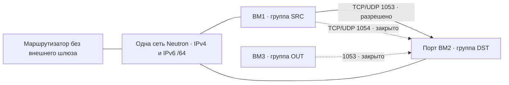
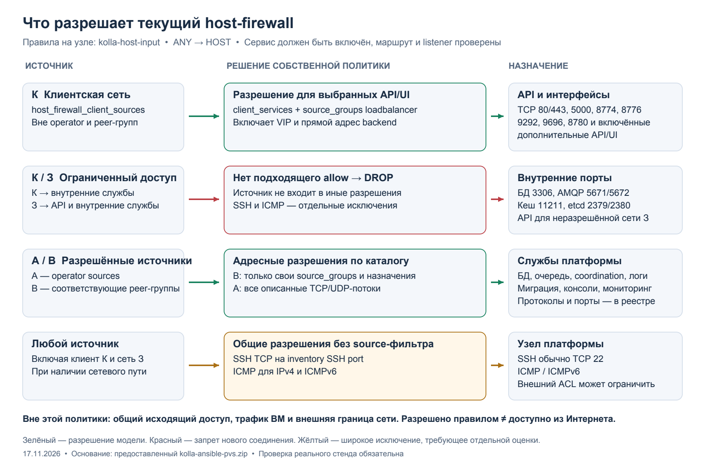
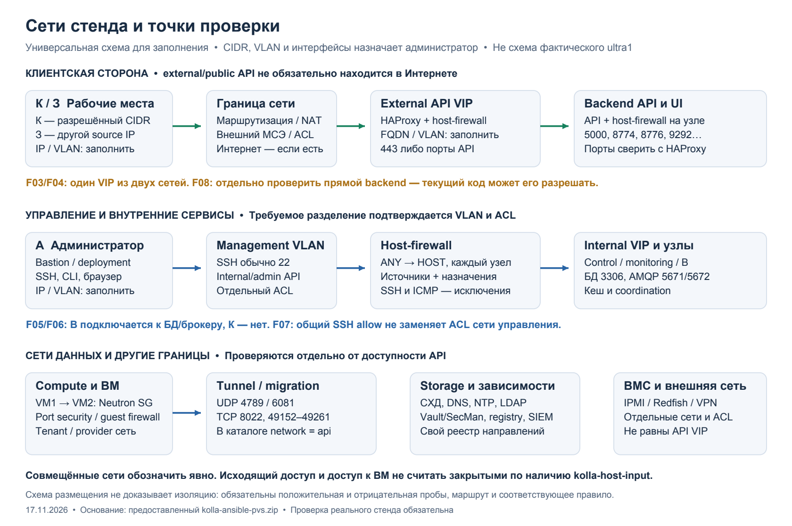

# Методика и демонстрация firewall в OpenStack PVS

Редакция от 18 ноября 2026 года. Для короткого показа на узлах откройте демонстрацию. Для испытаний виртуальных машин начните с N1 — оператор создаёт из CLI изолированную сеть, подсети IPv4 и IPv6, маршрутизатор и порты. Все указанные результаты — ожидаемые. Испытания на действующем стенде предстоит выполнить.

## Содержание

- [Короткая демонстрация](#demo)
- [Создание сети и ВМ через OpenStack CLI](#network)
- [Методика испытаний на узлах](#method)
- [Схемы сетей и подключений](#schemes)
- [Сети и полный каталог портов](#ports)
- [Что дополнить в ПМИ ДКБ-С](#dkb-review)
- [Соответствие ДКБ и ANSSI](#requirements)
- [Протокол испытаний](#protocol)
- [Расширенные проверки host-firewall](#extended)
- [Команды для смежных требований](#other-cli)
- [Ограничения текущей версии](#limits)
- [Источники](#sources)

Для показа на узлах [заполните файл с адресами стенда](#f-prep). Команды N и E выполняются в Bash. Отмеченные операции удаления и перезагрузки относятся к выделенным тестовым ресурсам. Для двух схем из раздела сетей рядом с этим документом должна находиться папка `diagrams`.


<a id="demo"></a>

## Короткая демонстрация

Продолжительность — 15–20 минут. Показываем уже подготовленный многосерверный стенд. Открываем три терминала с подписями «Узел», «Разрешённый клиент К», «Запрещённый клиент З»; для положительного контроля БД нужен четвёртый — «Внутренний узел В».

Для показа создания испытательной сети выполнить [N1 через CLI](#cli-network). Для показа изоляции ВМ в одной подсети использовать [N3, шаги 1–2](#cli-sg). Эти два опыта можно провести отдельно от 15–20 минут показа фильтра на узлах.

До встречи администратор заполняет адреса и порты из [паспорта стенда](#method), подтверждает маршрут из К/З и работающие сервисы, включает политику. Для показа выбираем один API/UI и одну внутреннюю службу. БД уже должна быть доступна из В. Загрузить подготовленный файл с адресами в каждом терминале по [инструкции для F01–F10](#f-prep). Короткий показ изменения правила для комиссии приведён в [E02, шаги 4–5](#e02).

### Шаг 1 Показать схему

На рабочем месте с Linux и графическим сеансом выполнить из папки комплекта первую команду. На macOS использовать вторую. На экране появятся [две схемы](diagrams/Схемы_firewall.pdf).

```bash
xdg-open diagrams/Схемы_firewall.pdf
```

```bash
open diagrams/Схемы_firewall.pdf
```

Сказать: «Клиент обращается к опубликованному сервису. Внутренние службы нужны узлам платформы. Firewall на узле проверяет входящие подключения; сети виртуальных машин контролируются отдельно».

Указать А, К, З, В и объяснить: external/public означает клиентскую сторону платформы; это не обязательно Интернет. Доступ из Интернета зависит от маршрутизации, NAT и внешнего МСЭ.

### Шаг 2 Показать включённую политику

**На узле:**

```bash
sudo firewall-cmd --info-policy=kolla-host-input
```

Показать ANY → HOST. Сказать: «Эта политика защищает сервисы самого узла».

### Шаг 3 Показать одно разрешение и общий запрет

**На узле:**

```bash
sudo firewall-cmd --policy=kolla-host-input --list-rich-rules
```

Выбрать заранее известную строку API или БД. Пояснить source, destination, port и accept. Найти завершающий drop. Сразу отметить исключения SSH и ICMP — они разрешены без ограничения источника.

### Шаг 4 Открытый клиентский вход

**Из К:**

```bash
nc -vz -w 3 "$VIP_IP" "$API_PORT"
```

Из К выполнить запрос к подготовленному HTTPS-адресу. Записать ожидаемый код страницы входа или API.

```bash
curl -sS --noproxy '*' --resolve "$API_FQDN:$API_PORT:$VIP_IP" --cacert "$CA" --max-time 8 -o /dev/null -w 'HTTP %{http_code}\n' "$PUBLIC_URL"
```

Показать ответ. Сказать: «Этот вход разрешён выбранной клиентской сети».

### Шаг 5 Тот же вход из другой сети

**Из З:**

```bash
nc -vz -w 3 "$VIP_IP" "$API_PORT"
```

Показать отсутствие соединения и сопоставить с успешным шагом 4. Назвать границу, где оно блокируется: host-firewall или внешний МСЭ. Если маршрут не подтверждён, не объявлять запрет доказанным.

### Шаг 6 Внутренний сервис работает

**Из В:**

```bash
nc -vz -w 3 "$DB_IP" "$DB_PORT"
```

Показать успех. Сказать: «База доступна разрешённому узлу платформы; служба работает».

### Шаг 7 Клиент не получает доступ к базе

**Из К:**

```bash
nc -vz -w 3 "$DB_IP" "$DB_PORT"
```

Показать отсутствие соединения к тому же IP и порту. Сказать: «Клиентский доступ к API не означает доступ к базе».

### Шаг 8 Показать ограничения текущей версии

**Из К:**

```bash
nc -vz -w 3 "$NODE_IP" "$BACKEND_PORT"
```

Показать результат без заранее обещанного запрета: текущая модель допускает прямой доступ к некоторым backend API/UI. Если путь открыт, записать расхождение с требованием доступа только через прокси.

**Из З:**

```bash
nc -vz -w 3 "$NODE_IP" "$SSH_PORT"
```

Пояснить, что собственная политика разрешает SSH всем источникам; запрет на внешнем МСЭ является отдельной защитой. Если такой доступ не соответствует согласованной политике, это открытый пункт приёмки.

### Шаг 9 Зафиксировать результат

На рабочем месте из папки комплекта создать отдельный протокол прогона, внести наблюдения и показать файл.

```bash
RESULT=$(mktemp -d "$HOME/pmi-result.XXXXXX")
cp 05_Протокол.md "$RESULT/Протокол.md"
date -u
vi "$RESULT/Протокол.md"
cat "$RESULT/Протокол.md"
```

Показать заполненные строки [протокола](#protocol). Для каждого результата оставить вывод терминала или скриншот с подписью точки и временем. Завершить словами о фактически показанном: какие подключения прошли, какие заблокированы и какой механизм это обеспечил.

Не заявлять «все требования выполнены», «наружу только 443» или «управление доступно только из management», если эти утверждения не подтверждены полным перечнем проверок. Применение, откат, IPv6, Security Groups, SIEM и TLS показываются отдельно, когда они входят в согласованный охват.

<a id="network"></a>

## Создание сети и ВМ через OpenStack CLI

Для ДКБ-С-03, 13–16 и 19 сеть создаёт оператор с deployment-машины А. Нужны отдельный тестовый проект, OpenStack CLI, четыре небольшие ВМ для полного группового теста и образ Linux с локальным входом через консоль, iproute2, ping, dig, nc, dnsmasq и Python 3. Для короткого показа С-03/19 достаточно ВМ 1 и 2. Тестовая сеть изолирована от внешней сети. Сети управления, хранения, VIP и ACL физических узлов берутся из паспорта действующего стенда.

**Схема тестового сегмента для N3.** Стрелки показывают новые соединения IPv4 в шаге выбора порта. С правилами шага 5 служба на 1053 отвечает, соседний работающий порт 1054 закрыт. Маршрутизатор обслуживает подсети внутри проекта.



<a id="cli-network"></a>

### N1. Создать сеть и две подсети

**1. На А** открыть Bash с профилем тестового проекта. Ввести имя профиля и два свободных префикса, выделенных администратором. IPv6 требует /64. Сверить показанный UUID проекта с паспортом.

```bash
read -rp 'Профиль тестового проекта из clouds.yaml: ' OS_CLOUD
export OS_CLOUD
openstack token issue -f value -c project_id
openstack subnet list
read -rp 'Тестовая подсеть IPv4, CIDR: ' CIDR4
read -rp 'Тестовая подсеть IPv6, /64: ' CIDR6
RUN=pmi-$(date -u +%Y%m%dT%H%M%SZ)
```

**2. На А** создать сеть и подсети. Каждый шаг выполнять после успеха предыдущего. Переменные хранят UUID в этом терминале. Если связь прервётся, найти свои объекты по имени прогона через `openstack network list`, `openstack subnet list` и `openstack port list`; сверить владельца и восстановить переменные по UUID. При частично выполненном прогоне продолжить с первого отсутствующего объекта.

```bash
NET=$(openstack network create --enable-port-security "$RUN-net" -f value -c id)
S4=$(openstack subnet create --network "$NET" --ip-version 4 --subnet-range "$CIDR4" "$RUN-v4" -f value -c id)
S6=$(openstack subnet create --network "$NET" --ip-version 6 --subnet-range "$CIDR6" --ipv6-ra-mode slaac --ipv6-address-mode slaac "$RUN-v6" -f value -c id)
openstack subnet list --network "$NET"
```

**3. На А** создать маршрутизатор для объявлений SLAAC и подключить подсети. Внешний шлюз для этих проверок не нужен.

```bash
RTR=$(openstack router create "$RUN-router" -f value -c id)
openstack router add subnet "$RTR" "$S4"
openstack router add subnet "$RTR" "$S6"
openstack router show "$RTR" -c interfaces_info -c external_gateway_info
openstack subnet show "$S6" -c cidr -c ipv6_ra_mode -c ipv6_address_mode
```

Ожидаем обе подсети на маршрутизаторе, пустой внешний шлюз и `slaac` в обоих полях IPv6.

<a id="cli-vms"></a>

### N2. Создать порты и ВМ

**1. На А** создать отдельные группы безопасности для источника, получателей и посторонней ВМ. Проверить исходные правила всех трёх групп. Для сценария нужен разрешённый исходящий трафик обеих семей и отсутствие входящих разрешений испытательных IPv4-потоков. Если в облаке другие шаблоны SG, сначала согласовать исходную политику тестового проекта.

```bash
SRC=$(openstack security group create "$RUN-src" -f value -c id)
DST=$(openstack security group create "$RUN-dst" -f value -c id)
OUT=$(openstack security group create "$RUN-out" -f value -c id)
openstack security group rule list "$SRC"
openstack security group rule list "$DST"
openstack security group rule list "$OUT"
```

**2. На А** создать порт каждой ВМ. Первый и второй нужны всегда. Для С-14 и контроля постороннего источника создать также третий и четвёртый. UUID и адреса из вывода перенести в паспорт. В коротком прогоне пропустить также SG OUT либо удалить её на этапе N5, если она создана. ВМ3 находится в той же сети, но изначально вне разрешённой группы.

```bash
P1=$(openstack port create --network "$NET" --security-group "$SRC" "$RUN-p1" -f value -c id)
P2=$(openstack port create --network "$NET" --security-group "$DST" "$RUN-p2" -f value -c id)
P3=$(openstack port create --network "$NET" --security-group "$OUT" "$RUN-p3" -f value -c id)
P4=$(openstack port create --network "$NET" --security-group "$DST" "$RUN-p4" -f value -c id)
openstack port list --network "$NET"
openstack port show "$P2" -c id -c fixed_ips -c mac_address -c security_group_ids -c port_security_enabled
```

**3. На А** выбрать образ и flavor. Создать ВМ на уже подготовленных портах, дождаться `ACTIVE`. Для короткого показа пропустить строки с ВМ3/4. На образе заранее подготовлен разрешённый консольный вход в гостевую ОС. Консоль работает независимо от тестовых ingress-правил.

```bash
openstack image list
openstack flavor list
read -rp 'UUID образа: ' IMG
read -rp 'UUID или имя flavor: ' FLAVOR
V1=$(openstack server create --wait --image "$IMG" --flavor "$FLAVOR" --port "$P1" "$RUN-vm1" -f value -c id)
V2=$(openstack server create --wait --image "$IMG" --flavor "$FLAVOR" --port "$P2" "$RUN-vm2" -f value -c id)
V3=$(openstack server create --wait --image "$IMG" --flavor "$FLAVOR" --port "$P3" "$RUN-vm3" -f value -c id)
V4=$(openstack server create --wait --image "$IMG" --flavor "$FLAVOR" --port "$P4" "$RUN-vm4" -f value -c id)
openstack server list --name "$RUN"
openstack port show "$P2" -c id -c device_id -c status -c fixed_ips
```

Для возобновления после разрыва связи на А сохранить UUID в личный файл. Команда записывает только перечисленные переменные. В сокращённом прогоне убрать из команды имена отсутствующих объектов. В новом Bash загрузить файл командой `source "$HOME/ИМЯ_ПРОГОНА.ids"` и заново выбрать тот же профиль проекта.

```bash
umask 077
declare -p RUN NET S4 S6 RTR SRC DST OUT P1 P2 P3 P4 V1 V2 V3 V4 > "$HOME/$RUN.ids"
```

**4. На А** получить адрес консоли каждой участвующей ВМ. Открыть выданную временную ссылку, войти в Linux и подписать терминалы. Ссылку с токеном в протокол не копировать. На каждой ВМ выполнить две последние команды. Сверить MAC и IPv4/IPv6 с Neutron.

```bash
openstack console url show "$V1"
openstack console url show "$V2"
openstack console url show "$V3"
openstack console url show "$V4"
```

```bash
hostname
ip -br addr
```

**5. На А и в консолях ВМ** ввести адреса ВМ1 и ВМ2 из вывода Neutron, в полном прогоне также адрес ВМ4. Переменные вводятся в каждом терминале, где используются. Для повторения между разными compute администратор проверяет размещение. Если ВМ на одном узле, результат относится только к этому размещению. Для отдельной пары с гарантированным разнесением использовать шаг N6.

```bash
read -rp 'IPv4 ВМ1: ' A1
read -rp 'IPv4 ВМ2: ' A2
read -rp 'IPv4 ВМ4 для полного прогона: ' A4
```

```bash
openstack server show "$V1" -c OS-EXT-SRV-ATTR:host
openstack server show "$V2" -c OS-EXT-SRV-ATTR:host
```

<a id="cli-sg"></a>

### N3. Проверить изоляцию, группу, порты и протоколы

**1. ВМ2**, затем **ВМ4** для групповой проверки. В отдельной консоли запустить тестовую DNS-службу. Ввести собственный IPv4 этой ВМ. Она отвечает одним известным адресом по TCP и UDP на 1053. Оставить службу работающей. Во второй консоли той же ВМ повторить ввод `MYIP` и две локальные пробы. Обе должны вернуть `192.0.2.123`.

```bash
read -rp 'IPv4 этой ВМ: ' MYIP
dnsmasq --no-daemon --user="$(id -un)" --conf-file=/dev/null --no-resolv --no-hosts --bind-interfaces --listen-address="$MYIP" --port=1053 --address=/probe.test/192.0.2.123
```

```bash
read -rp 'IPv4 этой ВМ: ' MYIP
dig +short +time=2 +tries=1 @"$MYIP" -p 1053 probe.test A
dig +short +tcp +time=2 +tries=1 @"$MYIP" -p 1053 probe.test A
```

Для полного прогона **на ВМ2 и ВМ4** заранее запустить во второй консоли ещё один работающий порт. В отдельном окне на той же ВМ проверить оба протокола к 1054. Оставить оба слушателя до конца N3. Для короткого показа С-03 достаточно 1053.

```bash
read -rp 'IPv4 этой ВМ: ' MYIP
dnsmasq --no-daemon --user="$(id -un)" --conf-file=/dev/null --no-resolv --no-hosts --bind-interfaces --listen-address="$MYIP" --port=1054 --address=/probe.test/192.0.2.123
```

```bash
read -rp 'IPv4 этой ВМ: ' MYIP
dig +short +time=2 +tries=1 @"$MYIP" -p 1054 probe.test A
dig +short +tcp +time=2 +tries=1 @"$MYIP" -p 1054 probe.test A
```

**2. С-03, одна пара. На ВМ1** выполнить обе пробы ниже. Исходно нет ответа. **На А** создать одно правило на адрес источника. **На ВМ1** повторить обе пробы. Только TCP должен вернуть тестовый адрес. **На А** удалить правило по сохранённому UUID. **На ВМ1** повторить обе пробы. Ожидаем снова отсутствие ответа при успешном локальном контроле на ВМ2.

```bash
dig +short +tcp +time=2 +tries=1 @"$A2" -p 1053 probe.test A
dig +short +time=2 +tries=1 @"$A2" -p 1053 probe.test A
```

```bash
T=$(openstack security group rule create --ingress --ethertype IPv4 --protocol tcp --dst-port 1053 --remote-ip "$A1/32" "$DST" -f value -c id)
openstack security group rule show "$T"
```

```bash
openstack security group rule delete "$T"
```

**3. С-13, связь узел → узел без ограничения портов. На А** создать правило для ВМ1 с любым протоколом. В этом шаге для буквального ограничения назначения выделить отдельную SG только порту ВМ2.

```bash
PAIR=$(openstack security group create "$RUN-pair" -f value -c id)
openstack port set --security-group "$DST" --security-group "$PAIR" "$P2"
R=$(openstack security group rule create --ingress --ethertype IPv4 --remote-ip "$A1/32" "$PAIR" -f value -c id)
openstack security group rule show "$R"
```

**На ВМ1** выполнить команды. На ВМ2 ожидаем ответ по ICMP, TCP и UDP. На ВМ4 та же TCP-проба остаётся без ответа. **На ВМ3** выполнить ту же команду dig к `"$A2"` на 1053, она также должна остаться без ответа. **На А** снять временное разрешение и членство, проверить, что на порту ВМ2 снова только DST.

```bash
ping -c 2 -W 2 "$A2"
dig +short +tcp +time=2 +tries=1 @"$A2" -p 1053 probe.test A
dig +short +time=2 +tries=1 @"$A2" -p 1053 probe.test A
dig +short +tcp +time=2 +tries=1 @"$A2" -p 1054 probe.test A
dig +short +tcp +time=2 +tries=1 @"$A4" -p 1053 probe.test A
```

```bash
openstack security group rule delete "$R"
openstack port unset --security-group "$PAIR" "$P2"
openstack port show "$P2" -c security_group_ids
openstack security group delete "$PAIR"
```

**4. С-14, группа → группа. На А** дать любой IPv4-протокол группе SRC на порты группы DST. **На ВМ1, затем на ВМ3** выполнить DNS-пробы ниже. ВМ1 получает ответ от обоих получателей, ВМ3 пока не получает. **На А** добавить порт ВМ3 в SRC. Повторить пробы с ВМ3, теперь ответы должны приходить от обеих ВМ. Снять членство, повторить отрицательные пробы с ВМ3, затем удалить правило на А.

```bash
G=$(openstack security group rule create --ingress --ethertype IPv4 --remote-group "$SRC" "$DST" -f value -c id)
openstack security group rule show "$G"
```

```bash
dig +short +time=2 +tries=1 @"$A2" -p 1053 probe.test A
dig +short +tcp +time=2 +tries=1 @"$A2" -p 1054 probe.test A
dig +short +tcp +time=2 +tries=1 @"$A2" -p 1053 probe.test A
dig +short +time=2 +tries=1 @"$A4" -p 1053 probe.test A
dig +short +tcp +time=2 +tries=1 @"$A4" -p 1054 probe.test A
dig +short +tcp +time=2 +tries=1 @"$A4" -p 1053 probe.test A
```

```bash
openstack port set --security-group "$OUT" --security-group "$SRC" "$P3"
openstack port show "$P3" -c security_group_ids
```

```bash
openstack port unset --security-group "$SRC" "$P3"
```

```bash
openstack security group rule delete "$G"
```

**5. С-15, выбор порта.** Использовать два порта, запущенных на ВМ2 в шаге 1. Ещё раз выполнить локальные пробы к 1054, если между испытаниями менялась конфигурация. **На А** разрешить два протокола только на 1053. **На ВМ1** сравнить соседние порты. На 1053 нужны два ответа, на работающем 1054 оба соединения закрыты.

```bash
T=$(openstack security group rule create --ingress --ethertype IPv4 --protocol tcp --dst-port 1053 --remote-ip "$A1/32" "$DST" -f value -c id)
U=$(openstack security group rule create --ingress --ethertype IPv4 --protocol udp --dst-port 1053 --remote-ip "$A1/32" "$DST" -f value -c id)
```

```bash
dig +short +tcp +time=2 +tries=1 @"$A2" -p 1053 probe.test A
dig +short +time=2 +tries=1 @"$A2" -p 1053 probe.test A
dig +short +tcp +time=2 +tries=1 @"$A2" -p 1054 probe.test A
dig +short +time=2 +tries=1 @"$A2" -p 1054 probe.test A
```

**6. С-16, выбор протокола. На А** удалить TCP-правило. **На ВМ1** повторить первые две пробы шага 5. Должен работать только UDP. Выполнить ping, исходно ответа нет. **На А** добавить только ICMP от ВМ1. Повторить ping, ожидаем ответ. Удалить оба правила и повторить ping и UDP, ожидаем прекращение доступа. Завершить тестовые DNS на ВМ клавишами Ctrl+C после последнего положительного локального контроля.

```bash
openstack security group rule delete "$T"
```

```bash
ping -c 2 -W 2 "$A2"
```

```bash
I=$(openstack security group rule create --ingress --ethertype IPv4 --protocol icmp --remote-ip "$A1/32" "$DST" -f value -c id)
```

```bash
openstack security group rule delete "$I" "$U"
```

<a id="cli-v6"></a>

### N4. Подтвердить IPv6 по одному порту

**1. На А** разрешить ICMPv6 внутри испытательного сегмента для двух участвующих групп. Источник `::/0` здесь нужен также для link-local адресов ND/RA. Использовать только SG данной изолированной сети. Если эквивалентное правило уже существует, записать его UUID и пропустить соответствующее создание.

```bash
openstack security group rule create --ingress --ethertype IPv6 --protocol ipv6-icmp --remote-ip ::/0 "$SRC"
openstack security group rule create --ingress --ethertype IPv6 --protocol ipv6-icmp --remote-ip ::/0 "$DST"
openstack port show "$P1" -c id -c fixed_ips -c mac_address
openstack port show "$P2" -c id -c fixed_ips -c mac_address
```

**2. На ВМ1 и ВМ2** сверить MAC и адрес выделенного /64 с портом. В госте может быть дополнительный временный адрес. Для следующего шага взять именно два адреса из Neutron.

```bash
ip -br link
ip -6 addr show scope global
ip -6 route
```

**3. На ВМ1** проверить соседа с явным адресом источника. Внести в протокол UUID порта ВМ2, MAC, IPv6 в Neutron и госте, ответ ping. Для замечания Н1 можно дополнительно сверить отображение существующего порта в Visage. Функция создания подсети кнопкой Visage при таком CLI-прогоне сохраняет статус «Не проверено».

```bash
read -rp 'IPv6 ВМ1 из Neutron: ' IP61
read -rp 'IPv6 ВМ2 из Neutron: ' IP62
ping -6 -I "$IP61" -c 3 -W 2 "$IP62"
```

<a id="cli-clean"></a>

### N5. Убрать объекты прогона

**1. На А** сверить имя прогона, UUID проекта и объектов с протоколом. Удалить только созданные для данного прогона ВМ и дождаться освобождения портов. При коротком прогоне выполнять только команды для созданных ресурсов.

```bash
openstack token issue -f value -c project_id
openstack server list --name "$RUN"
openstack server delete --wait "$V1" "$V2"
openstack server delete --wait "$V3" "$V4"
openstack port list --network "$NET"
```

**2. На А** удалить свои порты, затем интерфейсы маршрутизатора, сам маршрутизатор, подсети, сеть и SG. Если шаг С-13 прервался и осталась группа PAIR, удалить её после удаления портов. При ошибке посмотреть, какой объект остался зависимым, и повторить только незавершённый шаг.

```bash
openstack port delete "$P1" "$P2"
openstack port delete "$P3" "$P4"
openstack router remove subnet "$RTR" "$S6"
openstack router remove subnet "$RTR" "$S4"
openstack router delete "$RTR"
openstack subnet delete "$S6" "$S4"
openstack network delete "$NET"
openstack security group delete "$DST" "$SRC"
openstack security group delete "$OUT"
openstack network list --name "$RUN-net"
```

Последняя команда должна вернуть пустой список. ВМ, порты и сети действующего стенда в этот список удаления не входят.

### N6. Повторить С-03 между двумя compute

При наличии двух доступных compute выполнить как **отдельный прогон**. Пройти N1 и N2.1–2 с новым RUN. На А выбрать образ и flavor как в N2.3, создать группу размещения и запустить ВМ1 и ВМ2 в ней взамен двух обычных команд создания.

```bash
SP=$(openstack server group create --policy anti-affinity "$RUN-spread" -f value -c id)
V1=$(openstack server create --wait --image "$IMG" --flavor "$FLAVOR" --port "$P1" --hint group="$SP" "$RUN-vm1" -f value -c id)
V2=$(openstack server create --wait --image "$IMG" --flavor "$FLAVOR" --port "$P2" --hint group="$SP" "$RUN-vm2" -f value -c id)
openstack server show "$V1" -c OS-EXT-SRV-ATTR:host
openstack server show "$V2" -c OS-EXT-SRV-ATTR:host
```

Администратор подтверждает два разных имени compute. Повторить N2.4–5 и N3.1–2 для ВМ1/ВМ2. После удаления ВМ и сети по N5 удалить свою группу размещения.

```bash
openstack server group delete "$SP"
```

Синтаксис соответствует OpenStackClient 2025.1. [Сеть](https://docs.openstack.org/python-openstackclient/2025.1/cli/command-objects/network.html) · [Подсеть](https://docs.openstack.org/python-openstackclient/2025.1/cli/command-objects/subnet.html) · [Порт](https://docs.openstack.org/python-openstackclient/2025.1/cli/command-objects/port.html) · [Маршрутизатор](https://docs.openstack.org/python-openstackclient/2025.1/cli/command-objects/router.html) · [ВМ](https://docs.openstack.org/python-openstackclient/2025.1/cli/command-objects/server.html) · [Правило SG](https://docs.openstack.org/python-openstackclient/2025.1/cli/command-objects/security-group-rule.html)

<a id="method"></a>

## Методика испытаний на узлах

### 1 Назначение и результат

Цель — показать, какие подключения разрешает доработка host-firewall, какие блокирует и как это подтверждается на работающем стенде. Основную часть выполняют вручную без изменения правил. Отдельные расширенные проверки подтверждают применение и восстановление политики.

Объект — реализация из `kolla-ansible-pvs.zip`, политика firewalld `kolla-host-input`. Основание — ДКБ-С, исходная ПМИ от 13 ноября 2026 года и материалы ANSSI из `ansii-main.zip`. Подробная привязка приведена в [матрице требований](#requirements).

**Результат испытаний** — заполненный протокол, схема конкретного стенда и сохранённые результаты команд. Наличие кода или каталога портов само по себе не означает успешную приёмку.

Короткий показ охватывает выбранные примеры. Для полной приёмки повторить применимые сетевые проверки по всему утверждённому перечню адресов и портов и выполнить согласованные расширенные проверки E01–E07.

### 2 Подготовка администратором

Нужен многосерверный стенд: минимум два узла в inventory, практически удобнее контроллер и два compute. В single-node эта версия пропускает управление firewall. До показа администратор включает и проверяет политику, устанавливает `nc` на проверочные машины, готовит административную сессию OpenStack CLI и заполняет таблицы ниже. Применение правил описано отдельно в [расширенных проверках](#extended).

Для испытаний нужны четыре точки. Они могут быть отдельными ВМ или рабочими местами в соответствующих VLAN. Имя роли само по себе не даёт доступ: важен исходный IP, который видит узел, в том числе после NAT.

| Точка | Откуда выполняем | Назначение |
|---|---|---|
| А | Машина администратора или deployment | Просмотр конфигурации; доступ из operator sources |
| К | Машина в разрешённой клиентской сети | Проверка опубликованных API/UI и запрета внутренних служб |
| З | Машина из другой, неразрешённой сети | Проверка запрета API; маршрут до стенда должен существовать |
| В | Внутренний узел из разрешённой группы | Контроль работоспособности БД, брокера и других внутренних служб |

Точка К не должна входить одновременно в `host_firewall_operator_sources` или адреса разрешённых внутренних узлов. Точка З не должна попадать ни в один разрешённый диапазон. По умолчанию клиентами считаются `10.0.0.0/8`, `172.16.0.0/20`, `192.168.0.0/16`; для небольшого стенда администратору следует заранее задать конкретные проверяемые подсети. Нельзя автоматически считать любую другую VLAN запрещённой.

#### Паспорт стенда

| Поле | Значение перед испытанием |
|---|---|
| Дата, исполнитель, версия сборки | Заполнить |
| Узлы и их роли, inventory | Заполнить |
| А / К / З / В — исходный IP и VLAN | Заполнить для каждой точки |
| `NODE_IP` — API-адрес проверяемого узла | Заполнить |
| `VIP_IP` и FQDN опубликованного API/UI | Заполнить |
| Internal VIP, external VIP, VLAN каждого | Заполнить; отметить, если совпадают |
| `API_PORT` — порт работающего опубликованного входа | Заполнить; например 443 или 5000 |
| `DB_IP`, `DB_PORT` — работающий вход БД | Заполнить; обычно 3306, учесть ProxySQL |
| `MQ_IP`, `MQ_PORT` — работающий AMQP вход | Заполнить; 5671 при TLS или 5672 без TLS |
| `SSH_PORT` | Заполнить; обычно 22 |
| API, management, tunnel, storage и BMC сети | CIDR, VLAN, интерфейс; отметить совмещённые сети |
| Разрешённые client и operator sources | Перенести эффективные значения без секретов |
| Путь к CA для HTTPS | Заполнить при проверке через curl |

В шаблоне нет действующих адресов ultra1. Пример из исходного сценария `10.101.25.43` не переносится автоматически на новый стенд.

<a id="f-prep"></a>

#### Подготовить терминалы для F01–F10

**1. На А** перенести из паспорта только подтверждённые адреса, порты и полный URL публичного сервиса. Значения ниже — пример синтаксиса для изолированного стенда. Перед использованием заменить их в файле. В PUBLIC_URL взять то же DNS-имя, что в API_FQDN, и указать API_PORT, если он отличается от 443. CA должен быть доступен по указанному пути на К. Файл содержит только сетевые параметры. Создать его в новой папке материалов прогона.

```bash
mkdir -p "$HOME/pmi-runs"
cd "$(mktemp -d "$HOME/pmi-runs/params.XXXXXX")"
cat > pmi.env <<'ENV'
NODE_IP=192.0.2.11
VIP_IP=192.0.2.10
API_FQDN=api.example.test
API_PORT=443
BACKEND_PORT=5000
DB_IP=192.0.2.12
DB_PORT=3306
MQ_IP=192.0.2.13
MQ_PORT=5671
SSH_PORT=22
PUBLIC_URL=https://api.example.test/
CA=/path/to/stand-ca.pem
ENV
vi pmi.env
```

**2. На К, З, В и проверяемый узел** передать согласованный файл штатным способом. Например, на А ввести SSH-имя назначенной машины и выполнить scp. Повторить для остальных. В каждом терминале открыть Bash, загрузить параметры из полученного файла, проверить имя машины, время и адреса. Команды F03–F08 используют значения из этого файла.

```bash
read -rp 'SSH-имя точки проверки: ' POINT
scp ./pmi.env "$POINT:~/pmi-stand.env"
```

```bash
source "$HOME/pmi-stand.env"
hostname
date -u
ip -br addr
```

Для испытаний сети ВМ [создать сеть и подсети из CLI](#cli-network). Для К7 заранее подготовить [пять состояний host-firewall](#e02). На основном показе настройки этих объектов уже готовы.

#### Правило оценки соединений

`succeeded` или `open` в выводе `nc` — TCP-соединение установлено. `Connection refused` — получен отказ; это ещё не доказательство блокировки firewall. `timed out` — нет ответа; причиной также могут быть маршрут или отключённая служба.

**Для подтверждения запрета нужны вместе:** успешное соединение к тому же IP и порту из разрешённой точки, неуспешное из запрещённой и соответствующее правило на пути. Если маршрут или служба не проверены, результат «Не проверено», а не «Пройдено».

Если требуется доказать блокировку именно на узле, администратор дополнительно сопоставляет попытку с локальными правилами nftables и приходом пакетов. Команда захвата приведена в расширенном разделе. Если пакет не дошёл до узла, показан запрет на предыдущей границе, а не работа host-firewall.

Проверяются новые соединения. Уже открытая сессия может продолжать работу из-за stateful-обработки.

### 3 Основные проверки

#### F01 Убедиться что политика включена

**Где:** на проверяемом узле, права sudo. **Проверяет:** исходное состояние для всех следующих испытаний.

На узле последовательно вывести имя, состояние службы и направление политики.

```bash
# 1. Узел
hostname
# 2. Состояние
sudo firewall-cmd --state
# 3. Политика
sudo firewall-cmd --info-policy=kolla-host-input
```

**Ожидаем:** `running`; политика существует, содержит ingress `ANY`, egress `HOST`, priority `-500`. Сохранить вывод и имя узла. Если политика отсутствует или firewalld остановлен, основную демонстрацию не продолжать: сначала требуется подготовка.

#### F02 Показать правила одного узла

**Где:** на том же узле. **Проверяет:** ДКБ-С-08; повторение на всех узлах группы — С-09.

На H1 выполнить обе строки. Для группы повторить на H2 и приложить оба вывода.

```bash
# 1. Узел
hostname
# 2. Действующие правила
sudo firewall-cmd --policy=kolla-host-input --list-rich-rules
```

**Ожидаем:** разрешение SSH, разрешения ICMP/ICMPv6, адресные разрешения сервисов и завершающий `drop`. Выбрать одну строку сервиса и прочитать её вслух: «источник → адрес назначения → протокол → порт → accept». Для группы выполнить команду на каждом входящем в неё узле, подписать выводы именами узлов. Один вывод не подтверждает всю группу.

#### F03 Открыть опубликованный вход из клиентской сети

**Где:** точка К. **Проверяет:** разрешённое внешнее подключение к сервису.

Из К проверить маршрут, установить TCP-соединение и запросить опубликованный URL.

```bash
# 1. Маршрут
ip route get "$VIP_IP"
# 2. TCP
nc -vz -w 3 "$VIP_IP" "$API_PORT"
# 3. Ответ приложения
curl -sS --noproxy '*' --resolve "$API_FQDN:$API_PORT:$VIP_IP" --cacert "$CA" --max-time 8 -o /dev/null -w 'HTTP %{http_code}\n' "$PUBLIC_URL"
```

**Ожидаем:** соединение установлено. Последняя команда проверяет HTTPS по имени сервера с доверенным CA. Показать ожидаемую страницу, ответ API либо страницу входа. TCP-тест доказывает сетевую доступность; успешный вход в приложение проверяется отдельно.

**Сохранить:** исходный IP К, VIP, порт, время и вывод. Повторить для каждого опубликованного сервиса из утверждённого списка. Один пример достаточен для показа, но не для итоговой проверки всех портов.

#### F04 Проверить тот же вход из запрещённой сети

**Где:** точка З. **Проверяет:** ограничение источников доступа.

Из З проверить маршрут и повторить TCP-пробу F03 к тому же адресу.

```bash
# 1. Маршрут
ip route get "$VIP_IP"
# 2. Та же TCP-проба
nc -vz -w 3 "$VIP_IP" "$API_PORT"
```

**Ожидаем:** новое TCP-соединение не устанавливается; контроль F03 в тот же период успешен. Сопоставить с исходным IP и правилами. Если З входит в широкий client CIDR или приходит через разрешённый NAT, ожидание запрета неверно — исправить паспорт, а не записывать успешный тест.

**Сохранить:** оба результата F03/F04 и правило/границу, где произошёл запрет. Если внешний МСЭ блокирует пакет раньше узла, отметить это отдельно.

#### F05 Проверить закрытие базы данных для клиента

**Где:** сначала В, затем К. **Проверяет:** разделение опубликованных входов и внутренних служб.

Сначала на В выполнить обе строки. Затем на К выполнить те же две строки с теми же значениями.

```bash
# 1. Маршрут
ip route get "$DB_IP"
# 2. Подключение к БД
nc -vz -w 3 "$DB_IP" "$DB_PORT"
```

**Ожидаем:** из В соединение устанавливается; из К не устанавливается. Пароль БД вводить не нужно. В должна принадлежать реально разрешённой группе для выбранного адреса БД/ProxySQL. В текущем каталоге разные входы MariaDB и ProxySQL имеют разные группы источников.

**Сохранить:** два вывода для одного адреса и порта, строку соответствующего правила. Повторить для VIP БД и прямого адреса, если оба существуют и слушают.

#### F06 Проверить закрытие брокера для клиента

**Где:** сначала В, затем К. **Проверяет:** ограничение доступа к AMQP.

Сначала на В выполнить обе строки. Затем на К повторить их к тому же работающему входу брокера.

```bash
# 1. Маршрут
ip route get "$MQ_IP"
# 2. Подключение к брокеру
nc -vz -w 3 "$MQ_IP" "$MQ_PORT"
```

**Ожидаем:** из В TCP доступен; из К закрыт. Использовать действующий порт 5671 или 5672. Неудача на выключенном 5672 при работающем 5671 не подтверждает firewall. Для приёмки аналогично проверить Memcached, etcd, Consul и monitoring endpoints, если они включены.

#### F07 Честно показать исключения для SSH и ICMP

**Где:** точка З. **Проверяет:** реальные границы текущей доработки.

На З вывести маршрут и проверить новое соединение SSH и ответ ICMP.

```bash
# 1. Маршрут
ip route get "$NODE_IP"
# 2. SSH
nc -vz -w 3 "$NODE_IP" "$SSH_PORT"
# 3. ICMP
ping -c 3 "$NODE_IP"
```

**Ожидаем по коду:** собственная политика разрешает SSH и ICMP без source-ограничения. При наличии маршрута, слушающего SSH и отсутствии запрета других средств соединение/ответ возможны. Это характеристика реализации, а не автоматическое выполнение требования изоляции управления.

Если снаружи доступ отсутствует, показать, какой внешний ACL или другой механизм его закрыл. Не приписывать этот результат собственному правилу host-firewall. Для политики «SSH только из VLAN управления» требуется отдельный контроль или изменение реализации.

#### F08 Проверить прямой путь к backend

**Где:** точка К. **Проверяет:** ДКБ-С-31 и ANSSI R4/R5.

Сначала на backend-узле подтвердить слушатель командой `sudo ss -lntp "sport = :$BACKEND_PORT"`. Затем на К выполнить обе строки.

```bash
# 1. Маршрут
ip route get "$NODE_IP"
# 2. Прямое подключение
nc -vz -w 3 "$NODE_IP" "$BACKEND_PORT"
```

Администратор заранее выбирает реальный backend API/UI из каталога и подтверждает слушающий порт. **Ожидаем по текущему коду:** для сервисов из `client_services` с `loadbalancer` среди source groups клиентские источники добавляются и к прямому адресу узла. Поэтому соединение может быть разрешено.

**Критерий строгой схемы через прокси:** из К доступен только утверждённый frontend, прямой backend закрыт. Если прямое соединение проходит — записать «Не пройдено» для этой цели, даже если F03 успешен. Закрытие внешним МСЭ указывать как отдельный механизм.

#### F09 Показать сети управления и опубликованные адреса

**Где:** А с подготовленным OpenStack CLI и проверяемый узел. **Проверяет:** С-31, ANSSI R3/R4.

1. На А получить адреса из каталога сервисов.

```bash
openstack endpoint list -c "Service Name" -c Interface -c URL
```

2. На узле получить адреса, интерфейсы и доступные сведения о VLAN.

```bash
ip -br addr
ip -d link show
```

**Ожидаем:** адреса и интерфейсы совпадают с паспортом и схемой. VLAN на коммутаторе подтверждается его конфигурацией: Linux не покажет VLAN ID, если порт коммутатора работает в access-режиме. Отдельно перечислить SSH, Horizon, CLI/API, Grafana, OpenSearch Dashboards, административные интерфейсы БД/брокера и BMC. CLI — клиент API, собственного входящего порта у него нет.

Для С-31 требуется выделенная сеть управления и фактический запрет неразрешённого доступа. Для R4 — раздельные сети public и admin/internal с проверкой пути. Для буквального R3 дополнительно нужны разные TCP-порты admin и public; разные IP при одинаковом порте этого не подтверждают. Наличие имён endpoint `admin`, `internal`, `public` само по себе изоляцию не создаёт.

#### F10 Сверить каталог с работающими портами

**Где:** каждый узел из охвата. **Проверяет:** С-32.

На каждом узле последовательно получить имя, список слушателей и правила.

```bash
# 1. Узел
hostname
# 2. Слушатели
sudo ss -lntup
# 3. Действующие правила
sudo firewall-cmd --policy=kolla-host-input --list-rich-rules
```

**Ожидаем:** каждый слушающий host-порт объяснён в реестре: служба, адрес, протокол, разрешённые источники и основание. Сверить с [полным каталогом](#ports) и endpoint list. Для контейнера с отдельным network namespace сведения снимает администратор в его namespace; один host `ss` не гарантирует полный охват.

Отдельно записать разрешённые, но не слушающие порты. В текущем каталоге есть, например, оба UDP-порта 4789/6081 и безусловное разрешение 16509; это требует объяснения для конкретного профиля. Для каждого найденного расхождения указать решение: нужен сервис, лишнее разрешение, ошибочный порт или неполный каталог. `coverage: complete` — метка каталога, не результат испытаний.

### 4 Как заполнять результат

Использовать [протокол](#protocol). На каждую проверку записать дату и время UTC, точку запуска, IP назначения, порт, команду, наблюдение, файл/скриншот и статус.

| Статус | Когда ставить |
|---|---|
| Пройдено | Все критерии проверки подтверждены, свидетельства сохранены |
| Не пройдено | Наблюдение противоречит согласованному критерию |
| Не проверено | Не запускали, не хватило доступа, контрольной точки или доказательств |
| Не применимо | Компонент отсутствует и исключение из охвата согласовано |

Для F07/F08 отдельно записать соответствие текущему коду и соответствие требуемой политике. Совпадение с кодом, разрешающим нежелательный доступ, не делает требование выполненным.

<a id="schemes"></a>

## Схемы сетей и подключений

Первая схема показывает разрешения текущего кода. Вторая — универсальное размещение сетей и точек проверки. Реальные CIDR, VLAN и адреса заполняет администратор.

### Разрешения текущей политики



[Открыть векторную схему SVG](diagrams/01_Текущая_логика.svg)

### Сети и точки проверки



[Открыть векторную схему SVG](diagrams/02_Сети_стенда.svg)

<a id="ports"></a>

## Сети и полный каталог портов

В таблицах указаны разрешения модели из предоставленного архива. Это не результат сканирования стенда. Активность потока зависит от enable-флагов, групп inventory, условий и фактических адресов. Значения по умолчанию сверяются с effective vars, HAProxy и слушающими сервисами.

### Как читать схему

[Текущая логика](diagrams/01_Текущая_логика.svg) показывает именно собственную политику. [Сети стенда](diagrams/02_Сети_стенда.svg) — шаблон размещения точек проверки и границ контроля; разделение VLAN должен подтвердить администратор. «Разрешено правилом» означает возможность пройти этот фильтр, а не гарантию соединения.

### Что открыто и что закрыто

| Источник | Назначение | Собственная политика | Условие |
|---|---|---|---|
| Любой источник | SSH-порт узла | Разрешает | Обычно 22; внешний ACL может ограничить |
| Любой источник | ICMP и ICMPv6 узла | Разрешает | Прочие сетевые средства учитываются отдельно |
| Operator sources | Все TCP/UDP-потоки каталога | Разрешает | Флаг/условие сервиса включены; это шире одного SSH |
| Client sources | Некоторые опубликованные API/UI | Разрешает | client_services + loadbalancer в source_groups |
| Client sources | Прямые backend тех же сервисов | Разрешает | Не только путь через VIP; проверка F08 |
| Client sources | БД, брокер и прочие внутренние-only потоки | Не добавляет клиентское разрешение | Источник не должен одновременно быть operator/peer |
| Узел из source_groups | Адрес destination_group и порт потока | Разрешает | Точный состав берётся из inventory |
| Другой источник | Новый входящий поток на узел | Завершающий drop | Кроме общих SSH/ICMP и иных разрешений |
| Узел → внешняя система | Исходящее соединение | Эта политика не задаёт общий запрет | Проверять OUTPUT/внешний МСЭ |
| ВМ → ВМ | Tenant-трафик | Не является политикой SG | Проверять Neutron и гостевую ОС |

Возвратный трафик существующих соединений учитывает stateful-обработку firewalld. При испытании изменения правила открывайте новое соединение. ANY → HOST не означает контроль всех направлений.

### Краткая памятка портов

| Назначение | Порты по умолчанию | Кому обычно требуется |
|---|---|---|
| Horizon | TCP 80/443 | Клиентам и администраторам по согласованной публикации |
| API | TCP 5000, 8774, 8776, 9292, 9696, 8780 | Клиентам/сервисам через назначенные входы |
| Дополнительные API/UI | TCP 9311, 9322, 15868, 8989, 6385, 3000, 5601 | Только если сервис включён и публикация согласована |
| БД и очередь | TCP 3306; 5671/5672 | Внутренним разрешённым источникам |
| Кластер БД | TCP 4567, 4568, 4444 | Узлам кластера; UDP 4567 в данном каталоге не указан |
| Кеш и coordination | TCP 11211, 2379/2380, 8500; 8301/8302 TCP/UDP | Только согласно конкретным группам |
| Overlay | UDP 4789 и 6081 | Узлам openvswitch; оба есть в каталоге |
| Libvirt и миграция | TCP 16509/16514, 8022, 49152–49261 | Control/compute по назначению |
| Консоли | TCP 6080/6083; 5900–5999; 10000–20000 условно | Proxy/compute; не вся консольная группа публична |
| HA | IP protocol 112 VRRP; UDP 5405; TCP 3121 | Только соответствующим HA-группам |
| Мониторинг/логи | TCP 9091, 9093/9094, 9100 и другие; UDP 5140 | По подробному каталогу ниже |

Для режима single external frontend frontend-порт может быть 443 вместо номера API. Модель в основном копирует порт backend-потока на VIP; полноту таких разрешений проверить отдельно. Слушание на 0.0.0.0/:: не доказывает внешний доступ, а private IP не доказывает изоляцию от клиентских сетей.

### Полный каталог из архива

Всего 45 записей сервисов и 84 потока. Во всех потоках network = api. В таблице source_groups — исходные группы каталога; operator sources добавляются ко всем TCP/UDP-потокам автоматически. Клиентский допуск в колонке «К» относится к прямому адресу и возможным VIP-кандидатам. Это разрешения модели, не доказательство наличия frontend. Для flow с vip_source_groups действуют специально заданные VIP-источники.

#### keystone

Включение: `enable_keystone`. Дополнительно: `enable_haproxy`.

| ID потока | Протокол и порт | Источник → группа назначения | К | Условия |
|---|---|---|---|---|
| `keystone-internal-backend` | TCP 5000 (`keystone_internal_listen_port`) | loadbalancer → keystone | Да | Без доп. условия |
| `keystone-public-backend` | TCP 5000 (`keystone_public_listen_port`) | loadbalancer → keystone | Да | haproxy_enable_external_vip |
| `keystone-fernet-ssh` | TCP 8023 (`keystone_ssh_port`) | keystone → keystone | Нет | Без доп. условия |

#### glance

Включение: `enable_glance`. Дополнительно: `enable_haproxy`.

| ID потока | Протокол и порт | Источник → группа назначения | К | Условия |
|---|---|---|---|---|
| `glance-api-backend` | TCP 9292 (`glance_api_listen_port`) | loadbalancer → glance-api | Да | Без доп. условия |
| `glance-tls-proxy-stats` | TCP 9293 | glance-api → glance-api | Нет | glance_enable_tls_backend |

#### cinder

Включение: `enable_cinder`. Дополнительно: `enable_haproxy`.

| ID потока | Протокол и порт | Источник → группа назначения | К | Условия |
|---|---|---|---|---|
| `cinder-api-backend` | TCP 8776 (`cinder_api_listen_port`) | loadbalancer → cinder-api | Да | Без доп. условия |

#### nova

Включение: `enable_nova`. Дополнительно: `enable_haproxy`.

| ID потока | Протокол и порт | Источник → группа назначения | К | Условия |
|---|---|---|---|---|
| `nova-api-backend` | TCP 8774 (`nova_api_listen_port`) | loadbalancer → nova-api | Да | Без доп. условия |
| `nova-metadata-backend` | TCP 8775 (`nova_metadata_listen_port`) | loadbalancer → nova-metadata | Да | Без доп. условия |
| `nova-novncproxy-backend` | TCP 6080 (`nova_novncproxy_listen_port`) | loadbalancer → nova-novncproxy | Да | Без доп. условия |
| `nova-serialproxy-backend` | TCP 6083 (`nova_serialproxy_listen_port`) | loadbalancer → nova-serialproxy | Да | Без доп. условия |
| `nova-vnc` | TCP 5900-5999 | nova-novncproxy → compute | Нет | Без доп. условия |
| `nova-serial-console` | TCP 10000–20000 | nova-serialproxy → compute | Нет | Без доп. условия |

#### neutron

Включение: `enable_neutron`. Дополнительно: `enable_haproxy`.

| ID потока | Протокол и порт | Источник → группа назначения | К | Условия |
|---|---|---|---|---|
| `neutron-server-backend` | TCP 9696 (`neutron_server_listen_port`) | loadbalancer → neutron-server | Да | Без доп. условия |
| `neutron-tls-proxy-stats` | TCP 9697 | neutron-server → neutron-server | Нет | neutron_enable_tls_backend |

#### neutron-tunnel

Включение: `enable_neutron`.

| ID потока | Протокол и порт | Источник → группа назначения | К | Условия |
|---|---|---|---|---|
| `neutron-vxlan` | UDP 4789 | openvswitch → openvswitch | Нет | Без доп. условия |
| `neutron-geneve` | UDP 6081 | openvswitch → openvswitch | Нет | Без доп. условия |

#### placement

Включение: `enable_placement`. Дополнительно: `enable_haproxy`.

| ID потока | Протокол и порт | Источник → группа назначения | К | Условия |
|---|---|---|---|---|
| `placement-api-backend` | TCP 8780 (`placement_api_listen_port`) | loadbalancer → placement-api | Да | Без доп. условия |

#### horizon

Включение: `enable_horizon`. Дополнительно: `enable_haproxy`.

| ID потока | Протокол и порт | Источник → группа назначения | К | Условия |
|---|---|---|---|---|
| `horizon-backend` | TCP 80 или 443 по backend TLS (`horizon_listen_port`) | loadbalancer → horizon | Да | Без доп. условия |
| `horizon-tls` | TCP 443 | loadbalancer → horizon | Да | Без доп. условия |

#### watcher

Включение: `enable_watcher`. Дополнительно: `enable_haproxy`.

| ID потока | Протокол и порт | Источник → группа назначения | К | Условия |
|---|---|---|---|---|
| `watcher-api-backend` | TCP 9322 (`watcher_api_listen_port`) | loadbalancer → watcher-api | Да | Без доп. условия |

#### masakari

Включение: `enable_masakari`. Дополнительно: `enable_haproxy`.

| ID потока | Протокол и порт | Источник → группа назначения | К | Условия |
|---|---|---|---|---|
| `masakari-api-backend` | TCP 15868 (`masakari_api_listen_port`) | loadbalancer → masakari-api | Да | Без доп. условия |

#### mistral

Включение: `enable_mistral`. Дополнительно: `enable_haproxy`.

| ID потока | Протокол и порт | Источник → группа назначения | К | Условия |
|---|---|---|---|---|
| `mistral-api-backend` | TCP 8989 (`mistral_api_listen_port`) | loadbalancer → mistral-api | Да | Без доп. условия |

#### ironic

Включение: `enable_ironic`. Дополнительно: `enable_haproxy`.

| ID потока | Протокол и порт | Источник → группа назначения | К | Условия |
|---|---|---|---|---|
| `ironic-api-backend` | TCP 6385 (`ironic_api_listen_port`) | loadbalancer → ironic-api | Да | Без доп. условия |
| `ironic-http` | TCP 8089 (`ironic_http_port`) | ironic → ironic | Нет | Без доп. условия |

#### mariadb

Включение: `enable_mariadb`.

| ID потока | Протокол и порт | Источник → группа назначения | К | Условия |
|---|---|---|---|---|
| `mariadb-client` | TCP 3306 (`mariadb_port`) | common, loadbalancer → mariadb | Нет | Без доп. условия |
| `mariadb-galera-wsrep` | TCP 4567 (`mariadb_wsrep_port`) | mariadb → mariadb | Нет | Без доп. условия |
| `mariadb-galera-ist` | TCP 4568 (`mariadb_ist_port`) | mariadb → mariadb | Нет | Без доп. условия |
| `mariadb-galera-sst` | TCP 4444 (`mariadb_sst_port`) | mariadb → mariadb | Нет | Без доп. условия |

#### rabbitmq

Включение: `enable_rabbitmq`.

| ID потока | Протокол и порт | Источник → группа назначения | К | Условия |
|---|---|---|---|---|
| `rabbitmq-amqp` | TCP 5671 TLS / 5672 без TLS (`rabbitmq_port`) | common → rabbitmq | Нет | Без доп. условия |
| `rabbitmq-epmd` | TCP 4369 (`rabbitmq_epmd_port`) | control → rabbitmq | Нет | Без доп. условия |
| `rabbitmq-cluster` | TCP 25672 (`rabbitmq_cluster_port`) | control → rabbitmq | Нет | Без доп. условия |
| `rabbitmq-stream-replication` | TCP 6000-6500 | rabbitmq → rabbitmq | Нет | Без доп. условия |
| `rabbitmq-management` | TCP 15672 (`rabbitmq_management_port`) | loadbalancer → rabbitmq | Нет | Без доп. условия |

#### memcached

Включение: `enable_memcached`.

| ID потока | Протокол и порт | Источник → группа назначения | К | Условия |
|---|---|---|---|---|
| `memcached-client` | TCP 11211 (`memcached_port`) | common → memcached | Нет | Без доп. условия |

#### etcd

Включение: `enable_etcd`.

| ID потока | Протокол и порт | Источник → группа назначения | К | Условия |
|---|---|---|---|---|
| `etcd-client` | TCP 2379 (`etcd_client_port`) | control → etcd | Нет | Без доп. условия |
| `etcd-peer` | TCP 2380 (`etcd_peer_port`) | control → etcd | Нет | Без доп. условия |

#### consul

Включение: `enable_consul`.

| ID потока | Протокол и порт | Источник → группа назначения | К | Условия |
|---|---|---|---|---|
| `consul-http-server` | TCP 8500 (`consul_http_port`) | common → consul-server | Нет | Без доп. условия |
| `consul-serf-server` | TCP 8301 (`consul_serf_lan_port`) | common → consul-server | Нет | Без доп. условия |
| `consul-serf-server-udp` | UDP 8301 (`consul_serf_lan_port`) | common → consul-server | Нет | Без доп. условия |
| `consul-server-rpc` | TCP 8300 | common → consul-server | Нет | Без доп. условия |
| `consul-serf-wan` | TCP 8302 | control → consul-server | Нет | Без доп. условия |
| `consul-serf-wan-udp` | UDP 8302 | control → consul-server | Нет | Без доп. условия |
| `consul-dns` | TCP 8600 | common → consul-server | Нет | Без доп. условия |
| `consul-dns-udp` | UDP 8600 | common → consul-server | Нет | Без доп. условия |
| `consul-http-agent` | TCP 8500 (`consul_http_port`) | common → consul-agent | Нет | Без доп. условия |
| `consul-serf-agent` | TCP 8301 (`consul_serf_lan_port`) | common → consul-agent | Нет | Без доп. условия |
| `consul-serf-agent-udp` | UDP 8301 (`consul_serf_lan_port`) | common → consul-agent | Нет | Без доп. условия |
| `consul-dns-agent` | TCP 8600 | common → consul-agent | Нет | Без доп. условия |
| `consul-dns-agent-udp` | UDP 8600 | common → consul-agent | Нет | Без доп. условия |

#### proxysql

Включение: `enable_proxysql`.

| ID потока | Протокол и порт | Источник → группа назначения | К | Условия |
|---|---|---|---|---|
| `proxysql-admin` | TCP 6032 (`proxysql_admin_port`) | common → control | Нет | Без доп. условия; VIP peers: loadbalancer |
| `proxysql-mysql` | TCP 3306 (`database_port`) | loadbalancer → control | Нет | Без доп. условия |

#### nova-libvirt

Включение: `enable_nova_libvirt_container`.

| ID потока | Протокол и порт | Источник → группа назначения | К | Условия |
|---|---|---|---|---|
| `nova-libvirt-control` | TCP 16509 | control, compute → compute | Нет | Без доп. условия |
| `nova-libvirt-tls` | TCP 16514 | control, compute → compute | Нет | libvirt_tls |
| `nova-live-migration-data` | TCP 49152-49261 | compute → compute | Нет | Без доп. условия |

#### nova-ssh

Включение: `enable_nova_ssh`.

| ID потока | Протокол и порт | Источник → группа назначения | К | Условия |
|---|---|---|---|---|
| `nova-ssh-migration` | TCP 8022 | compute → compute | Нет | Без доп. условия |

#### tgtd

Включение: `enable_tgtd`.

| ID потока | Протокол и порт | Источник → группа назначения | К | Условия |
|---|---|---|---|---|
| `iscsi-target` | TCP 3260 (`iscsi_port`) | compute, control → storage | Нет | Без доп. условия |

#### hacluster

Включение: `enable_hacluster`.

| ID потока | Протокол и порт | Источник → группа назначения | К | Условия |
|---|---|---|---|---|
| `corosync` | UDP 5405 (`hacluster_corosync_port`) | hacluster → hacluster | Нет | Без доп. условия |
| `pacemaker-remote` | TCP 3121 | hacluster → hacluster-remote | Нет | Без доп. условия |

#### haproxy

Включение: `enable_haproxy`.

| ID потока | Протокол и порт | Источник → группа назначения | К | Условия |
|---|---|---|---|---|
| `haproxy-stats` | TCP 1984 | monitoring → loadbalancer | Нет | Без доп. условия |
| `haproxy-monitor` | TCP 61313 (`haproxy_monitor_port`) | monitoring → loadbalancer | Нет | Без доп. условия; VIP peers: loadbalancer |

#### keepalived

Включение: `enable_keepalived`.

| ID потока | Протокол и порт | Источник → группа назначения | К | Условия |
|---|---|---|---|---|
| `keepalived-vrrp` | VRRP IP protocol 112, без TCP/UDP-порта | loadbalancer → loadbalancer | Нет | Без доп. условия |

#### fluentd

Включение: `enable_fluentd`.

| ID потока | Протокол и порт | Источник → группа назначения | К | Условия |
|---|---|---|---|---|
| `fluentd-syslog` | UDP 5140 (`fluentd_syslog_port`) | common → common | Нет | Без доп. условия |

#### prometheus

Включение: `enable_prometheus`.

| ID потока | Протокол и порт | Источник → группа назначения | К | Условия |
|---|---|---|---|---|
| `prometheus-server` | TCP 9091 (`prometheus_listen_port`) | monitoring, loadbalancer → prometheus | Нет | Без доп. условия |

#### prometheus-alertmanager

Включение: `enable_prometheus_alertmanager`.

| ID потока | Протокол и порт | Источник → группа назначения | К | Условия |
|---|---|---|---|---|
| `alertmanager-http` | TCP 9093 (`prometheus_alertmanager_listen_port`) | monitoring, loadbalancer → prometheus-alertmanager | Нет | Без доп. условия |
| `alertmanager-cluster` | TCP 9094 (`prometheus_alertmanager_cluster_port`) | monitoring → prometheus-alertmanager | Нет | Без доп. условия |

#### grafana

Включение: `enable_grafana`.

| ID потока | Протокол и порт | Источник → группа назначения | К | Условия |
|---|---|---|---|---|
| `grafana-http` | TCP 3000 (`grafana_server_listen_port`) | loadbalancer, monitoring → grafana | Да | Без доп. условия |

#### prometheus-node-exporter

Включение: `enable_prometheus_node_exporter`.

| ID потока | Протокол и порт | Источник → группа назначения | К | Условия |
|---|---|---|---|---|
| `node-exporter` | TCP 9100 (`prometheus_node_exporter_port`) | monitoring → prometheus-node-exporter | Нет | Без доп. условия |

#### prometheus-mysqld-exporter

Включение: `enable_prometheus_mysqld_exporter`.

| ID потока | Протокол и порт | Источник → группа назначения | К | Условия |
|---|---|---|---|---|
| `mysqld-exporter` | TCP 9104 (`prometheus_mysqld_exporter_port`) | monitoring → prometheus-mysqld-exporter | Нет | Без доп. условия |

#### prometheus-memcached-exporter

Включение: `enable_prometheus_memcached_exporter`.

| ID потока | Протокол и порт | Источник → группа назначения | К | Условия |
|---|---|---|---|---|
| `memcached-exporter` | TCP 9150 (`prometheus_memcached_exporter_port`) | monitoring → prometheus-memcached-exporter | Нет | Без доп. условия |

#### prometheus-libvirt-exporter

Включение: `enable_prometheus_libvirt_exporter`.

| ID потока | Протокол и порт | Источник → группа назначения | К | Условия |
|---|---|---|---|---|
| `libvirt-exporter` | TCP 9177 (`prometheus_libvirt_exporter_port`) | monitoring → prometheus-libvirt-exporter | Нет | Без доп. условия |

#### prometheus-cadvisor

Включение: `enable_prometheus_cadvisor`.

| ID потока | Протокол и порт | Источник → группа назначения | К | Условия |
|---|---|---|---|---|
| `cadvisor` | TCP 18080 (`prometheus_cadvisor_port`) | monitoring → prometheus-cadvisor | Нет | Без доп. условия |

#### prometheus-openstack-exporter

Включение: `enable_prometheus_openstack_exporter`.

| ID потока | Протокол и порт | Источник → группа назначения | К | Условия |
|---|---|---|---|---|
| `openstack-exporter` | TCP 9198 (`prometheus_openstack_exporter_port`) | monitoring, loadbalancer → prometheus-openstack-exporter | Нет | Без доп. условия |

#### prometheus-haproxy-exporter

Включение: `enable_prometheus_haproxy_exporter`.

| ID потока | Протокол и порт | Источник → группа назначения | К | Условия |
|---|---|---|---|---|
| `haproxy-exporter` | TCP 9101 (`prometheus_haproxy_exporter_port`) | monitoring → loadbalancer | Нет | Без доп. условия |

#### prometheus-rabbitmq-exporter

Включение: `enable_prometheus_rabbitmq_exporter`.

| ID потока | Протокол и порт | Источник → группа назначения | К | Условия |
|---|---|---|---|---|
| `rabbitmq-exporter` | TCP 15692 (`prometheus_rabbitmq_exporter_port`) | monitoring → rabbitmq | Нет | Без доп. условия |

#### prometheus-proxysql-exporter

Включение: `enable_prometheus_proxysql_exporter`.

| ID потока | Протокол и порт | Источник → группа назначения | К | Условия |
|---|---|---|---|---|
| `proxysql-exporter` | TCP 6070 (`proxysql_prometheus_exporter_port`) | monitoring → control | Нет | Без доп. условия |

#### prometheus-fluentd-integration

Включение: `enable_prometheus_fluentd_integration`.

| ID потока | Протокол и порт | Источник → группа назначения | К | Условия |
|---|---|---|---|---|
| `fluentd-prometheus` | TCP 24231 (`prometheus_fluentd_integration_port`) | monitoring → common | Нет | Без доп. условия |

#### ironic-prometheus-exporter

Включение: `enable_ironic_prometheus_exporter`.

| ID потока | Протокол и порт | Источник → группа назначения | К | Условия |
|---|---|---|---|---|
| `ironic-exporter` | TCP 9608 (`ironic_prometheus_exporter_port`) | monitoring → ironic | Нет | Без доп. условия |

#### prometheus-blackbox-exporter

Включение: `enable_prometheus_blackbox_exporter`.

| ID потока | Протокол и порт | Источник → группа назначения | К | Условия |
|---|---|---|---|---|
| `blackbox-exporter` | TCP 9115 (`prometheus_blackbox_exporter_port`) | prometheus → prometheus-blackbox-exporter | Нет | Без доп. условия |

#### opensearch

Включение: `enable_opensearch`.

| ID потока | Протокол и порт | Источник → группа назначения | К | Условия |
|---|---|---|---|---|
| `opensearch-rest` | TCP 9200 по умолчанию (`opensearch_port`) | opensearch, opensearch-dashboards, common, monitoring, loadbalancer → opensearch | Нет | Без доп. условия |
| `opensearch-transport` | TCP 9300 | opensearch → opensearch | Нет | Без доп. условия |

#### opensearch-dashboards

Включение: `enable_opensearch_dashboards`. Дополнительно: `enable_haproxy`.

| ID потока | Протокол и порт | Источник → группа назначения | К | Условия |
|---|---|---|---|---|
| `opensearch-dashboards-backend` | TCP 5601 (`opensearch_dashboards_listen_port`) | loadbalancer → opensearch-dashboards | Да | Без доп. условия |

#### barbican

Включение: `enable_barbican`. Дополнительно: `enable_haproxy`.

| ID потока | Протокол и порт | Источник → группа назначения | К | Условия |
|---|---|---|---|---|
| `barbican-api-backend` | TCP 9311 (`barbican_api_listen_port`) | loadbalancer → barbican-api | Да | Без доп. условия |

#### security-audit-webhook

Включение: `enable_security_audit`.

| ID потока | Протокол и порт | Источник → группа назначения | К | Условия |
|---|---|---|---|---|
| `security-audit-webhook` | TCP 19890 (`security_audit_webhook_port`) | prometheus-alertmanager → fluentd | Нет | Без доп. условия |

#### prometheus-elasticsearch-exporter

Включение: `enable_prometheus_elasticsearch_exporter`.

| ID потока | Протокол и порт | Источник → группа назначения | К | Условия |
|---|---|---|---|---|
| `elasticsearch-exporter` | TCP 9108 (`prometheus_elasticsearch_exporter_port`) | monitoring → prometheus-elasticsearch-exporter | Нет | Без доп. условия |

### Что дополнить для конкретного стенда

Каталог не заменяет общую матрицу сети. Добавить зависимости, которых в нём нет как самостоятельных потоков: DNS, NTP, LDAP, Vault/SecMan, registry и репозитории, внешняя SIEM, BMC/Redfish/IPMI, внешние storage endpoints и резервное копирование. Их адреса, направления и порты определяются действующей конфигурацией; 443 для всех внешних систем не предполагается автоматически.

Для каждой связи заполнить: исходная сеть/IP → назначение/IP → протокол/порт → направление → разрешённые источники → точка фильтрации → владелец сервиса → результат проверки. Для BMC и tenant external network использовать отдельные строки: они не тождественны external API VIP.

На схеме не нужно рисовать 84 стрелки. Основные группы портов показаны крупно, полный состав доступен в этом реестре.

<a id="dkb-review"></a>

## Что дополнить в ПМИ ДКБ-С

**Для ближайшего показа firewall приоритет у замечания К7 / OST-2314.** В короткой демонстрации уже видно, что один клиент подключается к сервису, а другой получает отказ. Комиссия также запросила доказательство, что именно изменение **одного выбранного правила** открывает и закрывает доступ. Для этого достаточно одного работающего сервиса, одной команды у исполнителя и подготовленных администратором состояний политики. Ожидаемые результаты приведены ниже.

### Охват проверки

В реестре первого релиза 33 требования ДКБ-С. У 20 стоит «Да», у 13 — «Нет». В листе «Результаты испытаний» от 13.11.2026 только С-32 имеет статус «Выполнено». У 17 строк указано «Не выполнено», у 12 стоит отметка о микросегментации, у С-01 и С-02 отмечены зависимости от mTLS/Vault PKI, у С-33 поле пустое. Эти сведения относятся к исходному протоколу. Реестр релиза (`dkb_req-main/КБ_1_релиз.xlsx`) · ПМИ, строки 33–65 (`dkb_req-main/КБ_1_релиз_ПМИ__2026-11-13_.xlsx`)

В исходном файле шагов есть разделы «Сценарий демонстрации» для восьми требований. Созданная методика F01–F10 и E01–E07 уже добавляет проверки host-firewall и процедуры изменения политики. Из изменений для 1.0.3 особенно важны **13 требований и пять замечаний** в разделе CRPV 3 от 16.11.2026. В таблице указаны номера УКЗ из CRPV и обозначения из подробного разбора замечаний. Исходные шаги (`dkb_req-main/КБ_1_релиз_ДКБ_шаги_С.md`) · CRPV 3 (`dkb_req-main/CRPV_1.0.3_2026-11-16_v2.docx`) · Критерии УКЗ (`dkb_req-main/КБ_1_релиз_ДКБ_замечания_УКЗ.md`)

| УКЗ в CRPV / замечание | Требования | Что предъявить |
|---|---|---|
| 12 / К7 / OST-2314 | С-04…11, С-31, С-32 | Изменение правила на одном узле и в группе, проверка конкретного интерфейса, фактические пути управления и сверка портов |
| 1 / К1 / OST-2308 | С-01, С-02 | Сервис принимает сертификат заданной цепочки, отклоняет сертификат постороннего корня и отозванный сертификат |
| 6 / Н1 / OST-2301 | С-19 | Оператор создаёт IPv6-подсеть через OpenStack CLI и сверяет адрес ВМ с Neutron. В исходном Н1 отдельно запрошена операция в Visage; в этом прогоне можно подтвердить только отображение |
| 11 / К6 / OST-2313 | С-01, совместно с ЗСО-16.11 | Тестовое уведомление Grafana доставлено по защищённому почтовому соединению. Имя SMTP-сервера, режим TLS и время сверены с приёмником |
| 14 / К9 / OST-2316 | С-01 | Для реально используемого транспорта гипервизор → СХД показана защита канала либо предъявлено согласованное компенсирующее решение с собственным критерием |

### Основной показ для К7

Администратор выбирает два целевых узла H1 и H2 и контрольный узел H3. На каждом работает одна и та же тестовая служба, доступная из отдельной контрольной точки. Исполнитель работает с четвёртой машины, чей адрес видят узлы. Для испытания нужен её доступ только по проверяемому правилу. Взять порт, который с этого адреса ещё не разрешён никакой другой строкой, включая диапазоны. Например, TCP 18081 попадает в диапазон Nova serial console 10000–20000, и доступ зависит от группы источника и узла назначения. Каталог, поток nova-serial-console (`kolla-ansible-pvs/ansible/roles/host-firewall/vars/catalog.yml`)

**У исполнителя одна команда.** Администратор заранее вписывает три действительных IP и выбранный порт. После каждого изменения исполнитель открывает новое соединение к каждому узлу.

```bash
read -rp 'IP узла для этой пробы: ' IP
read -rp 'Тестовый TCP-порт: ' PORT
nc -vz -w 3 "$IP" "$PORT"
```

| Этап | Что подготовил администратор по E01/E02 | H1 | H2 | H3 |
|---|---|---|---|---|
| 0 | Исходная политика | Закрыт | Закрыт | Закрыт |
| 1 | Разрешил тестовый поток только на H1 | Открыт | Закрыт | Закрыт |
| 2 | Убрал разрешение H1 | Закрыт | Закрыт | Закрыт |
| 3 | Разрешил тот же поток группе H1 и H2 | Открыт | Открыт | Закрыт |
| 4 | Убрал разрешение группы | Закрыт | Закрыт | Закрыт |

**Что записать.** На каждом этапе администратор сохраняет версию каталога, plan ID и вывод действующей политики с именем узла. Исполнитель рядом с тремя фактическими результатами отмечает время. Этапы 1 и 3 проверяют создание для С-04/05, вывод политики на этих узлах — просмотр для С-08/09, этапы 2 и 4 — прекращение доступа для С-10/11. Успех из контрольной точки к тому же IP и порту подтверждает, что служба продолжала работать. Если запрещённая проба остановилась на внешнем МСЭ, место блокировки записывают отдельно.

Для группового просмотра приложить список членов группы и правила каждого из них. Если в приёмке требуется единая операция просмотра группы или выключатель, сохраняющий отключённое правило в конфигурации, зафиксировать это отдельно. Описанный прогон демонстрирует просмотр по узлам и исключение разрешения из применённой версии каталога.

**Особый случай С-06/07.** Сначала записать, какой интерфейс подлежит ограничению и что означает привязка в согласованной модели. Если требуется фильтрация по входному интерфейсу, администратор готовит два пути к одному IP и порту, сохраняет видимый source IP и подтверждает интерфейс прихода в каждом случае. Исполнитель повторяет одну пробу по обоим путям. При подготовленном запрете для второго пути критерием служит доступ только по первому. Если стенд позволяет менять лишь IP назначения или исходную сеть, графа проверки входного интерфейса остаётся открытой. В текущем компиляторе правило сопоставляет source, destination, протокол и порт. Формирование rich rules (`kolla-ansible-pvs/ansible/module_utils/kolla_firewall_plan.py`)

### Что добавить по остальным требованиям первого релиза

| Пункты | Действие исполнителя | Достаточное свидетельство для указанного действия |
|---|---|---|
| С-01 · взаимная аутентификация и авторизация | Взять один действующий сервисный маршрут. С разрешённой учётной записью выполнить операцию чтения. Повторить её с действительным сертификатом участника, которому эта операция запрещена. Отдельно открыть новое соединение без клиентского сертификата там, где требуется mTLS | Первая операция успешна, вторая отклонена уровнем авторизации, третья отклонена на этапе взаимной аутентификации. Записать сервис, роли, версию TLS и согласованный профиль шифрования. Для AMQP и БД использовать штатный клиент протокола. За ProxySQL подписать оба участка |
| С-01 · Grafana и СХД | Отправить штатное тестовое уведомление. Для хранилища выполнить разрешённое чтение тестового тома и связать инициатор с целевым портом СХД | Время доставки и запись почтового сервера с режимом TLS. Для СХД — транспорт, конечные точки и сведения о защите именно активной сессии. Если в почтовой схеме заявлен IMAPS, записать компонент, который получает почту, и проверить его отдельно |
| С-02 · отзыв | На тестовом endpoint выполнить подключение с действительным сертификатом. После отзыва и обновления CRL/OCSP повторить подключение новой сессией. Повторить с сертификатом корня, которому доверяет ОС, но который отсутствует в разрешённой цепочке сервиса | Успех до отзыва, отказ после него с причиной отзыва, отдельный отказ постороннего корня. Записать серийный номер, время отзыва, время обновления и решение принимающего сервиса. Ключи в протокол не включать |
| С-03 · изоляция ВМ | На одном tenant-сегменте проверить VM1 → VM2 без разрешения, с правилом от VM1 к VM2 и после удаления правила. Записать все SG порта VM2, состояние port security и разрешённый исходящий трафик VM1 | Один адрес назначения, один работающий сервис, три новых соединения «закрыто → открыто → закрыто». Если в исходном примере разрешён источник VM1, команду запускают именно **с VM1 на VM2** |
| С-13/14 · узлы и группы без указания порта | При согласованном подходе через Neutron применить правило без ограничения портов сначала к паре ВМ, затем через группу источников. Проверить два известных слушающих порта и третью ВМ вне группы. Для группы повторить после изменения членства | В правиле зафиксированы источник или идентификатор группы и отсутствие ограничения портов. Члены группы получают ожидаемый доступ, контрольный источник остаётся закрытым. Указать, что в опыте узлами служили ВМ |
| С-15/16 · порты и протоколы | На тестовой ВМ заранее поднять TCP и UDP службы с известным ответом. Разрешить TCP к одному порту. Проверить его, второй слушающий TCP-порт и UDP. Затем проверить отдельное разрешение UDP. Для выбора по протоколу отдельно переключить ICMP в тестовой SG | Один разрешённый TCP-порт доступен при блокировке соседнего. UDP подтверждён ответом приложения либо наблюдением на обеих сторонах. Для ICMP записана пара попыток до и после изменения. Разнести результаты С-15 и С-16 |
| С-19 · IPv6 | Создать сеть и подсеть SLAAC /64 командами N1, подключить порт и ВМ по N2. Сверить адрес и проверить соседа по N4 | UUID порта, MAC, адрес в Neutron и госте, результат ping. Просмотр в Visage можно приложить отдельно. Создание средствами Visage остаётся «Не проверено» |
| С-28 · DevOps | Проследить одно согласованное изменение в используемой системе Банка от заявки и коммита до применения и возврата. Использовать тот же подготовленный прогон К7 | Ссылка на ревизию, запуск задания или журнал Ansible, plan ID, transaction ID изменённых узлов, фактическое правило и ревизия возврата. Видно, какая версия дошла до стенда |
| С-30 · внешняя SIEM | Во время К7 записать одну операцию изменения и одну запрещённую попытку. Вместе с оператором SIEM найти **обе записи на конечном приёмнике** | Для изменения — субъект, узел, время и действие. Для срабатывания — источник, назначение, порт, решение и время. Приложить два ID событий и указать фильтр, создавший сетевую запись. В текущем завершающем drop отсутствует log, поэтому готовность источника событий выясняют до встречи |
| С-31 · VLAN управления | Со штатного места администратора проверить конкретный управляющий адрес, затем повторить с клиентского места. В отдельной строке показать разрешённый публичный вход для того же клиента. Выполнить для SSH, Horizon и управляющих API, дополнить включёнными административными интерфейсами | Для каждого входа записаны FQDN/IP, VLAN/VRF, TCP-порт, видимый source IP, результат и место решения. В конфигурации сети видна VLAN. У SSH код разрешает доступ без ограничения источника, поэтому доказательство ограничения по сети должно указывать фактический ACL |
| С-32 · полнота перечня | Сверить на одном примере всю цепочку «запись каталога → действующее правило → слушающий адрес → разрешённая и запрещённая точки». Затем повторить сверку для включённых ролей. Для HAProxy записать frontend и backend разными строками | Для каждого действующего входа известны владелец, адрес, направление, протокол, порт и разрешённые источники. Для открытого правила без слушателя указана причина. Отдельный список содержит внешние зависимости и обнаруженные расхождения. Историческая отметка С-32 относится к исходной ПМИ |

Пошаговые команды для каждого применимого пункта приведены в карточках ниже.

| ДКБ-С | Команды исполнителя |
|---|---|
| 01, 02 | [T1–T3, TLS, права и фактические сервисные соединения](#cli-tls) |
| 03, 13–16 | [N1–N3, сеть, узлы и Security Groups](#cli-network) |
| 04–11 | [E02, правило на одном узле, группе и пути к интерфейсу](#e02) |
| 19 | [N4, адрес и связь IPv6](#cli-v6), [V1 для узлов](#host-v6) |
| 28, 30 | [A1, изменение через DevOps и события на внешнем приёмнике](#cli-audit) |
| 31, 32 | [D1, VLAN, слушатели и разрешённые источники](#cli-deps) |

### Пункты за пределами первого релиза

Для следующих 13 пунктов в исходном реестре стоит «Нет». В графе приёмки оставить ссылку на согласованный охват. Нижеследующие критерии пригодятся при включении функции в следующий цикл.

| Пункты | Какой результат запросить у владельца функции |
|---|---|
| С-12, С-17, С-18 | Для С-12 показать вложенное и зависящее от времени членство ВМ. Для С-17 — прекращение действия одного правила в заданный момент. Для С-18 — срабатывание расписания с указанным часовым поясом и периодичностью |
| С-20, С-21, С-22 | Для С-20 различить доступ к двум URL на одном узле и политику для разных FQDN. Для С-21 изменить идентификационную метку и проверить членство и доступ. Для С-22 изменить поддерживаемый атрибут ВМ и подтвердить пересчёт состава динамической группы |
| С-23, С-24 | Для С-23 показать запрос из согласованной внешней системы, объект политики и применённый результат. Для С-24 проверить сохранение и действие политики в заявленном overlay с EVPN после изменения топологии |
| С-25, С-26, С-27 | Для С-25 получить прогноз решения на реальном тестовом потоке при сохранении доступа. Для С-26 предъявить результат API для заведомо конфликтующих и избыточных правил. Для С-27 проследить решение симулятора по шагам с заявленными Identity, FQDN и L7-параметрами |
| С-29 | Предъявить состояние одной конкретной сессии на узлах репликации и протокол сохранения этой сессии при согласованном переключении. Повторное подключение записать отдельным результатом |
| С-33 | Владелец удалённого доступа описывает фактический путь пользователя через сеть общего пользования и применяемое СКЗИ. Для приёмки по согласованному профилю прикладывает идентификацию средства, документы об оценке соответствия и результат подключения через заявленный шлюз. В строке 65 исходной ПМИ статус пуст |

### Как оформить решение комиссии

В протоколе F/E одна строка E07 объединяет несколько независимых функций. Для полного прогона ДКБ-С добавлять строку на каждое требование и проверяемый путь. Для С-01 отдельно заполнить строки по API, брокеру, обоим участкам БД, почте и фактическому транспорту СХД. Для С-30 заполнить две строки по видам событий. Технический результат и решение УЭК о применимости подхода к микросегментации записывать в разных графах.

| ДКБ-С / замечание | Объект или путь | Ожидаемое решение | Факт, время, свидетельство | Технический результат | Решение по охвату / замечанию |
|---|---|---|---|---|---|
| С-10 / К7 | Источник ___ → H1, TCP ___ | После отключения новый сеанс закрыт, контроль службы успешен | ___ | Не проверено | ___ |
| С-30 | Изменение правила на узле ___ | Во внешней SIEM видны субъект и действие | ___ | Не проверено | ___ |
| С-30 | Отказ соединения из ___ к ___ | Во внешней SIEM видны адреса, порт и решение фильтра | ___ | Не проверено | ___ |

<a id="requirements"></a>

## Соответствие ДКБ и ANSSI

Исходный статус взят из листа «Результаты испытаний» книги `КБ_1_релиз_ПМИ__2026-11-13_.xlsx`. Это историческая запись, не итог настоящих испытаний. Во всех новых протоколах начальный статус — «Не проверено». Согласование подхода с УЭК остаётся отдельным условием приёмки.

### ДКБ С

| Требование | Исходная ПМИ | Проверка | Граница подтверждения |
|---|---|---|---|
| ДКБ-С-01 | ⛔ (mTLS не включён — нужен Vault/SecMan) (строка 33) | E07 TLS | Отдельная проверка mTLS; firewall не выполняет аутентификацию |
| ДКБ-С-02 | ⛔ (нужен Vault PKI) (строка 34) | E07 сертификаты | Отдельная PKI-проверка, включая отзыв на реальном сервисе |
| ДКБ-С-03 | Не выполнено (строка 35) | E07 сеть ВМ | Neutron SG, отдельный контур |
| ДКБ-С-04 | Не выполнено (строка 36) | E01/E02 | Проверка изменения одного назначения через каталог |
| ДКБ-С-05 | Не выполнено (строка 37) | E01/E02 | Проверка группы назначений |
| ДКБ-С-06 | Не выполнено (строка 38) | E02, F09 | Частично: destination IP; входной интерфейс правилом не задаётся |
| ДКБ-С-07 | Не выполнено (строка 39) | E02, F09 | То же ограничение для группы |
| ДКБ-С-08 | Не выполнено (строка 40) | F02 | Просмотр собственной policy, а не только default zone |
| ДКБ-С-09 | Не выполнено (строка 41) | F02 | Повторить по каждому узлу группы |
| ДКБ-С-10 | Не выполнено (строка 42) | E02/E04 | Удаление правила новой версией; rollback только текущей транзакции |
| ДКБ-С-11 | Не выполнено (строка 43) | E02/E04 | Повторить по группе, не выключать firewalld целиком |
| ДКБ-С-12 | ⛔ микросегментация (строка 44) | Вне host-firewall | Вложенные/темпоральные группы не показаны |
| ДКБ-С-13 | Не выполнено (строка 45) | E07 сеть ВМ | Проверять SG; не выводить из host firewall |
| ДКБ-С-14 | Не выполнено (строка 46) | E07 сеть ВМ | Проверять группы SG и фактические связи |
| ДКБ-С-15 | Не выполнено (строка 47) | E07 сеть ВМ | TCP/UDP правила SG |
| ДКБ-С-16 | Не выполнено (строка 48) | E07 сеть ВМ | Протоколы SG; отдельные позитивные/негативные пробы |
| ДКБ-С-17 | ⛔ микросегментация (строка 49) | Вне host-firewall | Срок действия правил не подтверждён |
| ДКБ-С-18 | ⛔ микросегментация (строка 50) | Вне host-firewall | Расписания применения не подтверждены |
| ДКБ-С-19 | Не выполнено (строка 51) | E07 IPv6 | Создание через OpenStack CLI, адрес в госте, связь по IPv6. Отдельно отображение в Visage и политика узла |
| ДКБ-С-20 | ⛔ микросегментация (строка 52) | Вне host-firewall | L7 URL/FQDN фильтрация не подтверждена |
| ДКБ-С-21 | ⛔ микросегментация (строка 53) | Вне host-firewall | IBAC динамические группы не подтверждены |
| ДКБ-С-22 | ⛔ микросегментация (строка 54) | Вне host-firewall | Динамические группы по атрибутам не подтверждены |
| ДКБ-С-23 | ⛔ микросегментация (строка 55) | Вне host-firewall | Внешний API требуемой интеграции не подтверждён |
| ДКБ-С-24 | ⛔ микросегментация (строка 56) | E07 сеть ВМ | Разрешение overlay транспорта не равно политике overlay/EVPN |
| ДКБ-С-25 | ⛔ микросегментация (строка 57) | Вне host-firewall | Report моделирует правила; это не traffic observe mode |
| ДКБ-С-26 | ⛔ микросегментация (строка 58) | E03 частично | Admission-валидация не равна полному анализу конфликтов политик |
| ДКБ-С-27 | ⛔ микросегментация (строка 59) | Вне host-firewall | Симулятор пакета не предоставлен |
| ДКБ-С-28 | Не выполнено (строка 60) | E01/E02/E03 | Версия каталога и повторяемое применение; интеграция с системами Банка отдельно |
| ДКБ-С-29 | ⛔ микросегментация (строка 61) | Вне host-firewall | Общая распределённая state table не подтверждена |
| ДКБ-С-30 | Не выполнено (строка 62) | E07 SIEM | Нужна внешняя SIEM и два типа событий |
| ДКБ-С-31 | Не выполнено (строка 63) | F07/F08/F09 | Нужны VLAN/ACL и полный перечень интерфейсов; есть ограничения кода |
| ДКБ-С-32 | Выполнено (строка 64) | F10 | 84 потока плюс сверка с runtime и внешними зависимостями |
| ДКБ-С-33 | Поле пустое (строка 65) | Вне host-firewall | Проверять отдельный контур удалённого доступа и применяемое СКЗИ |

### Полезные рекомендации ANSSI

ANSSI используется как методическая основа с учётом версии OpenStack. Эти рекомендации не становятся автоматически обязательными требованиями Банка. Связь и критерий согласуются для конкретного испытания.

| ANSSI | Что взять в методику | Проверки |
|---|---|---|
| R3 | Отдельно сравнивать TCP-порты admin и public; одинаковые порты не закрывают буквальный пункт | F09 |
| R4 | Две точки проверки в разных сетях, реальная блокировка клиентского пути к управлению | F04, F07–F09 |
| R5 | Проверять и путь через proxy, и обход напрямую к backend | F03/F08 |
| R18–R20 | Проверять TLS/mTLS на разрешённом пути отдельно от L3/L4 | E07 |
| R34/R35 | Явно описывать сети зависимостей и область multicast | F09/F10, E07 |
| R39 | Проверять защиту миграции при её включении, отдельно от наличия разрешённого порта | E07, профиль миграции стенда |
| R43+ | Overlay-порт не доказывает шифрование инкапсулированного трафика | E07 |
| R48/R50+ | Единое время и сквозное подтверждение события на конечном приёмнике | Протокол, E07 SIEM |

В исходном французском руководстве полезны рисунки 5–7 (печатные страницы 19–20; PDF страницы 21–22): разделение API, сетей и обратный прокси. Здесь созданы собственные схемы для объяснения текущего форка; разделение из рисунков ANSSI не выдано за уже реализованное.

### Уточнения исходных сценариев

Для С-08/09 используем `--policy=kolla-host-input`, поскольку `--list-all` default zone может не показать собственную policy. Для С-03 правило ingress задаётся от IP VM1 к VM2 и проверяется VM1 → VM2; в старом сценарии направление ICMP-примера неоднозначно. Для С-28 одного reconfigure недостаточно, а его запуск может открыть окно без firewalld. Для С-30 запись OpenSearch не заменяет свидетельство внешней SIEM. Для С-31 endpoint list не доказывает наличие VLAN и ACL. Для С-32 полный каталог сверяется с реальными listeners и источниками.

<a id="protocol"></a>

## Протокол испытаний

Стенд: __________  Дата UTC: __________  Исполнитель: __________

Версия сборки и каталог: __________  Согласованный охват: __________

Схема и паспорт стенда: __________  Представитель приёмки: __________

Начальный статус всех проверок — «Не проверено». Для каждой группы/узла и каждого IP:порта при необходимости добавить отдельную строку.

| ID | Проверка | Статус | Свидетельство и время UTC |
|---|---|---|---|
| F01 | Политика включена | Не проверено | |
| F02 | Просмотр правил узла и группы | Не проверено | |
| F03 | Клиентский вход разрешён | Не проверено | |
| F04 | Другая сеть ограничена | Не проверено | |
| F05 | БД закрыта клиенту | Не проверено | |
| F06 | Брокер закрыт клиенту | Не проверено | |
| F07 | Исключения SSH и ICMP | Не проверено | |
| F08 | Прямой backend | Не проверено | |
| F09 | Сети управления и endpoints | Не проверено | |
| F10 | Каталог и listeners | Не проверено | |
| E01 | Report и apply | Не проверено | |
| E02 | Один узел и группа | Не проверено | |
| E03 | Неверный план и повтор | Не проверено | |
| E04 | Возврат правил | Не проверено | |
| E05 | Сбой и reboot | Не проверено | |
| E06 | Deploy/reconfigure | Не проверено | |
| E07 | SG / IPv6 / TLS / SIEM / зависимости | Не проверено | |

### Карточка одной сетевой попытки

| Поле | Заполнить |
|---|---|
| ID проверки и время UTC | |
| Точка А / К / З / В и реальный source IP | |
| Destination IP или FQDN, протокол, порт | |
| Команда | |
| Ожидаемое поведение по согласованной политике | |
| Фактический результат | |
| Положительный контроль того же IP и порта | |
| Где разрешён или запрещён поток и ID правила | |
| Вывод терминала или скриншот | |
| Соответствие коду и отдельно требованию | |
| Статус и номер замечания | |

### Заключение

Пройдено: ___  Не пройдено: ___  Не проверено: ___  Не применимо: ___

Открытые замечания и решения: __________________________________________________

Фактически подтверждённый объём: ______________________________________________

Исполнитель: ____________________  Представитель приёмки: ____________________

### Протокол CLI-проверок ДКБ-С

Заполнять отдельную строку для каждого направления и каждого перехода политики. Для К7 использовать пять строк для каждого узла, включая контрольный H3. Для IPv6 приложить вывод порта и гостевой ОС. Если заявлена проверка создания в Visage, её статус записать отдельно от CLI.

| Требование и шаг | Машина и исходный IP | Назначение, протокол и порт | UUID объекта, plan или transaction ID | Ожидание | Команда и фактический результат | Время UTC, файл | Статус |
|---|---|---|---|---|---|---|---|
| С-03 / N3.2, до правила | ВМ1 ___ | ВМ2 ___ TCP 1053 | порт ___ | закрыто | ___ | ___ | Не проверено |
| С-03 / N3.2, с правилом | ВМ1 ___ | тот же адрес | правило ___ | ответ 192.0.2.123 | ___ | ___ | Не проверено |
| С-03 / N3.2, после удаления | ВМ1 ___ | тот же адрес | удалено ___ | закрыто, локальная служба отвечает | ___ | ___ | Не проверено |
| С-19 / N4 | ВМ1 ___ | ВМ2 ___ ICMPv6 | порт и MAC ___ | ответ с ожидаемого адреса | ___ | ___ | Не проверено |

<a id="extended"></a>

## Расширенные проверки host-firewall

Выполнять на отдельном многосерверном испытательном стенде, с консольным доступом к узлам. Изменения политики, остановка тестового сервиса и reboot относятся только к указанным ниже опытам. Основной показ F01–F10 использует уже настроенную политику.

<a id="e01"></a>

### E01. Получить план, применить, проверить сохранение

**1. На deployment-машине А** открыть Bash в окружении форка. Подготовить отдельную папку прогона. Ввести абсолютные пути к полному inventory и действующей версии каталога стенда. Для испытаний используется копия. Убедиться, что каталог соответствует развёрнутой сборке и учитывает локальные переопределения. Указать доступный с А TCP-вход платформы для встроенной проверки. Команда `report` работает без изменения правил.

```bash
umask 077
mkdir -p "$HOME/pmi-runs"
cd "$(mktemp -d "$HOME/pmi-runs/run.XXXXXX")"
pwd
read -rp 'Полный путь к inventory: ' INV
read -rp 'Полный путь к действующему catalog.yml: ' CATALOG
read -rp 'IP доступного сервиса: ' VERIFY_IP
read -rp 'Его TCP-порт: ' VERIFY_PORT
ansible --version
kolla-ansible host-firewall --help
cp "$CATALOG" original.yml
PROFILE=original.yml
set -o pipefail
nc -vz -w 3 "$VERIFY_IP" "$VERIFY_PORT"
```

Нужны Ansible Core 2.18.x, исправный SSH по ключу, явный SSH user, известные host keys и действующий firewalld с Python bindings. Сначала использовать штатный многосерверный inventory без `--limit`. Профиль источников, адреса, включённые службы и прочие постоянные настройки должны совпадать с реальной конфигурацией стенда.

**2. На А** выполнить определения ниже один раз в этом Bash. Это три короткие операторские команды для дальнейших шагов. `fw_report` сохраняет выведенный план. `fw_plan` спрашивает его проверенный ID. `fw_apply` применяет тот же каталог с тем же inventory. Массив INVARGS позволит добавить группы для E02, сохранив полный inventory.

```bash
INVARGS=(-i "$INV")
cat > checks.yml <<YAML
host_firewall_serial: 1
host_firewall_rollback_timeout: 300
host_firewall_verification_checks:
  - id: api-tcp
    type: tcp
    host: "$VERIFY_IP"
    port: $VERIFY_PORT
YAML
fw_report() {
  kolla-ansible host-firewall "${INVARGS[@]}" --mode report -e "@$PROFILE" -e @checks.yml | tee "$1.report"
}
fw_plan() {
  read -rp 'Сверенный plan_id, 64 шестнадцатеричных символа: ' PLAN
}
fw_apply() {
  kolla-ansible host-firewall "${INVARGS[@]}" --mode apply -e "@$PROFILE" -e @checks.yml -e "host_firewall_plan_id=$PLAN" | tee "$1.apply"
}
```

**3. На каждом проверяемом узле** открыть Bash и завести отдельный рабочий каталог. Определить команды снимка и просмотра состояния. `tx` показывает только идентификаторы и состояние. Внутреннее содержимое файла транзакции в протокол не выгружать.

```bash
umask 077
mkdir -p "$HOME/pmi-runs"
cd "$(mktemp -d "$HOME/pmi-runs/node.XXXXXX")"
set -o pipefail
snapshot() {
  sudo firewall-cmd --policy=kolla-host-input --list-rich-rules | LC_ALL=C sort > "$1.runtime"
  sudo firewall-cmd --permanent --policy=kolla-host-input --list-rich-rules | LC_ALL=C sort > "$1.permanent"
}
tx() {
  local root=/var/lib/kolla-host-firewall id
  id=$(sudo jq -er .id "$root/current.json") || return
  sudo jq '{id,plan_id,state}' "$root/transactions/$id.json"
}
hostname
sudo firewall-cmd --state
sudo firewall-cmd --get-policies
```

**4. На А** получить первый отчёт. Если на узлах уже есть политика, непосредственно до и после отчёта выполнить на каждом узле первый и второй снимки соответственно. Пустой вывод обеих команд diff подтверждает неизменность.

```bash
snapshot before-report
```

```bash
fw_report first
```

```bash
snapshot after-report
diff -u before-report.runtime after-report.runtime
diff -u before-report.permanent after-report.permanent
```

**5. Только при первоначальной подготовке**, если политики ещё нет, в согласованное окно на А создать её и установить механизмы восстановления. Эта операция может вызвать reload. При уже подготовленных узлах перейти сразу к шагу 6.

```bash
kolla-ansible host-firewall "${INVARGS[@]}" --mode apply -e '{"host_firewall_initialize":true,"host_firewall_allow_initial_reload":true}'
```

**6. На А** получить свежий отчёт. Проверить выбранные узлы, `collection_complete`, `candidate_flows`, `blockers`, затем перенести из этого отчёта `plan_id`. В режиме report допустимы диагностические маркеры `APPLY_REQUIRES_VERIFICATION` и `SSH_ACCESS_NOT_VERIFIED`; иной blocker требует разбора до применения. Выполнять команды по одной.

```bash
fw_report original
less original.report
fw_plan
fw_apply original
```

**7. На узлах** прочитать результат и сравнить runtime/permanent. Ожидаем `COMMITTED` и одинаковый состав правил. Затем выполнить положительные и отрицательные пробы F03–F06. Сохранить ID отдельно для каждого узла. Неизменившаяся уже зафиксированная политика может сохранить прежний ID.

```bash
hostname
tx
snapshot committed
diff -u committed.runtime committed.permanent
```

<a id="e02"></a>

### E02. Открыть и закрыть один поток на узле, затем на группе

Для К7 (С-04/05/08/09/10/11) нужны H1 и H2, контрольный H3, испытательный источник П и разрешённый источник В. П и В — существующие узлы полного inventory с известными API-адресами. В роли П взять узел, чей видимый IP отсутствует в operator sources и других разрешениях на тестовый порт. В тестовом примере включены Keystone и HAProxy, порт TCP 28081 свободен. При другом порте заменить 28081 во всех шагах. На А нужны jq и Python с PyYAML из окружения Ansible.

**1. На А** в каталоге E01 ввести именно inventory-имена. Дополнительный inventory добавляет группы для опыта. Исходные группы и адреса сохраняются.

```bash
read -rp 'Inventory-имя H1: ' H1
read -rp 'Inventory-имя H2: ' H2
read -rp 'Inventory-имя H3: ' H3
read -rp 'Inventory-имя источника П: ' PROBE
read -rp 'Inventory-имя источника В: ' CONTROL
cat > pmi.ini <<INI
[pmi_one]
$H1
[pmi_two]
$H1
$H2
[pmi_three]
$H1
$H2
$H3
[pmi_probe]
$PROBE
[pmi_control]
$CONTROL
INI
INVARGS=(-i "$INV" -i "$PWD/pmi.ini")
ansible-inventory "${INVARGS[@]}" --graph pmi_two
ansible-inventory "${INVARGS[@]}" --graph pmi_three
jq --version
```

**2. На А** создать четыре версии. В baseline разрешён только контрольный путь В к службе трёх узлов плюс штатные operator sources этого потока. В solo и group добавлен тот же порт для источника П. Посмотреть разницу. Использовать отдельный идентификатор потока, которого в исходном каталоге ещё нет.

Файлы baseline, solo и group записываются в синтаксисе JSON, который Ansible принимает как YAML. Файл original.yml сохраняет исходные данные.

```bash
python3 -c 'import sys, json, yaml; json.dump(yaml.safe_load(sys.stdin), sys.stdout)' < original.yml > original.json
jq '.host_firewall_catalog.services.keystone.flows += [{"id":"pmi-control","protocol":"tcp","port":28081,"destination_group":"pmi_three","network":"api","source_groups":["pmi_control"]}]' original.json > baseline.yml
jq '.host_firewall_catalog.services.keystone.flows += [{"id":"pmi-test","protocol":"tcp","port":28081,"destination_group":"pmi_one","network":"api","source_groups":["pmi_probe"]}]' baseline.yml > solo.yml
jq '(.host_firewall_catalog.services.keystone.flows[] | select(.id == "pmi-test") | .destination_group) = "pmi_two"' solo.yml > group.yml
diff -u baseline.yml solo.yml
diff -u solo.yml group.yml
```

**3. На H1, H2, H3** указать собственный API-IP и проверить, что порт свободен. Если он занят, взять другой согласованный порт для всего опыта. Запустить временный слушатель из пустого каталога. Оставить эту консоль открытой. Во второй консоли выполнить `ss`. Должен быть виден выбранный IP, TCP 28081.

```bash
read -rp 'API-IP этого узла: ' BIND_IP
ss -lnt 'sport = :28081'
python3 -m http.server 28081 --bind "$BIND_IP" --directory "$(mktemp -d)"
```

```bash
ss -lnt 'sport = :28081'
```

**4. На П и В** открыть Bash, указать три *адреса*, определить команду одной серии проб. Все соединения новые. Записывать время и результат каждого узла; продолжать после ожидаемого тайм-аута.

```bash
read -rp 'API-IP H1: ' IP1
read -rp 'API-IP H2: ' IP2
read -rp 'API-IP H3: ' IP3
probe3() {
  date -u
  nc -vz -w 3 "$IP1" 28081
  nc -vz -w 3 "$IP2" 28081
  nc -vz -w 3 "$IP3" 28081
}
```

**5. На А** выполнить строки таблицы сверху вниз. В каждой строке выполнить команды колонок отдельно слева направо. После `fw_report` открыть сохранённый `.report`, сверить назначения и источники тестового потока; только затем вводить ID и применять. После каждого применения на В и П выполнить `probe3`, на каждом H выполнить `hostname`, `tx` и `snapshot ИМЯ_ЭТАПА` из E01. Полные правила выводит `sudo firewall-cmd --policy=kolla-host-input --list-rich-rules`.

| Этап | Выбрать каталог на А | Получить план на А | Ввести ID на А | Применить на А | Ожидается на П для H1 / H2 / H3 |
|---|---|---|---|---|---|
| 0 | `PROFILE=baseline.yml` | `fw_report k0` | `fw_plan` | `fw_apply k0` | закрыт / закрыт / закрыт |
| 1 | `PROFILE=solo.yml` | `fw_report k1` | `fw_plan` | `fw_apply k1` | открыт / закрыт / закрыт |
| 2 | `PROFILE=baseline.yml` | `fw_report k2` | `fw_plan` | `fw_apply k2` | закрыт / закрыт / закрыт |
| 3 | `PROFILE=group.yml` | `fw_report k3` | `fw_plan` | `fw_apply k3` | открыт / открыт / закрыт |
| 4 | `PROFILE=baseline.yml` | `fw_report k4` | `fw_plan` | `fw_apply k4` | закрыт / закрыт / закрыт |

На В во всех пяти состояниях нужны три успеха. На H3 сравнить снимки этапов 0 и 3. На H1/H2 увидеть строку разрешения для П и её исчезновение после этапа 4. Код применяет изменения каталога. Буквальное сохранение отключённого объекта отдельным выключателем потребует собственного подтверждения.

```bash
diff -u k0.runtime k3.runtime
diff -u k3.runtime k4.runtime
```

**6. Для С-06/07** на А снова включить групповой профиль, поскольку этап 4 вернул исходный запрет. На П проверить обычный маршрут командой `probe3`; H1 и H2 должны отвечать.

```bash
PROFILE=group.yml
fw_report interface
fw_plan
fw_apply interface
```

Для сравнения интерфейсов администратор подготавливает два уже маршрутизируемых пути к одному API-IP, сохраняющих одинаковый видимый адрес источника. На H1 в двух консолях указать разные входные интерфейсы и один адрес П. На П для каждого пути выполнить ту же пробу после выбора соответствующего маршрута стенда. Ниже вариант с двумя заранее настроенными VRF на П. Если стенд предоставляет две машины в разных путях с тем же видимым source IP после NAT, выполнить обычную команду nc с каждой. Подтвердить путь захватом. Повторить для H2 при групповом правиле этапа 3. Не менять адрес назначения между попытками.

```bash
read -rp 'Входной интерфейс узла для этой попытки: ' IFACE
read -rp 'Адрес П, видимый на узле: ' SRC_IP
sudo timeout 15 tcpdump -nli "$IFACE" -c 1 "src host $SRC_IP and tcp dst port 28081"
```

```bash
read -rp 'VRF первого пути на П: ' VRF1
read -rp 'VRF второго пути на П: ' VRF2
ip route get "$IP1" vrf "$VRF1"
sudo ip vrf exec "$VRF1" nc -vz -w 3 "$IP1" 28081
ip route get "$IP1" vrf "$VRF2"
sudo ip vrf exec "$VRF2" nc -vz -w 3 "$IP1" 28081
```

Текущая rich rule задаёт destination IP, но не входной интерфейс. Если оба пути разрешены при требовании разрешить один, записать несоответствие. Если второго пути с тем же source/destination нет, оставить «Не проверено».

**7. На А** вернуть исходную политику после E02 или связанных опытов E03–E05. На H повторить F01–F06, сравнить правила со снимком `committed`. Завершить только свои слушатели Ctrl+C.

```bash
PROFILE=original.yml
fw_report restore
fw_plan
fw_apply restore
```

```bash
snapshot restored
diff -u committed.runtime restored.runtime
diff -u committed.permanent restored.permanent
```

<a id="e03"></a>

### E03. Отклонить неверный ID и повторить штатное применение

**1. На узлах** снять `snapshot e3-before`. **На А** выбрать текущий подтверждённый профиль, например original после восстановления E02. Получить план, ввести его ID. Команды меняют первую цифру ID гарантированно, сохраняя длину.

```bash
PROFILE=original.yml
fw_report e3
fw_plan
GOOD=$PLAN
case "$GOOD" in 0*) PLAN="1${GOOD:1}" ;; *) PLAN="0${GOOD:1}" ;; esac
fw_apply e3-wrong
```

Ожидаем отказ `FRESH_REPORT_MISMATCH`. На каждом узле сравнить снимки, обе разницы должны быть пусты.

```bash
snapshot e3-denied
diff -u e3-before.runtime e3-denied.runtime
diff -u e3-before.permanent e3-denied.permanent
```

**2. На А** получить свежий корректный план, применить. На каждом узле выполнить `snapshot pass1`. Потом на А повторить те же действия с новым отчётом, на узлах сравнить состояния. Правила и доступ F03–F06 должны совпасть.

```bash
fw_report e3-first
fw_plan
fw_apply e3-first
```

```bash
fw_report e3-second
fw_plan
fw_apply e3-second
```

```bash
snapshot pass2
diff -u pass1.runtime pass2.runtime
diff -u pass1.permanent pass2.permanent
tx
```

<a id="e04"></a>

### E04. Откатить конкретную транзакцию

**1. На А** повторить этап 0 E02. На каждом H снять `snapshot pre-rollback`. Выполнить этап 3 E02 и `probe3` с П и В. **На каждом изменённом H** прочитать его собственный ID и состояние.

```bash
hostname
tx
```

**2. На А** выполнить для H1 и H2 отдельно. Ввести inventory-имя и UUID именно этого узла. Опция `--limit` здесь относится к ручному rollback. Между применением и откатом другой транзакции на этом узле быть не должно.

```bash
read -rp 'Узел, чью транзакцию откатываем: ' TARGET
read -rp 'Текущий transaction ID этого узла: ' TXID
kolla-ansible host-firewall "${INVARGS[@]}" --mode rollback --limit "$TARGET" -e "host_firewall_rollback_transaction_id=$TXID"
```

**3. На каждом изменённом H** проверить `ROLLED_BACK` и обе разницы. На В проверить три разрешённых контроля, на П — три закрытых порта командой `probe3`. После опыта вернуть исходный профиль по E02.7.

```bash
tx
snapshot post-rollback
diff -u pre-rollback.runtime post-rollback.runtime
diff -u pre-rollback.permanent post-rollback.permanent
```

<a id="e05"></a>

### E05. Восстановление после сбоя и после перезагрузки

**1. На испытательном H1** подтвердить готовность таймера и boot-recovery. На А предварительно выполнить этап 0 E02. На H1 выполнить `snapshot pre-failure`. Для опыта проверки запустить отдельный TCP-слушатель на узле с адресом испытательной сети, доступном с А. TCP-проверка форка отвергает loopback и link-local. Встроенная проверка выполняется с А. Штатный API остаётся в списке проверок.

```bash
sudo systemctl is-active kolla-host-firewall-watchdog.timer
sudo systemctl status kolla-host-firewall-boot-recovery.service --no-pager
sudo systemctl list-timers --all kolla-host-firewall-watchdog.timer
```

**2. На узле пробника** в отдельной консоли запустить временный слушатель в пустом каталоге. На А в рабочем терминале E01 ввести тот же адрес и выполнить второй блок. На H1 заранее открыть консоль с командой `tx`. Для отслеживания стадии выполнять её повторно. Опыт учитывается, только если на H1 началась новая транзакция для текущего плана.

```bash
read -rp 'IP выделенного узла пробника: ' CHECK_IP
python3 -m http.server 28082 --bind "$CHECK_IP" --directory "$(mktemp -d)"
```

```bash
read -rp 'Доступный с А IP узла пробника: ' CHECK_IP
nc -vz -w 3 "$CHECK_IP" 28082
cp checks.yml checks.normal.yml
cat >> checks.yml <<YAML
  - id: test-listener
    type: tcp
    host: "$CHECK_IP"
    port: 28082
YAML
PROFILE=solo.yml
fw_report failure
fw_plan
fw_apply failure
```

**3. Отказ проверки после применения runtime.** При состоянии `RUNTIME_APPLIED` на H1 остановить только временный слушатель в его терминале на узле пробника клавишами Ctrl+C. Дождаться завершения apply. На H1 сверить состояние и исходные правила командами ниже. Ожидаем ошибку проверки, затем `ROLLED_BACK`. Если проверка успела завершиться раньше, опыт не состоялся. Вернуть baseline по этапу 0 E02 с обычными checks, прежде чем повторять.

```bash
tx
snapshot after-failure
diff -u pre-failure.runtime after-failure.runtime
diff -u pre-failure.permanent after-failure.permanent
sudo journalctl -u kolla-host-firewall-watchdog.service --since '15 min ago' --no-pager
```

**4. Отдельный опыт потери управляющего процесса. На А** восстановить обычный файл проверок. Повторить этапы 0 и 1 E02 в отдельных запусках. В терминале испытательного apply при новой стадии `RUNTIME_APPLIED` нажать Ctrl+Z. Выполнить `jobs -l`, убедиться, что текущая остановленная группа — только этот apply. Завершить эту группу командой ниже. Таймер и узел продолжают работать. По окончании rollback timeout (300 с) и следующего такта таймера на H1 повторить команды шага 3. Доказательство — возврат до запуска следующей команды Kolla и запись локального watchdog. При пропущенной стадии оставить «Не проверено».

```bash
cp checks.normal.yml checks.yml
```

```bash
jobs -l
kill -KILL %+
```

**5. Перезагрузка с зафиксированными правилами.** На А применить штатный профиль по E02.7. На выделенном H1 через консоль подтвердить `COMMITTED`, сохранить снимок и текущий boot ID. В согласованное окно, с учтённым поведением HA/Masakari, выполнить reboot **только этого H1**. После входа вернуться в папку снимка (путь выводит `pwd`), заново определить `snapshot` и `tx` из E01.3 без создания нового каталога.

```bash
pwd
tx
snapshot pre-boot
cat /proc/sys/kernel/random/boot_id
sudo systemctl reboot
```

```bash
cat /proc/sys/kernel/random/boot_id
sudo firewall-cmd --state
tx
snapshot post-boot
diff -u pre-boot.runtime post-boot.runtime
diff -u pre-boot.permanent post-boot.permanent
sudo journalctl -b -u kolla-host-firewall-boot-recovery.service --no-pager
```

Ожидаем новый boot ID, прежние правила и результаты F03–F06. Для отдельного опыта загрузки с незавершённой транзакцией повторить этапы 0/1 E02, выполнить `snapshot pre-pending` после этапа 0 и выполнить тот же reboot при подтверждённом новом `RUNTIME_APPLIED`. Сравнить `post-boot` с `pre-pending`, проверить `ROLLED_BACK` и журнал текущей загрузки. Затем вернуть original по E02.7.

<a id="e06"></a>

### E06. Проверить фильтрацию во время reconfigure

**1. На стенде с включённым enable_pvs_firewalld** выбрать действующий внутренний сервис, например IP и порт БД. Из В подтвердить работу сервиса, из К подтвердить исходный запрет по F05. На К задать `DB_IP` и `DB_PORT` из паспорта. Запустить наблюдение только этого адреса и порта. Из В в соседнем терминале повторять такой же контроль службы. Закончить Ctrl+C после reconfigure.

```bash
while true; do date -u; nc -vz -w 2 "$DB_IP" "$DB_PORT"; sleep 1; done 2>&1 | tee e06-path.log
```

**2. На А** в окно испытаний выполнить штатный reconfigure форка с полным inventory и исходной конфигурацией. Если предмет испытания — deploy, вместо reconfigure использовать вторую команду на выделенном стенде, подготовленном к развёртыванию. Это два отдельных опыта.

```bash
kolla-ansible reconfigure -i "$INV" | tee e06-reconfigure.log
```

```bash
kolla-ansible deploy -i "$INV" | tee e06-deploy.log
```

**3. На узле** проверить окончание и след firewalld за интервал прогона. Из К и В повторить F03–F06. Если после сбоя служба остановлена, записать интервал и состояние до восстановления. Администратор на выделенном стенде устраняет зафиксированную причину сбоя, возвращает штатную защиту через консоль и применяет E01. Критерий непрерывности нарушен, если хоть одна запрещённая попытка прошла. Дискретные пробы могут пропустить короткое окно; указать интервал наблюдения.

```bash
sudo systemctl is-active firewalld
sudo systemctl is-enabled firewalld
sudo journalctl -u firewalld --since '1 hour ago' --no-pager
sudo firewall-cmd --info-policy=kolla-host-input
```

<a id="e07"></a>

### E07. Выполнить проверки по контурам

| Пункты | Пошаговые команды | Что записать |
|---|---|---|
| С-03, 13–16 | [Создание сети и ВМ](#cli-network), [правила SG](#cli-sg) | UUID портов/SG/правил, ответы приложения до и после, размещение ВМ |
| С-19 | [IPv6 в Neutron и гостевой ОС](#cli-v6), [IPv6 на узлах](#host-v6) | Семейство, источник, адрес назначения, роль фильтра |
| С-01/02, К1, К6, К9 | [TLS, авторизация, почта и СХД](#cli-tls) | Принимающая сторона, успешный и отрицательные результаты |
| С-28/30 | [Цепочка изменения и события SIEM](#cli-audit) | Ревизия, запуск, ID транзакции, два события у получателя |
| С-31/32 | [Управление и зависимости](#cli-deps), F07–F10 | Интерфейс, адрес, порт, разрешённый источник, место решения |

#### Уточнить место отказа F04–F06

**1. На назначении** ввести видимый адрес клиента и порт, запустить захват заголовков. **2. На клиенте** сразу повторить одну команду nc из F04, F05 или F06. **3. На узле** вывести listener и действующие правила. Пришедший SYN, работающий listener, маршрут ответа и подходящее правило вместе позволяют локализовать отказ. Если пакет не пришёл, искать предыдущую границу.

```bash
read -rp 'Видимый IP клиента: ' CLIENT
read -rp 'Проверяемый порт: ' PORT
sudo timeout 10 tcpdump -ni any -nn "src host $CLIENT and tcp dst port $PORT"
sudo ss -lnt "sport = :$PORT"
ip route get "$CLIENT"
sudo nft -a list ruleset
```

<a id="other-cli"></a>

## Команды для смежных требований

Каждый маршрут проверяют отдельно. Записать источник, назначение и ожидаемое решение до испытания. Команды с `read` предназначены для Bash. Учетные данные берутся из подготовленных профилей с правами только на испытание. Значения ключей, пароли и токены в протокол не выводить.

<a id="cli-tls"></a>

### T1. С-01/02 и К1. TLS, доверенный УЦ, отзыв, права

**1. На разрешённом клиенте** выбрать HTTPS-операцию чтения. Для mTLS нужен вход, где обязательна проверка клиентского сертификата. Подготовить выделенный действующий сертификат, его цепочку, ключ, сертификат чужого УЦ и ключ к нему. Остальные условия запроса сохранять одинаковыми. Сертификаты клиента в PEM при необходимости содержат промежуточный УЦ. Ввести полный URL с DNS-именем сервера, чтобы проверить имя и SNI.

```bash
read -rp 'HTTPS URL проверяемого чтения: ' URL
read -rp 'Файл доверенного CA сервера: ' CA
read -rp 'Цепочка разрешённого клиента: ' CERT
read -rp 'Ключ разрешённого клиента: ' KEY
read -rp 'Цепочка тестового клиента постороннего УЦ: ' OTHER
read -rp 'Его ключ: ' OTHER_KEY
openssl x509 -in "$CERT" -noout -subject -issuer -serial -dates
openssl x509 -in "$OTHER" -noout -subject -issuer -serial
```

**2. На том же клиенте** выполнить три новых запроса. Если выбранная операция требует прикладного токена, одинаковые параметры передать через защищённый локальный `curl --config` во всех трёх вызовах; содержимое файла в протокол не включать. Успех — ожидаемый ответ авторизованного чтения. Для двух отрицательных случаев зафиксировать TLS alert или документированное отклонение клиентского сертификата на TLS-терминаторе и запись этого узла. Один HTTP 401 без установления причины недостаточен.

```bash
mtls() { curl -sS --connect-timeout 4 --max-time 12 --cacert "$CA" -o /dev/null -w 'HTTP %{http_code}\n' "$@" "$URL"; }
mtls --cert "$CERT" --key "$KEY"
mtls
mtls --cert "$OTHER" --key "$OTHER_KEY"
```

**3. Отзыв.** Повторить успешную пробу с выделенным одноразовым сертификатом и зафиксировать его серийный номер. На машине оператора испытательного Vault PKI выбрать mount нужного издателя и передать серийный номер из его учётной записи (формат Vault). Отзыв необратим для данного сертификата. Здесь используется только сертификат, выпущенный специально для этого опыта. Для иного УЦ использовать уже зарегистрированный тестовый отзыв с временем и номером, либо его собственную процедуру обслуживания.

```bash
date -u
openssl x509 -in "$CERT" -noout -serial -issuer
mtls --cert "$CERT" --key "$KEY"
```

```bash
read -rp 'Mount испытательного Vault PKI: ' PKI
read -rp 'Серийный номер одноразового сертификата в Vault: ' SERIAL
vault write "$PKI/revoke" serial_number="$SERIAL"
```

**4. На клиенте** после штатного обновления CRL/OCSP на принимающем сервисе повторить тот же запрос и отдельный контроль с ещё действующим клиентом. На принимающем узле выбрать сервисный журнал TLS-терминатора за этот интервал, записать причину и время отказа. Критерий — отозванный отклонён, второй действующий принят, посторонняя цепочка также отклонена. Проверка CRL только командой openssl на рабочем месте не подтверждает применение CRL сервисом.

```bash
date -u
mtls --cert "$CERT" --key "$KEY"
read -rp 'Второй действующий клиент, цепочка: ' CONTROL_CERT
read -rp 'Его ключ: ' CONTROL_KEY
mtls --cert "$CONTROL_CERT" --key "$CONTROL_KEY"
```

```bash
read -rp 'Файл журнала принимающего сервиса: ' TLS_LOG
sudo tail -n 150 "$TLS_LOG" | grep -Ei 'certificate|revoked|unknown ca|verify|handshake'
```

**5. Авторизация отдельно. На А** выбрать два профиля с действующими удостоверениями и разными полномочиями. Для примера ниже в RBAC стенда одна роль может просматривать сервисы Nova, другая должна получить HTTP 403. Если в стенде иная матрица ролей, выбрать заранее утверждённое чтение с такой парой решений и записать фактическую команду. Проверка токена выводит только project ID.

```bash
read -rp 'Профиль с разрешённым чтением: ' ALLOW
read -rp 'Профиль с ограниченной ролью: ' DENY
openstack --os-cloud "$ALLOW" token issue -f value -c project_id
openstack --os-cloud "$DENY" token issue -f value -c project_id
openstack --os-cloud "$ALLOW" compute service list
openstack --os-cloud "$DENY" compute service list
```

### T2. С-01. Брокер и оба участка БД

**1. На принимающем узле RabbitMQ** выбрать фактический контейнер Kolla и получить сведения о служебных соединениях. Для Docker пример ниже; при Podman заменить имя клиента контейнеров. Успех — нужный сервисный пользователь, TLS, согласованная версия и субъект сертификата именно этой сессии.

```bash
sudo docker ps --format '{{.Names}}'
read -rp 'Контейнер RabbitMQ: ' RABBIT
sudo docker exec "$RABBIT" rabbitmqctl list_connections user peer_host peer_port ssl ssl_protocol peer_cert_subject
```

**2. На разрешённом AMQP-клиенте** выполнить одну и ту же пробу c действующим сертификатом и без него. Команда передаёт только стандартный заголовок AMQP 0-9-1. Ответ Connection.Start подтверждает, что сервер принял TLS и перешёл к AMQP. Для обязательного mTLS у второй попытки ожидается ошибка клиентского сертификата и отсутствует AMQP-ответ. На брокере подтвердить причину. Сопоставить разрешённые прикладные права со штатным сервисным соединением.

```bash
read -rp 'DNS-имя брокера: ' MQ_NAME
read -rp 'AMQPS-порт: ' MQ_TLS
read -rp 'CA брокера: ' CA
read -rp 'Действующий сертификат клиента брокера: ' CERT
read -rp 'Ключ этого клиента: ' KEY
amqp_probe() {
  printf 'AMQP\000\000\011\001' | timeout 6 openssl s_client -quiet -connect "$MQ_NAME:$MQ_TLS" -servername "$MQ_NAME" -verify_hostname "$MQ_NAME" -verify_return_error -CAfile "$CA" "$@" | od -An -tx1 -N 16
}
amqp_probe -cert "$CERT" -key "$KEY"
amqp_probe
```

**3. На разрешённом клиенте БД** подготовить два файла настроек MariaDB клиента с одним и тем же пользователем, паролем и доверенным CA. Первый содержит клиентские `ssl-cert` и `ssl-key`, второй их не содержит. Файлы с правами 0600. Указать FQDN и порт реального входа ProxySQL, затем повторить для FQDN/порта принимающей MariaDB **из разрешённой точки на стороне ProxySQL** с соответствующей тестовой учётной записью. Нужен отдельный положительный и отрицательный контроль на каждом участке.

```bash
read -rp 'Файл клиента БД с сертификатом: ' WITH_CERT
read -rp 'Файл того же клиента без сертификата: ' WITHOUT_CERT
read -rp 'DNS-имя принимающей стороны: ' SQL_HOST
read -rp 'Порт этой стороны: ' SQL_PORT
mariadb --defaults-file="$WITH_CERT" --protocol=tcp --host="$SQL_HOST" --port="$SQL_PORT" --ssl-verify-server-cert -e 'SELECT 1'
mariadb --defaults-file="$WITHOUT_CERT" --protocol=tcp --host="$SQL_HOST" --port="$SQL_PORT" --ssl-verify-server-cert -e 'SELECT 1'
```

**4. На клиенте ProxySQL** запросить состояние текущего клиентского TLS через статус команды клиента. **На стороне MariaDB** с теми же параметрами прямого тестового подключения запросить cipher. Для фактической связи ProxySQL → MariaDB дополнительно на админ-входе ProxySQL проверить соединение с нужным backend и на стороне MariaDB увидеть сессию с IP ProxySQL. Если сервер поддерживает таблицу `performance_schema.status_by_thread`, последняя команда на MariaDB связывает TLS cipher именно с этой сессией. Если таблицы нет, потребовать эквивалентное свидетельство от принимающего сервера. Одна успешная ручная сессия к backend не доказывает свойства действующего пула ProxySQL.

```bash
mariadb --defaults-file="$WITH_CERT" --protocol=tcp --host="$SQL_HOST" --port="$SQL_PORT" --ssl-verify-server-cert -e '\s'
mariadb --defaults-file="$WITH_CERT" --protocol=tcp --host="$SQL_HOST" --port="$SQL_PORT" --ssl-verify-server-cert -e "SHOW SESSION STATUS LIKE 'Ssl_cipher'"
```

```bash
read -rp 'Защищённый клиентский файл для admin ProxySQL: ' PROXY_ADMIN
mariadb --defaults-file="$PROXY_ADMIN" -e 'SELECT hostgroup,srv_host,srv_port,ConnUsed,ConnFree FROM stats_mysql_connection_pool'
read -rp 'Защищённый файл наблюдателя MariaDB: ' DB_AUDIT
mariadb --defaults-file="$DB_AUDIT" -e "SELECT t.PROCESSLIST_USER,t.PROCESSLIST_HOST,s.VARIABLE_VALUE AS cipher FROM performance_schema.threads t JOIN performance_schema.status_by_thread s USING (THREAD_ID) WHERE s.VARIABLE_NAME='Ssl_cipher' AND t.PROCESSLIST_HOST IS NOT NULL"
```

### T3. К6 и К9. Доставка почты и канал СХД

**1. К6, испытательный отправитель.** Использовать подготовленное правило Grafana, отслеживающее доступность выделенного HTTP-пробника. Его маршрут должен вести в тестовый email contact point Grafana. На согласованном хосте запустить временный HTTP на выделенном адресе. В точке мониторинга проверить HTTP 200. Дождаться нормального состояния правила.

```bash
read -rp 'IP тестового пробника: ' PROBE_IP
python3 -m http.server 28083 --bind "$PROBE_IP" --directory "$(mktemp -d)"
```

```bash
read -rp 'URL этого пробника из сети мониторинга: ' PROBE_URL
curl -sS --max-time 4 -o /dev/null -w '%{http_code}\n' "$PROBE_URL"
date -u
```

**2. На хосте пробника** остановить этот процесс Ctrl+C. Выждать период проверки, for и group_wait настроенного правила. На узле Grafana найти запись отправки. На тестовом почтовом шлюзе найти ту же доставку в журнале. Ниже пример для Postfix с журналом в journald. Сопоставить по времени, соединению/IP Grafana, queue ID, получателю и ID письма на тестовом ящике. В журнале SMTP должно быть подтверждение TLS именно этой сессии. Если политика требует IMAPS для получения, выполнить последнюю команду к реальному IMAP входу и подтвердить получение того же письма на ящике.

```bash
read -rp 'Файл журнала Grafana: ' GRAFANA_LOG
sudo tail -n 200 "$GRAFANA_LOG" | grep -Ei 'notify|email|smtp|alert'
```

```bash
sudo journalctl --since '20 min ago' --no-pager -t postfix/smtpd -t postfix/cleanup -t postfix/qmgr -t postfix/local
```

```bash
read -rp 'IMAPS URL тестового ящика, например imaps://mail.example/INBOX: ' IMAP_URL
read -rp 'Файл netrc тестового IMAP: ' IMAP_AUTH
read -rp 'CA IMAP-сервера: ' MAIL_CA
read -rp 'Message-ID тестового письма: ' MSG
curl -sS --netrc-file "$IMAP_AUTH" --cacert "$MAIL_CA" "$IMAP_URL" -X "UID SEARCH HEADER Message-ID \"$MSG\""
```

Запустить пробник снова той же командой и проверить HTTP 200. Критерий К6 требует фактической защищённой доставки сообщения от Grafana. Изолированное TLS-подключение оператора к SMTP проверяет только доступность сервера.

**3. К9, compute.** Выбрать выделенный диск тестовой ВМ с известным Cinder volume ID и путём до реальной СХД. На А установить привязку тома. На compute сопоставить диск и backend с документацией стенда. Для варианта с IPsec выполнить `swanctl --list-sas` на оконечном устройстве до и после чтения. Сверить селекторы compute/СХД, negotiated algorithms и изменение счётчиков нужной SA. Для FC, Ceph msgr2 или иного транспорта у владельца указывают его механизм, CLI и свидетельство текущей сессии. Если транспорт или средство защиты неизвестны, результат К9 остаётся открытым.

```bash
read -rp 'UUID тестовой ВМ: ' SERVER
openstack server volume list "$SERVER"
read -rp 'UUID проверяемого тестового тома: ' VOL
openstack volume show "$VOL" -c id -c attachments -c type
```

```bash
sudo swanctl --list-sas
```

**4. Внутри тестовой ВМ** сверить диск с назначенным тестовым томом и прочитать 8 МиБ без записи. Повторить команду просмотра SA на оконечном устройстве. Для общего туннеля требуется также привязать поток к адресу/интервалу операции. Компенсирующее решение оценивается по его согласованному критерию.

```bash
lsblk -o NAME,SIZE,TYPE,SERIAL,MOUNTPOINT
read -rp 'Путь к выделенному тестовому диску: ' DISK
date -u
sudo dd if="$DISK" of=/dev/null bs=1M count=8 iflag=direct status=none
date -u
```

<a id="cli-audit"></a>

### A1. С-28 и С-30. Изменение политики и две записи во внешней SIEM

**1. На А** в рабочем каталоге E01 указать путь к фактическому репозиторию, ревизию согласованного изменения и путь к каталогу относительно корня Git. Сопоставить содержимое из Git с файлом, переданным Kolla в E02. При разном форматировании сравнить нормализованные структуры YAML/JSON. Выполнить выбранный этап E02, записать номер заявки и ID задания из используемой системы Банка. Повторить для возврата. Если применялся только локально сгенерированный файл, так и записать; это частичная проверка С-28.

```bash
read -rp 'Каталог checkout: ' REPO
read -rp 'Ревизия политики: ' REV
read -rp 'Путь файла политики внутри git: ' FILE
git -C "$REPO" show -s --format='%H %cI %s' "$REV"
git -C "$REPO" show "$REV:$FILE" > reviewed.yml
norm_policy() { python3 -c 'import json,sys,yaml; print(json.dumps(yaml.safe_load(sys.stdin),sort_keys=True,indent=2))' < "$1"; }
diff -u <(norm_policy reviewed.yml) <(norm_policy "$PROFILE")
date -u
```

Если система Банка использует GitLab CI, на А получить сведения конкретного задания через настроенный профиль glab. Команда не выводит переменные CI. Сопоставить SHA задания с ревизией. Успешный статус задания и журнал применения должны относиться к одному прогону.

```bash
read -rp 'Домен используемого GitLab: ' GITLAB_HOST
read -rp 'Числовой ID проекта: ' PROJECT_ID
read -rp 'ID задания применения: ' JOB_ID
glab api --hostname "$GITLAB_HOST" "projects/$PROJECT_ID/jobs/$JOB_ID" | jq '{id,status,sha:.commit.id,started_at,finished_at,web_url}'
```

**2. На изменённом H** выполнить `hostname`, `date -u`, `tx` (E01.3). **На П** после этапа 2 E02 записать время и попытку, которая должна быть закрыта; **на В** в тот же интервал проверить тот же адрес и порт. Указать реальный фильтр, принявший решение. У завершающего drop в каталоге отсутствует log; для С-30 понадобится действующий источник событий фильтра.

```bash
date -u
nc -vz -w 3 "$IP1" 28081
```

**3. У оператора внешней SIEM** выполнить два поиска. Ниже готовый пример для внешнего приёмника с OpenSearch-совместимым Search API. Ввести URL реального индекса с окончанием `/_search`, путь к CA, read-only netrc и запросы для схемы приёмника. Для изменения искать по имени узла, идентификатору транзакции или версии и времени; для отказа — по source/destination IP, порту, решению и времени. Примеры q для ECS — `host.name:"h1" AND event.action:"policy-change"` и `source.ip:"192.0.2.20" AND destination.ip:"192.0.2.30" AND destination.port:28081 AND event.action:"drop"`. Дату события сверить по UTC явно.

```bash
read -rp 'HTTPS URL внешнего индекса с /_search: ' SEARCH
read -rp 'CA внешней SIEM: ' SIEM_CA
read -rp 'Путь к netrc оператора SIEM: ' SIEM_AUTH
read -rp 'Поиск операции изменения по полям этого приёмника: ' Q_CHANGE
read -rp 'Поиск события отказа по полям этого приёмника: ' Q_DROP
siem_find() {
  curl --fail -sS --netrc-file "$SIEM_AUTH" --cacert "$SIEM_CA" --get "$SEARCH" --data-urlencode "q=$1" --data-urlencode 'sort=@timestamp:desc' --data-urlencode 'size=10' --data-urlencode 'filter_path=hits.hits._id,hits.hits._source.@timestamp,hits.hits._source.event,hits.hits._source.host.name,hits.hits._source.user.name,hits.hits._source.source.ip,hits.hits._source.destination'
}
siem_find "$Q_CHANGE" | jq .
siem_find "$Q_DROP" | jq .
```

Сохранить ID двух событий конечного приёмника и факты из записи. Если SIEM использует другой API, оператор выполняет два эквивалентных запроса штатным CLI и прилагает их текст и ответы. До определения продукта/схемы и получения записи именно на внешнем приёмнике результат доставки — «Не проверено». Ноль найденных записей при исправной цепочке поиска фиксируется отдельно.

<a id="host-v6"></a>

### V1. IPv6 на узлах платформы

**1. На узле с подготовленным IPv6-профилем** проверить адреса, listener и политику. Взять IPv6 действующего сервиса. Наличие tenant-подсети из N1 и результат этой проверки записываются раздельно.

```bash
ip -6 -br addr
sudo ss -6 -lnt
sudo firewall-cmd --policy=kolla-host-input --list-rich-rules | grep ipv6
```

**2. На К и З** указать один и тот же IPv6 опубликованного входа и порт, сопоставить успех из К и запрет из З с фактическим правилом. Для БД и очереди повторить nc с В и К, для прямого backend — с К, для SSH и ICMPv6 — с З согласно F05–F08. Указать адрес и порт каждого пути в протоколе.

```bash
read -rp 'IPv6 проверяемого сервиса или узла: ' V6
read -rp 'Порт проверяемого сервиса: ' VP
ip -6 route get "$V6"
nc -6 -vz -w 3 "$V6" "$VP"
ping -6 -c 2 -W 2 "$V6"
```

<a id="cli-deps"></a>

### D1. С-31/32. VLAN управления, публикация и зависимости

**1. На А** получить опубликованные интерфейсы. **На узле** получить адреса, VLAN и listeners. Если VLAN заканчивается на коммутаторе, дополнить согласованным выводом его CLI по фактическому порту. Для Linux-моста с VLAN filtering приложить также вывод bridge. Разнести в протоколе management, публичный frontend, прямой backend, storage, BMC и сети ВМ.

```bash
openstack endpoint list -c 'Service Name' -c Interface -c URL
```

```bash
ip -br addr
ip -d link show
bridge vlan show
sudo ss -lntup
sudo firewall-cmd --policy=kolla-host-input --list-rich-rules
```

**2. На А, затем на К** ввести один и тот же управляющий IP и порт из матрицы. Выполнить две команды. Из А ожидаем доступ. Из К при требуемой изоляции ожидаем запрет. Затем на К ввести публичный адрес/порт и повторить, ожидаем успех. Повторить для каждого согласованного входа (SSH, API, Horizon, Grafana, BMC). Проверить и зафиксировать разные роли frontend/backend, внешний ACL и исключение SSH в текущей политике.

```bash
read -rp 'IPv4 конкретного входа: ' DEST
read -rp 'TCP-порт: ' DPORT
ip route get "$DEST"
nc -vz -w 3 "$DEST" "$DPORT"
```

**3. На узле-клиенте каждой зависимости** для TCP повторить предыдущий шаг к фактическому адресу и порту. Для UDP нужен ответ протокола. Примеры ниже для DNS и синхронизации времени. Подставить имя из обслуживаемой зоны; для NTP сопоставить адрес и достижимость реально настроенного peer. Для LDAP/Vault/registry/SIEM/storage/BMC с TCP записать действующий адрес, штатного клиента и обратный контроль из запрещённого источника. Входящая policy узла сама по себе не устанавливает ограничения egress.

```bash
read -rp 'IP штатного DNS: ' DNS
read -rp 'Известная запись обслуживаемой зоны: ' FQDN
dig +short +time=2 +tries=1 @"$DNS" "$FQDN" A
chronyc -n sources -v
chronyc tracking
```

**4. На проверяемом H** сопоставить конкретный порт со слушателем и правилом. Вручную учесть также диапазоны, в которые входит порт, и VIP на HAProxy. Для сервиса в отдельном network namespace выполнить ss в соответствующем контейнере, если утилита в нём установлена. Повторить соединения из положительной и отрицательной точек как в шаге 2. Записать каждую пару «правило без listener» и «listener без строки реестра» для разбора.

```bash
read -rp 'Проверяемый TCP-порт: ' DPORT
sudo ss -lntp "sport = :$DPORT"
sudo firewall-cmd --policy=kolla-host-input --list-rich-rules
sudo docker ps --format '{{.Names}}'
read -rp 'Контейнер сервиса с отдельным netns: ' SERVICE
sudo docker exec "$SERVICE" ss -lntup
```

<a id="limits"></a>

## Ограничения текущей версии

Эти пункты установлены чтением предоставленного кода и входят в критерии испытаний. Фактическую доступность на стенде определяют также маршруты, слушающие службы и другие средства фильтрации. Исходники не изменялись.

| Наблюдение | Значение для испытаний | Где проверять |
|---|---|---|
| Политика ANY → HOST, priority -500 | Контроль входа на сам узел; не общий контроль OUTPUT/FORWARD или ВМ | F01, E07 |
| SSH accept без source/destination, ICMP и ICMPv6 accept | Нельзя утверждать «SSH только из management» на основании этой политики | F07 |
| Operator sources добавляются ко всем TCP/UDP-потокам каталога | Администратор может иметь доступ к БД, очередям и служебным портам; это не узкая SSH-only роль | F02, F05 |
| Client sources добавляются к backend некоторых API/UI | Не обеспечивается самостоятельный запрет обхода прокси | F08 |
| В модели VIP хранится без роли internal/external | Генерируемые VIP-разрешения не разделяют admin/public по назначению; оценивать каждый VIP отдельно | F09 |
| VIP-кандидаты строятся только там, где текущий узел входит также в destination group потока | Выделенные loadbalancer и API-узлы требуют отдельной проверки полноты VIP-правил | F03, F10 |
| VIP-порт обычно копируется из backend flow | При single external frontend на 443 или отличающемся frontend-порте нельзя считать каталог правильным без сверки HAProxy | F10 |
| Все 84 записи каталога используют network api | Не доказывается поддержка отдельного tunnel/storage/migration интерфейса для этих потоков | F09, E07 |
| Привязка потока к destination IP, без match по входному интерфейсу | С-06/07 нельзя закрывать как строгую фильтрацию по интерфейсу | E02 |
| Адреса в aggregate собираются только по selected hosts | Ручной apply с узким --limit может потерять адреса нужных peer-групп; возможны MISSING_ADDRESS и неполный отчёт | E01/E02 |
| Unknown enabled flags по умолчанию дают warning | Нет гарантии полного покрытия новых/неизвестных сервисов; strict усиливает ручную проверку, но не делает auto путь эквивалентным | F10, E03 |
| Auto apply снимает blockers и ограничивает проверку свежим SSH | Успешный deploy не доказывает сохранение всех межсервисных соединений | E06 |
| Deploy/reconfigure останавливает firewalld; recovery может остановить и отключить его | Нет доказанной непрерывной фильтрации во время изменения; расширение доступа при ошибке нужно оценить явно | E06 |
| Teardown останавливает весь firewalld | Это шире удаления собственных правил; не использовать как безобидное отключение одного правила | E04/E06 |
| DROP не содержит log | Не обещать deny-запись в SIEM без отдельной настроенной цепочки | E07 |
| Одна api_address_family в проекции | IPv6 требует отдельного профиля; полный dual-stack не подтверждён | E07 |
| 4789 и 6081 разрешаются вместе при enable_neutron | В конкретном OVS/OVN-профиле одно разрешение может оказаться лишним | F10 |
| 16509 безусловен при enable_nova_libvirt_container, 16514 добавляется при libvirt_tls | Включение TLS не удаляет само разрешение 16509; проверить listener и необходимый минимум | F10 |
| Report/CLI не является интерфейсом произвольного CRUD правил | Создание/удаление реализуют версией каталога/политики, а не выдуманными CLI-командами | E02/E04 |
| Single-node пропускает управление | Одноузловой стенд не подходит для приёмки этой доработки | Подготовка |

Если требуется строгая схема «управление только из management, клиенты только через proxy, фильтрация сохраняется во время изменения», одних текущих правил недостаточно. Потребуются изменения реализации или явно описанные внешние средства контроля с отдельными испытаниями. Выбор конкретного решения не подменяется отметкой «пройдено».

Приоритеты до такой приёмки: ограничить SSH; разделить operator-доступ по назначению; убрать клиентский обход backend и различать роли VIP; проверить отдельные сети и frontend-порты; определить требуемое поведение при deploy/ошибке; организовать аудит правил и доставку в SIEM. Этот комплект фиксирует потребность, но не вносит указанные изменения.

<a id="sources"></a>

## Источники

Комплект подготовлен 17 ноября 2026 года. Приоритет для поведения доработки — код предоставленного архива. Старые статусы ПМИ и примеры ultra1 сохранены как исторический источник, а не перенесены на новый стенд.

### Предоставленные архивы

| Архив | SHA256 |
|---|---|
| kolla-ansible-pvs.zip | `0bf6ab41a788874ebe7f6fa99149abacb362a7fa820ba11749849ea81a213d87` |
| dkb_req-main.zip | `98bd9ac05fe0fd49539f869a3f0049226fbac30feab385b2bf171c135b9fa2c1` |
| ansii-main.zip | `2ced41e3304545442e7d7a33ac9de002264ec82752735229169bbb65679273d3` |

### Локальные основания

| ID | Файл | Что подтверждает |
|---|---|---|
| D1 | `dkb_req-main/КБ_1_релиз_ДКБ_шаги_С.md` | Сценарии С-01…С-33 и исходные ограничения |
| D2 | `dkb_req-main/КБ_1_релиз_ПМИ__2026-11-13_.xlsx` | Лист Результаты испытаний, строки 33–65; статусы |
| A1 | `ansii-main/Как проверять рекомендации ANSSI в OpenStack Epoxy.md` | R3/R4/R5, R18–R20, R34/R35, R50+ |
| A2 | `ansii-main/openstack-anssi-offline/guide-anssi-fr.pdf` | ANSSI-BP-104, версия 1.0 от 16.04.2024; рисунки 5–7 |
| K1 | `kolla-ansible-pvs/ansible/roles/host-firewall/vars/catalog.yml` | 45 сервисных записей, 84 потока |
| K2 | `kolla-ansible-pvs/ansible/module_utils/kolla_firewall_plan.py` | 44–84: SSH, ICMP, разрешения и DROP |
| K3 | `kolla-ansible-pvs/ansible/module_utils/kolla_firewall_model.py` | 197–512: candidates, источники, VIP и blockers |
| K4 | `kolla-ansible-pvs/ansible/action_plugins/kolla_firewall_model.py` | project, operator/client sources, aggregate selected hosts |
| K5 | `kolla-ansible-pvs/ansible/action_plugins/kolla_firewall_admission.py` | auto apply, ручной plan ID, validation и rollback |
| K6 | `kolla-ansible-pvs/ansible/module_utils/kolla_firewall_firewalld.py` | Policy ANY → HOST; собственные/чужие правила |
| K7 | `kolla-ansible-pvs/ansible/module_utils/kolla_firewall_verification.py` | Свежий SSH; проверки TCP/HTTP |
| K8 | `kolla-ansible-pvs/ansible/host-firewall.yml` | Single-node, Ansible 2.18.x, автоматическое восстановление |
| K9 | `kolla-ansible-pvs/ansible/roles/host-firewall/tasks/apply.yml` | Runtime → verify → commit; rescue rollback |
| K10 | `kolla-ansible-pvs/ansible/roles/host-firewall/tasks/teardown.yml` | Удаление own policy и остановка firewalld |
| K11 | `kolla-ansible-pvs/ansible/site.yml` | 165–202: остановка firewalld для deploy/reconfigure |
| K12 | `kolla-ansible-pvs/ansible/group_vars/all.yml` | Порты, enable_pvs_firewalld, client sources |
| K13 | `kolla-ansible-pvs/kolla_ansible/cli/commands.py` | HostFirewall: --mode, запрет частичного playbook/tags |
| K14 | `kolla-ansible-pvs/ansible/module_utils/kolla_firewall_transaction.py` | Состояния транзакций и watchdog recovery |
| K15 | `kolla-ansible-pvs/ansible/module_utils/kolla_firewall_runtime.py` | Пути состояния, preflight, prepare и rollback |
| K16 | `kolla-ansible-pvs/ansible/roles/host-firewall/tasks/prepare.yml` | Первичная инициализация и recovery units |

### Внешние первичные источники

- [firewalld policies](https://firewalld.org/documentation/man-pages/firewalld.policies.html) — направленность policy и HOST/ANY, сверено при подготовке.
- [Kolla Ansible 2025.1 Advanced Configuration](https://docs.openstack.org/kolla-ansible/2025.1/admin/advanced-configuration.html) — combined/separate endpoints; internal и admin могут использовать общий IP.
- [ANSSI OpenStack guide 1.0](https://messervices.cyber.gouv.fr/documents-guides/anssi-guide-openstack_v1-0.pdf) — R3/R4/R5; локальная копия также приложена в исходном архиве.
- [OpenStackClient security group rule](https://docs.openstack.org/python-openstackclient/2025.1/cli/command-objects/security-group-rule.html) — синтаксис дополнительного SG-примера.

### Что проверено при выпуске комплекта

Сопоставлены сценарии ДКБ, 33 строки ПМИ, рекомендации и схемы ANSSI, каталог и управляющий код firewall. Полный перечень 84 потоков сформирован из catalog.yml; значения портов взяты из group_vars/all.yml без выдачи Jinja-шаблонов за effective vars. Проверены локальные ссылки, соответствие ID сценариев, целостность исходных архивов и визуальный вид PDF/схем.

В пошаговой редакции проверены команды против интерфейса host-firewall из архива, примеры OpenStackClient — по [справочнику версии 2025.1](https://docs.openstack.org/python-openstackclient/2025.1/cli/command-list.html).

На копии каталога выполнены команды подготовки профилей К7. Компилятор потоков форка на тестовых данных сформировал ожидаемые разрешения для трёх узлов на всех пяти этапах. Валидатор форка принял оба примера TCP-проверок E01/E05.

Сетевые подключения, применение firewall, перезагрузка и приёмка реального стенда не выполнялись. Эти результаты заполняются исполнителем в протоколе. Исходный код и архивы не исправлялись.
